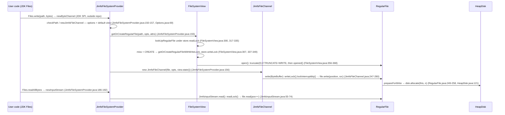

# Flows


## 0. Method (how the TOP-3 was chosen — numbers first)

Three measurements, all reproducible on a depth-100 clone of the PIN:

1. **Churn per file** — command run in the clone (brief-prescribed):

   ```
   $ git log --format= --name-only | sort | uniq -c | sort -rn | head -20
        55 pom.xml
        23 .github/workflows/ci.yml
         6 jimfs/src/test/java/com/google/common/jimfs/JimfsUnixLikeFileSystemTest.java
         4 jimfs/src/test/java/com/google/common/jimfs/PollingWatchServiceTest.java
         4 jimfs/src/test/java/com/google/common/jimfs/JimfsInputStreamTest.java
         4 jimfs/src/test/java/com/google/common/jimfs/JimfsFileChannelTest.java
         4 jimfs/src/test/java/com/google/common/jimfs/JimfsAsynchronousFileChannelTest.java
         4 jimfs/src/test/java/com/google/common/jimfs/ConfigurationTest.java
         4 jimfs/src/main/java/com/google/common/jimfs/RegularFile.java
         4 README.md
         3 jimfs/src/test/java/com/google/common/jimfs/JimfsOutputStreamTest.java
         3 jimfs/src/test/java/com/google/common/jimfs/FileTreeTest.java
         3 jimfs/src/test/java/com/google/common/jimfs/AttributeServiceTest.java
         3 jimfs/src/main/java/com/google/common/jimfs/PosixAttributeProvider.java
         3 jimfs/src/main/java/com/google/common/jimfs/JimfsSecureDirectoryStream.java
         3 jimfs/src/main/java/com/google/common/jimfs/JimfsInputStream.java
         3 jimfs/src/main/java/com/google/common/jimfs/JimfsFileSystemProvider.java
         3 .github/dependabot.yml
         2 jimfs/src/test/java/com/google/common/jimfs/WindowsPathTypeTest.java
         2 jimfs/src/test/java/com/google/common/jimfs/UserLookupServiceTest.java
   ```

   DECLARATION (per brief): the churn window is only the ≤100 most recent commits (shallow clone) — a lower bound on lifetime churn, not total history. Main-source-only ranking (`git log --format= --name-only | grep 'src/main/java' | sort | uniq -c | sort -rn`): `RegularFile.java` 4; `PosixAttributeProvider.java`, `JimfsSecureDirectoryStream.java`, `JimfsInputStream.java`, `JimfsFileSystemProvider.java` 3; `PathService.java`, `PollingWatchService.java`, `Options.java` … 2. Main files touched somewhere in the window: 90.

2. **Fan-in per class** — number of *other* main-tree files referencing the class name (word match, self excluded):

   ```
   $ cd jimfs/src/main/java/com/google/common/jimfs
   $ for f in *.java; do cls="${f%.java}"
       fin=$(grep -rlw "$cls" . --include='*.java' | grep -vx "./$f" | wc -l)
       imp=$(grep -c '^import' "$f"); echo "$fin $imp $cls"; done | sort -rn | head -22
   24 10 File
   13 4 Name
   13 1 FileLookup
   12 17 Jimfs
   11 8 AttributeProvider
   11 27 JimfsPath
   10 18 RegularFile
    9 29 Configuration
    8 7 Directory
    8 12 FileSystemState
    7 17 JimfsFileSystem
    6 35 FileSystemView
    6 3 AbstractAttributeView
    6 22 PathService
    6 2 SymbolicLink
    6 17 Options
    6 11 DirectoryEntry
    6 10 PathType
    5 7 HeapDisk
    4 5 PathNormalization
    4 3 Util
    4 27 JimfsFileChannel
   ```

   Column 1 = fan-in, column 2 = fan-out (import statements per file). Caveat: `File` (24) is ambiguous — word-matching also catches `java.io.File` usage — so it is excluded from anchor ranking; the remaining top fan-ins are unambiguous jimfs types. Verified composition of `FileLookup` fan-in (13 referencing files): the 8 attribute providers + `AttributeService`, `AbstractAttributeView`, `FileSystemView`, `JimfsFileStore`, `JimfsSecureDirectoryStream` — i.e. file lookup is the shared machinery of every attribute/operation path.

3. **Structural numbers from gm-02 JSON**: `FileSystemView.java` 744 LOC (largest file, "contains the implementation of most file system operations", javadoc verbatim `FileSystemView.java:57-59`); `Configuration.java` 731 LOC; fan-out leader `FileSystemView` 35 imports (re-measured above); dependency surface `java.nio.file` 188 plain imports (211 with static — the JDK `Files.*` SPI contract), Guava cross-boundary 176.

## 1. TOP-3 selection (numeric, combined fan-in/out + churn)

| Rank | Flow | Anchor evidence (numbers) |
|---|---|---|
| 1 | **Byte I/O** — `Files.write`/`Files.readAllBytes` → SPI provider → `FileSystemView` → `RegularFile` → `HeapDisk` | `RegularFile` churn 4 = top main churn + fan-in 10; `JimfsInputStream` churn 3; `JimfsFileSystemProvider` churn 3; `FileSystemView` fan-out 35 (package max) & 744 LOC (largest file); `JimfsFileChannel` fan-out 27; implements the 188-import `java.nio.file` contract |
| 2 | **Path parse + lookup** — `getPath` → `PathService` → `PathType` → `JimfsPath`; lookup → `FileTree` → `Directory` | `FileLookup` fan-in 13, `Name` fan-in 13 (top jimfs-specific fan-ins); `JimfsPath` fan-in 11 + fan-out 27; `PathType` fan-in 10; `PathService` fan-out 22 + churn 2; `Directory` fan-in 8 |
| 3 | **Bootstrap** — `Jimfs.newFileSystem(...)` → `JimfsFileSystems` → full object graph | `Jimfs` fan-in 12 (highest unambiguous); `Configuration` fan-out 29 (2nd) & 731 LOC; sole flow that constructs all 8 core collaborators (`PathService`, `FileSystemState`, `AttributeService`, `HeapDisk`, `FileFactory`, `FileTree`, `JimfsFileStore`, `FileSystemView` — `JimfsFileSystems.java:63-103`) |

Runner-up (why it lost): attribute read flow — `AttributeProvider` fan-in 11 and `PosixAttributeProvider` churn 3 are strong, but it terminates in `store.readAttributes(file, …)` immediately after the same lookup step (`FileSystemView.java:722-726`), i.e. it is flow 3 plus one attribute hop, not an independent surface.

Ordering note: rank 1 vs 3 is a judgment call between churn-dominant and fan-in-dominant evidence; both top the table on their respective axes. Bootstrap is ranked 3 because it runs once per file system, whereas byte I/O and path lookup run per operation.

---

## 2. Flow 1 — Byte write + read (`Files.write` → `RegularFile` → `HeapDisk`)

**Why expensive (numbers):** touches the hottest churn file (`RegularFile.java`, 4 changes in the ≤100-commit window — the maximum among main sources), two churn-3 files (`JimfsFileSystemProvider.java`, `JimfsInputStream.java`), the package's fan-out hub (`FileSystemView`, 35 imports, 744 LOC) and the second-widest channel class (`JimfsFileChannel`, 27 imports). It is the concrete implementation of the 188-import `java.nio.file` SPI contract from gm-02 — every `Files.*` byte call from user code lands here.



**Step evidence (grep-verified on the PIN clone):**

1. `JimfsFileSystemProvider.java:160-167` — `newByteChannel(Path, Set<OpenOption>, FileAttribute<?>...)` checks `FILE_CHANNEL` support and either returns the `JimfsFileChannel` or wraps it in `DowngradedSeekableByteChannel` (verbatim: `return checkedPath.getJimfsFileSystem().getFileStore().supportsFeature(FILE_CHANNEL) ? channel : new DowngradedSeekableByteChannel(channel);`).
2. `JimfsFileSystemProvider.java:150-157` — `newJimfsFileChannel`: `ImmutableSet<OpenOption> opts = Options.getOptionsForChannel(options);` (:153, `Options.java:69`), `FileSystemView view = getDefaultView(path);` (:154 → `JimfsFileSystem.java:207-209`), `RegularFile file = view.getOrCreateRegularFile(path, opts, attrs);` (:155), `return new JimfsFileChannel(file, opts, view.state());` (:156).
3. `FileSystemView.java:294-310` — `getOrCreateRegularFile`: without `CREATE_NEW` first tries `lookUpRegularFile` (:300); with `CREATE`/`CREATE_NEW` goes to `getOrCreateRegularFileWithWriteLock` (:307); else `throw new NoSuchFileException(path.toString())`.
4. `FileSystemView.java:317-335` — `lookUpRegularFile`: `store.readLock().lock()` → `DirectoryEntry entry = lookUp(path, options)` (:321) → non-regular file → `FileSystemException(..., "not a regular file")` → `open((RegularFile) file, options)`.
5. `FileSystemView.java:337-349` — `getOrCreateRegularFileWithWriteLock`: `store.writeLock().lock()` (:339) → `File file = createFile(path, store.regularFileCreator(), options.contains(CREATE_NEW), attrs);` (:341; creator `JimfsFileStore.java:131-134`).
6. `FileSystemView.java:356-368` — `open(...)`: `if (options.contains(TRUNCATE_EXISTING) && options.contains(WRITE)) { file.writeLock().lock(); file.truncate(0); ... }` (:357-364; `file.truncate(0)` :360), then `file.opened();` (:368; `RegularFile.java:189`).
7. `JimfsFileChannel.java:247-280` — `write(ByteBuffer src)`: `checkOpen(); checkWritable();` (:249-250), `file.writeLock().lockInterruptibly();` (:260), `if (append) { position = file.size(); }` (:262-263), `written = file.write(position, src);` (:265), `file.setLastModifiedTime(fileSystemState.now());` (:267), unlock in `finally` (:270).
8. `RegularFile.java:354-381` — `write(long pos, ByteBuffer buf)` (array variant `:312-343`): `prepareForWrite(pos, len)` (`:249`; allocates missing blocks via `disk.allocate(this, additionalBlocksNeeded)` `:258`, `HeapDisk.java:121 public synchronized void allocate(RegularFile file, int count)`), then copies bytes block-by-block and grows `size`.
9. `JimfsFileSystemProvider.java:186-192` — `newInputStream`: `RegularFile file = view.getOrCreateRegularFile(checkedPath, opts, NO_ATTRS); return new JimfsInputStream(file, view.state());` (:190-191; output twin `newOutputStream` :197-203 → `JimfsOutputStream`, APPEND flag).
10. `JimfsInputStream.java:55-74` — `read()`: `file.readLock().lock()` (:61), `int b = file.read(pos++);` (:64; `RegularFile.read(long)` :469, array variant :484), `file.setLastAccessTime(fileSystemState.now());` (:68). Bulk twin: `readInternal` :87-108 (`file.readLock().lock()` :96, `file.read(pos, b, off, len)` :98).

---

## 3. Flow 2 — Path parse + lookup (`getPath` → `PathService`/`PathType` → `FileTree` → `Directory`)

**Why expensive (numbers):** the two top jimfs-specific fan-ins live here — `FileLookup` 13 and `Name` 13 — plus `JimfsPath` fan-in 11 / fan-out 27, `PathType` fan-in 10 and `PathService` fan-out 22 (churn 2). Every operation of the other flows (open, read, write, delete, copy, attributes) begins by parsing a path and walking the tree through exactly this machinery; the 13 `FileLookup` referencing files are precisely the attribute providers + `FileSystemView` + `JimfsFileStore` + `JimfsSecureDirectoryStream`.

```mermaid
sequenceDiagram
    participant U as User code
    participant FS as JimfsFileSystem
    participant PS as PathService
    participant T as UnixPathType/PathType
    participant N as Name
    participant V as FileSystemView
    participant S as JimfsFileStore
    participant FT as FileTree
    participant D as Directory
    U->>FS: fileSystem.getPath("/foo/bar.txt") (JimfsFileSystem.java:254-257)
    FS->>PS: parsePath(first, more) (PathService.java:183-186)
    PS->>T: type.parsePath(joined) (UnixPathType.java:39-48 → ParseResult, PathType.java:212)
    T->>N: toPath → name(): normalize display+canonical → Name.create (PathService.java:126-139, 188-192)
    PS->>PS: createPath → new JimfsPath(this, root, names) (PathService.java:167-180)
    U->>V: first op (e.g. readAttributes) → lookUpWithLock (FileSystemView.java:105-118, 722-726)
    V->>S: store.lookUp(workingDirectory, path, options) (FileSystemView.java:118)
    S->>FT: state.checkOpen() → tree.lookUp (JimfsFileStore.java:124-129)
    FT->>D: walk names: getRoot(root) :91, directory.get(name) per element :126 (FileTree.java; Directory.java:108)
    FT->>FT: symlink → followSymbolicLink :176-179, depth cap 40 :45 (FileTree.java); last element → lookUpLast :151-169, getRealEntry def :194 (FileTree.java)
    FT-->>V: DirectoryEntry → file (attributes read via store.readAttributes, FileSystemView.java:722-726)
```

**Step evidence:**

1. `JimfsFileSystem.java:254-257` — `getPath(String first, String... more)`: `fileStore.state().checkOpen(); return pathService.parsePath(first, more);`.
2. `PathService.java:183-186` — `parsePath`: `String joined = type.joiner().join(Iterables.filter(Lists.asList(first, more), NOT_EMPTY)); return toPath(type.parsePath(joined));`.
3. `UnixPathType.java:39-48` — `parsePath`: empty → `emptyPath()` (:40-42); `checkValid` rejects `\0` (`:50-56`, `InvalidPathException` thrown :53); `String root = path.startsWith("/") ? "/" : null; return new ParseResult(root, splitter().split(path));` (:46-47). `PathType.java:212-242` — `ParseResult` (root + names; `isAbsolute()` :223-225). Abstract contract `PathType.java:159`.
4. `PathService.java:188-192` — `toPath(ParseResult)`: `Name root = parsed.root() == null ? null : name(parsed.root());` + `names(parsed.names())`. `PathService.java:126-139` — `name(String)`: `""`/`"."'`/`".."` map to `Name.EMPTY`/`Name.SELF`/`Name.PARENT` (`Name.java:42/45/48`); default: `PathNormalization.normalize` on display and canonical forms → `Name.create(display, canonical)` (`Name.java:66`).
5. `PathService.java:167-180` — `createPath` filters empty names, falls back to `emptyPath()`; `createPathInternal` → `new JimfsPath(this, root, names)` (`JimfsPath.java:55 final class JimfsPath implements Path`). Relative resolution against the working directory happens at lookup, not at parse (`FileSystemView.java:57-59` javadoc; `lookUp` passes `workingDirectory` :118).
6. `FileSystemView.java:105` — `lookUpWithLock`: `store.readLock().lock(); try { return lookUp(path, options); } finally { store.readLock().unlock(); }`; private `lookUp` (:116-118) → `store.lookUp(workingDirectory, path, options)` (:118).
7. `JimfsFileStore.java:124-128` — `lookUp(File workingDirectory, JimfsPath path, Set<? super LinkOption> options)`: `state.checkOpen(); return tree.lookUp(workingDirectory, path, options);` (read-lock held by the caller — view level).
8. `FileTree.java:72-80` — public `lookUp` → recursive dispatch :77, `NoSuchFileException` :80; private `lookUp(dir, path, options, 0)` (:85): absolute → `getRoot(path.root())` (:91); empty relative path → canonical `Name.SELF` list (constant `EMPTY_PATH_NAMES` :47, fallback :105).
9. `FileTree.java:115` — name walk: `DirectoryEntry entry = directory.get(name);` (:126; `Directory.java:108 public @Nullable DirectoryEntry get(Name name)`), `File file = entry.file();` (:131), intermediate symlink dispatched at :132-133 → `followSymbolicLink` (:176-179, `MAX_SYMBOLIC_LINK_DEPTH = 40` :45, "too many levels of symbolic links" :179).
10. `FileTree.java:151-169` — `lookUpLast`: last `directory.get(name)` (:159), missing → `new DirectoryEntry(directory, name, null)` (:161), `NOFOLLOW_LINKS` respected (:165), `getRealEntry` resolves `.`/`..` to the real parent entry (call :169, def :194). Consumers: `readAttributes` gets the resolved file (`FileSystemView.java:722-726`); attribute views receive a lazy `FileLookup` callback (`FileSystemView.java:709-719`, interface `FileLookup.java:26-34`).

---

## 4. Flow 3 — Bootstrap (`Jimfs.newFileSystem(...)` → full object graph)

**Why expensive (numbers):** `Jimfs` has fan-in 12 (highest unambiguous in the package) and `Configuration` fan-out 29 with 731 LOC; this is the only flow that constructs every core collaborator — `PathService`, `FileSystemState`, `AttributeService`, `HeapDisk`, `FileFactory`, root `Directory` tree, `FileTree`, `JimfsFileStore`, `FileSystemView`, `JimfsFileSystem` — in one call chain (`JimfsFileSystems.java:61-104`). Every other flow presupposes this graph; it also wires the JDK SPI registration that makes `Paths.get("jimfs://...")` work.

```mermaid
sequenceDiagram
    participant U as User code
    participant J as Jimfs (facade)
    participant W as JimfsFileSystems
    participant P as PathService + FileSystemState
    participant S as JimfsFileStore (+HeapDisk/FileFactory/FileTree/AttributeService)
    participant V as FileSystemView
    participant F as JimfsFileSystem
    participant SP as SystemJimfsFileSystemProvider (SPI cache)
    U->>J: Jimfs.newFileSystem(Configuration.unix()) (Jimfs.java:118-120; Configuration.java:85, 727 build)
    J->>J: newFileSystem(name, config) → URI jimfs://name (Jimfs.java:130-137, :132)
    J->>W: JimfsFileSystems.newFileSystem(JimfsFileSystemProvider.instance(), uri, config) (Jimfs.java:147-148)
    W->>P: new PathService(config) + new FileSystemState(fileTimeSource, removeRunnable) (JimfsFileSystems.java:63-65)
    W->>S: createFileStore: AttributeService, HeapDisk, FileFactory; roots: parsePath → createRootDirectory → setInitialAttributes (JimfsFileSystems.java:79-104)
    S-->>W: new JimfsFileStore(new FileTree(roots), fileFactory, disk, attributeService, features, state) (JimfsFileSystems.java:102-103)
    W->>V: createDefaultView: parsePath(workingDirectory) → getRoot → link chain → new FileSystemView(fileStore, dir, workDirPath) (JimfsFileSystems.java:107-125)
    W->>F: new JimfsFileSystem(provider, uri, fileStore, pathService, defaultView, watchServiceConfig) (JimfsFileSystems.java:71-72; ctor JimfsFileSystem.java:181-194)
    W->>P: pathService.setFileSystem(fileSystem) (JimfsFileSystems.java:74; PathService.java:97-101)
    J->>SP: FileSystems.newFileSystem(uri, {FILE_SYSTEM_KEY: fs}) → cached for Paths.get(URI) (Jimfs.java:159-165; SystemJimfsFileSystemProvider.java:62-69, 111-117)
    J-->>U: return FileSystem (Jimfs.java:167)
```

**Step evidence:**

1. `Jimfs.java:96-98` — `newFileSystem()` → `newFileSystem(newRandomFileSystemName())`; `:118-120` — `newFileSystem(Configuration)` → random name + given config; `Configuration.java:85` (`unix()`), `:205` (`forCurrentPlatform()`), `:727` (`build()` → `new Configuration(this)`).
2. `Jimfs.java:130-137` — `newFileSystem(String name, Configuration)`: `URI uri = new URI(URI_SCHEME, name, null, null);` (:132) → `newFileSystem(uri, configuration)`.
3. `Jimfs.java:140-148` — scheme check (:141-142), then `JimfsFileSystem fileSystem = JimfsFileSystems.newFileSystem(JimfsFileSystemProvider.instance(), uri, config);` (:147-148; singleton provider `JimfsFileSystemProvider.java:63-77`).
4. `JimfsFileSystems.java:63-65` — `PathService pathService = new PathService(config);` + `FileSystemState state = new FileSystemState(config.fileTimeSource, removeFileSystemRunnable(uri));` (reflective cache-removal hook `:39-55`; `FileSystemState.java:28-58`, `open = new AtomicBoolean(true)`).
5. `JimfsFileSystems.java:79-104` — `createFileStore`: `AttributeService` (:81), `HeapDisk disk = new HeapDisk(config);` (:83), `FileFactory` (:84); per configured root: `pathService.parsePath(root)` (:90), `fileFactory.createRootDirectory(rootName)` (:97), `attributeService.setInitialAttributes(rootDir)` (:98); returns `new JimfsFileStore(new FileTree(roots), fileFactory, disk, attributeService, config.supportedFeatures, state)` (:102-103; `JimfsFileStore.java:50`, `FileTree.java:38, 53-54`).
6. `JimfsFileSystems.java:107-125` — `createDefaultView`: `pathService.parsePath(config.workingDirectory)` (:109), `fileStore.getRoot(workingDirPath.root())` (:111; `JimfsFileStore.java:105-108`), missing working-dir chain → create + `dir.link(name, newDir)` (:116-122; `Directory.java:128`), `new FileSystemView(fileStore, dir, workingDirPath)` (:124; `FileSystemView.java:75-81`).
7. `JimfsFileSystems.java:71-75` — `new JimfsFileSystem(provider, uri, fileStore, pathService, defaultView, watchServiceConfig)` (:71-72; constructor `JimfsFileSystem.java:181-194`), then `pathService.setFileSystem(fileSystem);` (:74; `PathService.java:96-101`).
8. `Jimfs.java:159-165` — registers the FS with the system provider so URI lookups work: `ImmutableMap<String, ?> env = ImmutableMap.of(FILE_SYSTEM_KEY, fileSystem); FileSystems.newFileSystem(uri, env, SystemJimfsFileSystemProvider.class.getClassLoader());` (:160-161); `ProviderNotFoundException | ServiceConfigurationError` deliberately ignored (:162-165). `SystemJimfsFileSystemProvider.java:62-63` `@AutoService(FileSystemProvider.class)` (SPI registration generated at build), `:69` `FILE_SYSTEM_KEY = "fileSystem"`, `:111-117` reads the key to cache the file system.
9. `Jimfs.java:167` — `return fileSystem;` (IOException → `AssertionError` :168-170).
10. Design context: `JimfsFileSystem.java:42-77` class javadoc states exactly this wiring ("created by JimfsFileSystems using a user-provided Configuration … provider handles calls to methods in Files … FileSystemView … delegates to JimfsFileStore … FileFactory / HeapDisk / FileTree / AttributeService").

---

## 5. Caveats

- Churn window = ≤100 latest commits (shallow clone) — declared per brief; treat as lower bound.
- Fan-in is a word-match count of the class name across other main files; it can overcount via same-named JDK types (`File` → 24, ambiguous, excluded from ranking) and counts text references (including javadoc `{@link}`), not resolved call-graph edges.
- Fan-out = `grep -c '^import'` per file (import statements, not distinct types).
- JDK-side steps (`Files.write` → `FileSystemProvider.newByteChannel`, `Paths.get(URI)` dispatch) are JDK NIO contract behavior, outside this repository; the diagrams mark them as such and cite only jimfs-side `file:line`.
- Mermaid step counts: 10–11 per flow (within the 5–12 bound).

## JSON block

```json
{
  "subject": "jimfs",
  "pin": "8fa098e0715aa492914285312c07e151d2aace4d",
  "method": {
    "churn": "git log --format= --name-only | sort | uniq -c | sort -rn (window <=100 commits, shallow clone, declared)",
    "fan_in": "grep -rlw <Class> across main tree, self file excluded (word match)",
    "fan_out": "grep -c '^import' per main file",
    "structural": "gm-02 JSON (LOC, deps_out java.nio.file 188 plain, FileSystemView 744 LOC largest)"
  },
  "top_flows": [
    {
      "rank": 1,
      "name": "byte_io_write_read",
      "anchors": {
        "RegularFile": { "fan_in": 10, "churn": 4 },
        "JimfsInputStream": { "churn": 3 },
        "JimfsFileSystemProvider": { "churn": 3 },
        "FileSystemView": { "fan_out": 35, "loc": 744 },
        "JimfsFileChannel": { "fan_out": 27 }
      },
      "entry": "Files.write/readAllBytes -> JimfsFileSystemProvider.newByteChannel/newInputStream",
      "steps": 11
    },
    {
      "rank": 2,
      "name": "path_parse_and_lookup",
      "anchors": {
        "FileLookup": { "fan_in": 13 },
        "Name": { "fan_in": 13 },
        "JimfsPath": { "fan_in": 11, "fan_out": 27 },
        "PathType": { "fan_in": 10 },
        "PathService": { "fan_out": 22, "churn": 2 },
        "Directory": { "fan_in": 8 }
      },
      "entry": "FileSystem.getPath -> PathService.parsePath -> FileTree.lookUp",
      "steps": 11
    },
    {
      "rank": 3,
      "name": "bootstrap_new_file_system",
      "anchors": {
        "Jimfs": { "fan_in": 12 },
        "Configuration": { "fan_out": 29, "loc": 731 },
        "constructed_collaborators": ["PathService", "FileSystemState", "AttributeService", "HeapDisk", "FileFactory", "FileTree", "JimfsFileStore", "FileSystemView"]
      },
      "entry": "Jimfs.newFileSystem -> JimfsFileSystems.newFileSystem",
      "steps": 11
    }
  ],
  "runner_up": "attribute read flow (AttributeProvider fan_in 11, PosixAttributeProvider churn 3) — reuses flow 2 lookup, not independent",
  "census_crosscheck": { "main_files": 62, "main_loc": 12468, "imports": 704, "matches_gm01_gm02": true }
}
```
