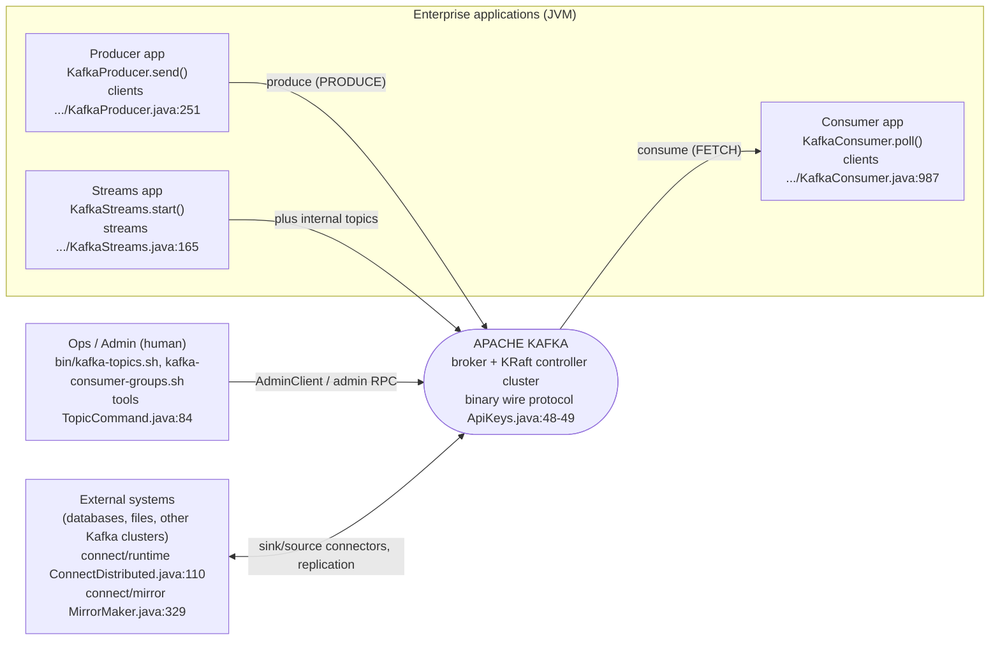
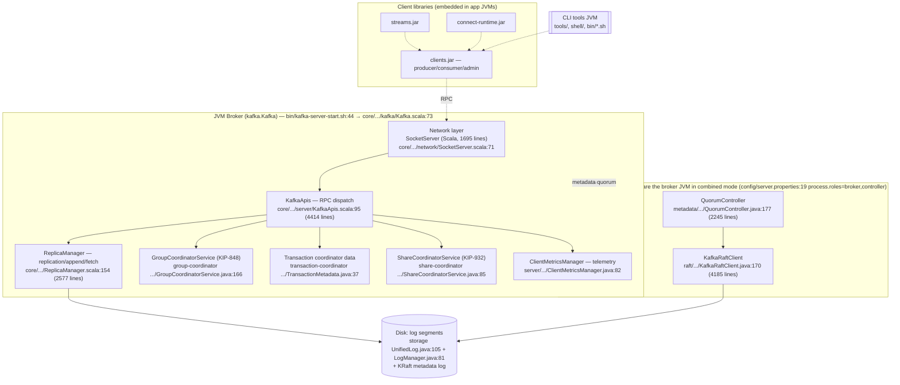
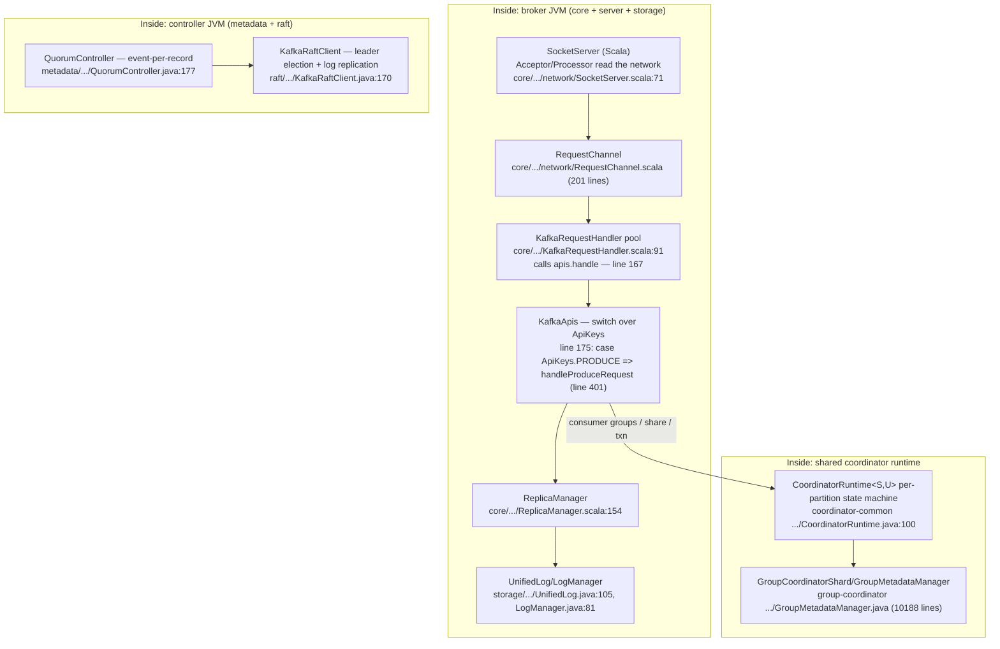

# Overview

How apache/kafka works, as a narrative companion to the module map
([`02-module-map.md`](02-module-map.md)). Architecture views (C4) live in this
document only; [`03-c4/`](03-c4/) holds their raw source files
(`workspace.dsl` — Structurizr — and `diagrams.mmd` — mermaid).

## 1. What Kafka is

1. Apache Kafka is an open-source distributed event-streaming platform used for
   high-performance data pipelines, streaming analytics, data integration, and
   mission-critical applications. The server side is a cluster of brokers that
   store events in log-structured commit logs; the client side produces and
   consumes through a binary wire protocol (`ApiKeys` PRODUCE/FETCH —
   `clients/src/main/java/org/apache/kafka/common/protocol/ApiKeys.java`,
   lines 48-49).
2. The repository is a **65-module Gradle monorepo** (plus the `api-checker`
   composite build) written in **Java + Scala 2.13**. The broker runtime keeps
   its Scala core (`core/`, entry `def main` —
   `core/src/main/scala/kafka/Kafka.scala`, line 73) while newer server code
   has moved to Java in `server/` and `server-common/`.
3. Since 4.x, Kafka runs **KRaft only** (no ZooKeeper): neither
   `config/zookeeper.properties` nor `bin/zookeeper-server-start.sh` exists in
   the tree; node roles are declared via `process.roles=broker,controller`
   (`config/server.properties`, line 19).
4. Consensus and metadata are handled by `raft/` (`KafkaRaftClient` —
   `raft/src/main/java/org/apache/kafka/raft/KafkaRaftClient.java`, line 170)
   and `metadata/` (`QuorumController` —
   `metadata/src/main/java/org/apache/kafka/controller/QuorumController.java`,
   line 177); event data lives in the log layer of `storage/` (`UnifiedLog` —
   `storage/src/main/java/org/apache/kafka/storage/internals/log/UnifiedLog.java`,
   line 105).
5. The integration ecosystem lives in the same repo: clients
   (producer/consumer/admin), Kafka Streams, Kafka Connect (runtime + SPI +
   MirrorMaker 2), and CLI tools — all sharing one dependency graph whose root
   leaf is `clients` (imported by 23 other modules).

## 2. Five-minute tour

- **Read first:** the upstream `README.md`, then
  `docs/getting-started/quickstart.md` (a running cluster in three commands).
- **Run a broker instantly (KRaft combined mode):**
  `bin/kafka-storage.sh random-uuid`, then
  `bin/kafka-storage.sh format --standalone -t $KAFKA_CLUSTER_ID -c config/server.properties`,
  then `bin/kafka-server-start.sh config/server.properties` (which execs
  `kafka.Kafka` — `bin/kafka-server-start.sh`, line 44).
- **Three client API layers:** `KafkaProducer.send()`
  (`clients/.../producer/KafkaProducer.java`, line 1027), `KafkaConsumer.poll()`
  (`clients/.../consumer/KafkaConsumer.java`, line 987), and the admin client —
  all in module `clients` (387,364 lines, the largest module).
- **The broker is two halves:** the older Scala half in `core/` (KafkaApis,
  ReplicaManager — 160,338 lines) and the newer Java half in `server/` +
  `server-common/` (network/config/metrics/share — 53,773 + 35,932 lines). The
  upstream build guide says the Scala core is "gradually being removed along
  with Scala code".
- **KRaft:** the controller (`QuorumController`) + consensus
  (`KafkaRaftClient`) own the metadata log; brokers consume metadata through
  the metadata cache/image (module `metadata` — 62,545 lines).
- **Log storage:** `storage/` (UnifiedLog/LogSegment/LogManager — 73,952
  lines) plus the tiered-storage SPI `storage/api/` (`RemoteStorageManager`).
- **Coordinators are now modules:** group (KIP-848), share (KIP-932), and
  transaction coordinators all run on the shared `CoordinatorRuntime` of
  `coordinator-common/`
  (`coordinator-common/src/main/java/org/apache/kafka/coordinator/common/runtime/CoordinatorRuntime.java`,
  line 100).
- **Integration:** Kafka Connect (`connect/` — runtime 104,931 lines), Kafka
  Streams (`streams/` — 338,869 lines), MirrorMaker 2
  (`connect/mirror` — main at `MirrorMaker.java`, line 329).
- **CLI:** `tools/` + `bin/*.sh` (`TopicCommand` main at line 84; 40+ launcher
  scripts), metadata shell in `shell/`.
- **Testing at three levels:** Gradle unit/integration suites, the real-broker
  cluster harness `test-common/` (`KafkaClusterTestKit`), and Python/ducktape
  system tests (`tests/`).

## 3. C4 — System context (L1)

From the outside, Kafka is one streaming cluster exchanging events with
several kinds of actors (see [`03-c4/`](03-c4/) for the model source):



- Clients touch the system only through the wire protocol, described centrally
  by `ApiKeys` (PRODUCE/FETCH at lines 48-49; SHARE_FETCH at line 126 — the
  KIP-932 share-group API).
- Ops/admin traffic rides the same RPC path with the ADMIN api key; the CLI
  tools are a thin layer over the clients' admin API.
- Connect and MirrorMaker sit at the system boundary: they turn Kafka into a
  data-integration system (`ConnectDistributed.java` line 110; `MirrorMaker.java`
  line 329).

## 4. C4 — Containers (L2)

Inside the system boundary, the deployable units:



- Broker and controller can be separate JVMs (`config/broker.properties` with
  only `process.roles=broker`; `config/controller.properties` with only
  `process.roles=controller`) or combined (`config/server.properties`) — same
  artifact `kafka.Kafka` either way.
- The group/share/transaction coordinators are no longer classes inside core
  but separate data modules running on the shared `CoordinatorRuntime`
  (`CoordinatorRuntime.java`, line 100); the broker core is their consumer
  (all three appear in core's `depends_on`).
- Client libraries are "soft" containers (jars embedded in application JVMs,
  not separate processes); CLI tools are short-lived JVM processes.

## 5. C4 — Components (L3)

The main component chain of a broker-side RPC:



- **Network in/out:** the real `SocketServer` is the Scala class in core
  (`core/src/main/scala/kafka/network/SocketServer.scala`, line 71 — 1,695
  lines, with `RequestChannel.scala` at 201 lines). The file
  `server/src/main/java/org/apache/kafka/network/SocketServer.java` is only a
  42-line constants holder (`public class SocketServer` at line 24) — a known
  map discrepancy, documented under "Known issues" below.
- **Request handling:** the worker pool `KafkaRequestHandler` (class at line
  91) calls `apis.handle(request, requestLocal)` at line 167; `KafkaApis`
  (class at line 95, 4,414 lines — the largest file in core) dispatches on
  `ApiKeys` (PRODUCE dispatch at line 175, handler at line 401).
- **Log engine:** `ReplicaManager` (line 154) routes appends/fetches to
  `UnifiedLog` (line 105, 2,806 lines) and `LogManager` (line 81, 1,895
  lines) in module `storage`, consumed by the broker through the
  `org.apache.kafka.storage.*` packages.
- **KIP-848/932 coordinators:** `GroupCoordinatorService` (line 166, 2,735
  lines) and `ShareCoordinatorService` (line 85) run on `CoordinatorRuntime`
  (line 100) — a per-partition state machine with an event processor.
- **KRaft controller:** `QuorumController` (line 177, 2,245 lines) is the
  `Controller` implementation; `KafkaRaftClient` (line 170, 4,185 lines)
  provides leader election and log replication for the metadata log.
- **Broker telemetry:** `ClientMetricsManager`
  (`server/src/main/java/org/apache/kafka/server/ClientMetricsManager.java`,
  line 82) — the server side of KIP-714 client metrics.
- The real KRaft broker runtime is the Scala `BrokerServer`
  (`core/src/main/scala/kafka/server/BrokerServer.scala`, line 83 — 993 lines
  at the measurement commit) at the head of the broker component chain.

## 6. Directory map by role

The 33 top-level directories (full list in
[`01-cartography.md`](01-cartography.md)), grouped by role, with sizes from the
module census (66 modules, 6,542 files, 1,738,903 lines at the measurement
commit):

| region | directories | role | size (lines) |
|---|---|---|---|
| Platform clients | `clients/` | producer/consumer/admin + nearly all of `org.apache.kafka.common` + wire protocol | 387,364 |
| Streaming | `streams/` (+ `streams-scala`, `examples`, `test-utils`, `integration-tests`, 26× `upgrade-system-tests-*`) | KStream/KTable DSL + Processor API; broker-less topology testing | 338,869 (main module) |
| Broker core (Scala) | `core/` | entry `kafka.Kafka`, KafkaApis, ReplicaManager, BrokerServer, Scala SocketServer | 160,338 |
| Broker services (Java) | `server/`, `server-common/` | network/config, share fetch/DLQ, client metrics, MetadataVersion, purgatory, event queue | 53,773 + 35,932 |
| KRaft | `metadata/`, `raft/` | controller + metadata cache/image + StandardAuthorizer; consensus client | 62,545 + 55,879 |
| Log engine | `storage/`, `storage/api/` | UnifiedLog/LogSegment/LogManager + tiered-storage SPI | 73,952 + 2,224 |
| Coordinators | `group-coordinator/` (+ api), `share-coordinator/`, `transaction-coordinator/`, `coordinator-common/`, `mirror-coordinator/` | group/share/transaction/mirror runtimes on the shared CoordinatorRuntime | 142,204 + 9,915 + 3,897 + 18,618 + 110 |
| Integration | `connect/` (9 modules) | Connect runtime + SPI + MirrorMaker 2 | 104,931 (runtime) |
| Tooling | `tools/` (+ api), `shell/`, `bin/` | official CLIs, metadata shell, 40+ launchers | 62,476 + 265 |
| Build infra | `gradle/`, `generator/`, `api-checker/`, `checkstyle/`, `release/` | wrapper, protocol codegen from JSON, internal-API guard, style rules | — |
| Docs & packaging | `docs/`, `docker/`, `config/`, `examples/`, `licenses/` | source docs, images, sample configs (KRaft-only), demos | — |
| System testing | `tests/`, `test-common/` (3 modules), `trogdor/`, `jmh-benchmarks/` | ducktape system tests, JVM cluster test kit, fault injection, microbenchmarks | — |
| Other | `committer-tools/`, `vagrant/`, `raft/bin/` | committer utilities, legacy dev environment, KRaft standalone test script | — |

## 7. Hot data flows

The highest-churn execution paths are analyzed in
[`06-flows.md`](06-flows.md): ranked by churn-weighted fan, the top three are
**D — Streams pipeline** (record I/O, state stores, internal topics), **B —
consumer-group heartbeat/rebalance (KIP-848)**, and **C — KRaft metadata
write**; the classic produce→append→fetch path ranks fourth — its wire path is
entirely contained in flow D. Quick teaser of the produce path from the code:
`SocketServer.scala:71` → `RequestChannel` →
`KafkaRequestHandler.scala:167` (`apis.handle`) → `KafkaApis.scala:175`
dispatch → `handleProduceRequest` (line 401) → `ReplicaManager.scala:154` →
`UnifiedLog.java:105` append; the fetch path returns through the same
`KafkaApis` (`ApiKeys.FETCH` — `ApiKeys.java:49`).

## 8. Build and run

Verified against the tree at the measurement commit. JDK requirements: Java 11+
for `clients`/`generator`/`streams`, 17+ for other modules; builds are tested
on JDK 17 and 25 (per the upstream build guide).

```bash
# 0) Build
./gradlew jar                                   # compile jars
./gradlew clean releaseTarGz                    # distribution tarball

# 1) Run a one-node KRaft cluster (combined mode)
bin/kafka-storage.sh random-uuid                # generate KAFKA_CLUSTER_ID
bin/kafka-storage.sh format --standalone -t $KAFKA_CLUSTER_ID -c config/server.properties
bin/kafka-server-start.sh config/server.properties   # exec kafka.Kafka
#    NOTE: no config/kraft/ anymore (3.x style) and no ZooKeeper scripts —
#    KRaft config is config/server.properties | broker.properties | controller.properties

# 2) Use it
bin/kafka-topics.sh --create --topic demo --bootstrap-server localhost:9092
bin/kafka-console-producer.sh --topic demo --bootstrap-server localhost:9092
bin/kafka-console-consumer.sh --topic demo --from-beginning --bootstrap-server localhost:9092

# 3) Test harness (Gradle)
./gradlew test                                  # all unit + integration
./gradlew unitTest ; ./gradlew integrationTest  # split suites
./gradlew test -Pkafka.test.run.flaky=true      # include @Flaky
./gradlew clients:test --tests RequestResponseTest                     # one class
./gradlew clients:clients-integration-tests:test --tests org.apache.kafka.clients.producer.ProducerFailureHandlingTest.testCannotSendToInternalTopic   # one method
./gradlew clients:reportCoverage -PenableTestCoverage=true -Dorg.gradle.parallel=false

# 4) Quality gates
./gradlew spotlessApply
./gradlew checkstyleMain checkstyleTest spotlessCheck

# 5) System tests (Python, needs docker/ducker)
#    ducktape harness: tests/kafkatest, specs in tests/spec
```

- Connect for real: `bin/connect-standalone.sh` → execs
  `kafka-run-class.sh … ConnectStandalone` (line 45); distributed mode uses
  `ConnectDistributed.java` (line 110).
- A handy KRaft test script: `raft/bin/test-kraft-server-start.sh`.

## 9. Extension points

The most valuable SPI/plugin surfaces, measured directly in the tree:

| Extension point | Interface / entry | Use it for |
|---|---|---|
| Connect Connector SPI | `public abstract class Connector implements ConnectPlugin` — `connect/api/src/main/java/org/apache/kafka/connect/connector/Connector.java`, line 48 | Wiring external systems into Kafka (source/sink) |
| Connect REST auth | `ConnectRestExtension` — `connect/api/src/main/java/org/apache/kafka/connect/rest/ConnectRestExtension.java`, line 54; sample implementation `BasicAuthSecurityRestExtension.java`, line 64 | Authenticating the worker REST API |
| Tiered / remote storage | `RemoteStorageManager` — `storage/api/src/main/java/org/apache/kafka/server/log/remote/storage/RemoteStorageManager.java`, line 56 | Moving cold segments to external storage |
| Consumer group assignor | `ConsumerGroupPartitionAssignor` — `group-coordinator/group-coordinator-api/src/main/java/org/apache/kafka/coordinator/group/api/assignor/ConsumerGroupPartitionAssignor.java`, line 26 | New KIP-848 partition-assignment strategies |
| Cluster authorizer | `StandardAuthorizer implements ClusterMetadataAuthorizer` — `metadata/src/main/java/org/apache/kafka/metadata/authorizer/StandardAuthorizer.java`, line 57 | ACL enforcement in the KRaft metadata plane |
| Client telemetry | `MetricsReporter` — `clients/src/main/java/org/apache/kafka/common/metrics/MetricsReporter.java`, line 33; server side `ClientMetricsManager.java`, line 82 | Consuming KIP-714 client metrics |
| CLI record reader | `RecordReader` — `tools/tools-api/src/main/java/org/apache/kafka/tools/api/RecordReader.java`, line 36 | Log-reading plugins for ConsoleProducer et al. |
| Streams broker-less testing | `TopologyTestDriver` — `streams/test-utils/src/main/java/org/apache/kafka/streams/TopologyTestDriver.java`, line 229 | Unit-testing topologies without a broker |
| Build-time API guard | api-checker — `api-checker/core/src/main/java/org/apache/kafka/apicheck/PluginDeveloperApiUsageScanner.java`, line 82 | Blocking plugin use of internal APIs |
| Protocol codegen | `generator/` emits message classes from JSON specs (`processMessages` target; generated code must never be hand-edited) | Adding RPCs/fields without touching generated code |

Architectural direction: new coordinator logic (share groups, mirror config)
appears as coordinator modules on `CoordinatorRuntime` (see
`share-coordinator`, `mirror-coordinator`) rather than as classes in core —
that is the insertion point for new metadata-plane features.

## 10. Reuse risks

1. **Build scale:** 6,283 Java files / 1,604,604 lines plus 65 Gradle modules
   and a composite build — CI/build cost is real; the dual JDK requirement
   (11+/17+; build on 17 and 25) forces a build matrix.
2. **The Scala core is being dismantled gradually:** internal `kafka.*` Scala
   APIs have no stability guarantee; a fork tied to core internals must track
   every commit.
3. **Trunk moves fast:** the upstream head moved repeatedly within the two
   days this study ran; always pin a specific SHA when reusing.
4. **KRaft-only:** all ZooKeeper-era documentation/configuration is obsolete;
   sample configs are `config/server.properties` (combined),
   `broker.properties`, `controller.properties`.
5. **API/KIP policy:** public API/wire-protocol/config changes require a KIP;
   generated code is never hand-edited; run `spotlessApply`/checkstyle before
   contributing back.
6. **Heavy test infrastructure:** integration tests build real KRaft clusters
   (`KafkaClusterTestKit`), system tests need ducktape + docker — a fork
   without this infrastructure cannot be validated quickly.
7. **License:** Apache-2.0 (`LICENSE`, lines 2-3) with `NOTICE`/
   `NOTICE-binary` and `licenses/` for dependencies — commercial reuse is fine
   but new files must carry license headers and the NOTICE must be kept.
8. **Moving API surface:** share groups (KIP-932 — `ApiKeys.SHARE_FETCH`, line
   126; `share-coordinator`; share DLQ) and client telemetry (KIP-714) are
   under active development; their production readiness cannot be inferred
   from code alone.

## 11. Known documentation issues

- **`server` module network entry:** the module map's mechanical scan lists
  `SocketServer.java` (42-line constants holder) as the network entry of
  `server`; the actual network implementation is the Scala `SocketServer`
  (1,695 lines) in `core`. The module-map row and this section document both;
  treat the Scala class as the real entry point.
- **Entrypoint census scope:** the 19-Java-main count covers `clients`,
  `connect/runtime`, and `core` neighbors only — not a repo-wide census of
  runtime vs utility mains.
- **KIP-932 / KIP-714 maturity:** the code is broadly present but
  production-readiness is not verifiable from code alone.
- **`mirror-coordinator` runtime path:** how the server consumes
  `ClusterMirrorConfigs` through dynamic config at runtime has not been
  traced end-to-end in this study.

## 12. Provenance

All file/line claims on this page were verified against a checkout at the
measurement commit `0c92b0664539d0dfb60b43ede0026497a581d8e0` (KAFKA-20125,
#21416) and cross-checked independently (a second pass re-ran ~48 spot checks
— class declarations, line pointers, and the census — with 100% agreement).
The extracts pin is `aa62a433` (5 commits earlier); none of the cited paths
changed between the two commits, so every reference resolves identically at
both. Module sizes come from the module census referenced by
[`02-module-map.md`](02-module-map.md) and [`matrix/matrix.csv`](../../matrix/matrix.csv).
