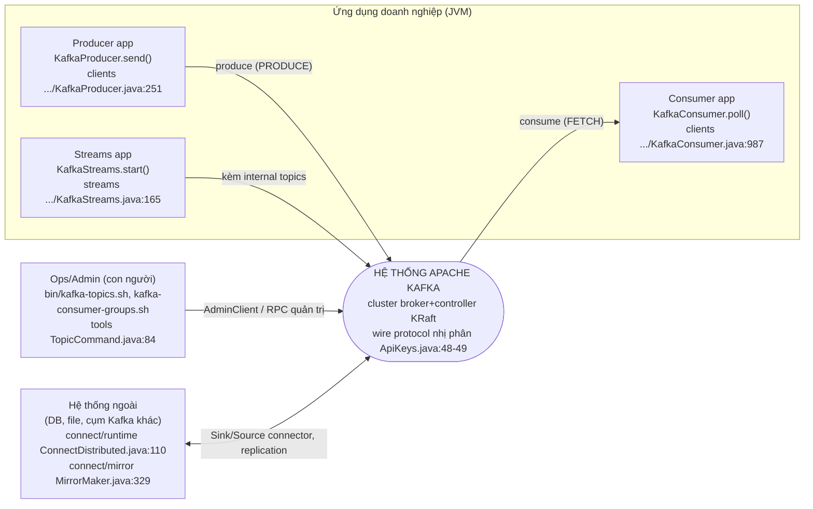
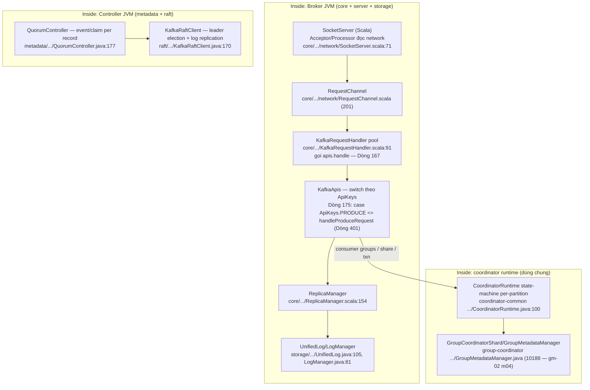

# gm-04 — OVERVIEW: apache/kafka (STREAM B)

Task: `goldmine-spec--b-overview--ef360255` | Lần chạy: **1** (chưa có `reports/gm-04-overview.md` trước đó → không kế thừa, không ghi INHERITED).
INPUT: gm-01 (`reports/gm-01-cartography.md`) + gm-02 (`reports/gm-02-module-map.md`). KHÔNG đọc gm-03 (gate-consistency đối chiếu chéo — trùng lệch là lỗi của node này).
Môi trường: sandbox riêng `bitnami/git:latest`, ttl 3600 (session `sess-ce490557`); clone nông depth 100, mọi claim đo lại trực tiếp trên clone này (HEAD `3655d7c…`, thấy Provenance — mục 11).

> **Drift sha so cert gm-01:** cert gm-01 RUN 4 đo tại `aa62a433…`; clone của node này ở trunk mới `3655d7c19cd9771ef4b1d213084cfd08f45c7581` (trunk di chuyển giữa 2 node). Số liệu gm-02 đã được re-verify tại chính HEAD `3655d7c` (w2/w3/w4) nên các evidence file:line trong bản này khớp cert; riêng LOC java chênh **+1 dòng** (chi tiết mục 11).

---

## 1. Kafka là gì — 5 câu

1. Apache Kafka là "an open-source distributed event streaming platform used by thousands of companies for high-performance data pipelines, streaming analytics, data integration, and mission-critical applications" (File: README.md | Dòng: 12) — nền tảng streaming phân tán, phía server là cụm broker lưu event theo log-structured commit log, phía client là thư viện produce/consume qua wire protocol nhị phân (ApiKeys PRODUCE/FETCH — File: clients/src/main/java/org/apache/kafka/common/protocol/ApiKeys.java | Dòng: 48-49).
2. Repo này là **monorepo Gradle 65 module** (File: settings.gradle | khối `include` đếm 65 quote-pair; `rootProject.name = 'kafka'` Dòng: 143) viết **Java + Scala 2.13** (File: AGENTS.md | Dòng: 26, 30) — broker runtime còn giữ phần lõi Scala (`core`, entrypoint `def main` — File: core/src/main/scala/kafka/Kafka.scala | Dòng: 73) trong khi phần server mới đã Java hóa tách sang `server/`, `server-common/`.
3. Từ 4.x, Kafka **chỉ chạy KRaft** (không còn ZooKeeper): không còn `config/zookeeper.properties` lẫn `bin/zookeeper-server-start.sh` trong cây (kiểm `ls` → không tồn tại, sandbox `sess-ce490557`); vai trò node khai qua `process.roles=broker,controller` (File: config/server.properties | Dòng: 19).
4. Consensus + metadata do `raft/` (KafkaRaftClient — File: raft/src/main/java/org/apache/kafka/raft/KafkaRaftClient.java | Dòng: 170) và `metadata/` (QuorumController — File: metadata/src/main/java/org/apache/kafka/controller/QuorumController.java | Dòng: 177) đảm nhiệm; dữ liệu event nằm ở tầng log `storage/` (UnifiedLog — File: storage/src/main/java/org/apache/kafka/storage/internals/log/UnifiedLog.java | Dòng: 105).
5. Hệ sinh thái tích hợp nằm cùng repo: clients (producer/consumer/admin), Kafka Streams, Kafka Connect (runtime + SPI + MirrorMaker 2), CLI tools — dùng chung một đồ thị phụ thuộc mà `clients` là lá gốc (deps_out 23 module — File: reports/gm-02-module-map.md | Dòng: 56).

## 2. Nắm trong 5 phút — 10 bullet

- **Đọc gì trước:** `README.md` (định nghĩa, Dòng 12) → `AGENTS.md` (bản đồ repo + lệnh build/test cho agent, Dòng 34-53, 56-115) → `docs/getting-started/quickstart.md` (chạy cụm trong 5 lệnh).
- **Chạy broker tức thì (KRaft combined):** `bin/kafka-storage.sh format --standalone -t $KAFKA_CLUSTER_ID -c config/server.properties` rồi `bin/kafka-server-start.sh config/server.properties` (File: docs/getting-started/quickstart.md | Dòng: 55; File: bin/kafka-server-start.sh | Dòng: 44 — `exec kafka.Kafka`).
- **Client API 3 lớp:** `KafkaProducer.send()` (File: clients/src/main/java/org/apache/kafka/clients/producer/KafkaProducer.java | Dòng: 1027), `KafkaConsumer.poll()` (File: clients/src/main/java/org/apache/kafka/clients/consumer/KafkaConsumer.java | Dòng: 987), và AdminClient (module `clients`, 387.329 LOC — checklist m01).
- **Broker = 2 nửa:** nửa Scala cũ `core/` (KafkaApis, ReplicaManager — 160.242 LOC, m03) và nửa Java mới `server/`+`server-common/` (network/config/metrics/share — 53.707 + 35.932 LOC, m10/m12); AGENTS.md nói thẳng core Scala "gradually being removed" (File: AGENTS.md | Dòng: 39).
- **KRaft:** controller (QuorumController) + consensus (KafkaRaftClient) quản metadata log; broker đọc metadata qua metadata cache/image (m07 — 62.545 LOC).
- **Log storage:** `storage/` UnifiedLog/LogSegment/LogManager (73.952 LOC, m06) + SPI tiered storage `storage/api/` (RemoteStorageManager — m29).
- **Coordinator mới tách module:** group (KIP-848), share (KIP-932), transaction — cùng chạy trên `CoordinatorRuntime` của `coordinator-common/` (File: coordinator-common/src/main/java/org/apache/kafka/coordinator/common/runtime/CoordinatorRuntime.java | Dòng: 100).
- **Tích hợp ngoài:** Kafka Connect (`connect/` — runtime 104.931 LOC m05), Kafka Streams (`streams/` — 338.869 LOC m02), MirrorMaker 2 (`connect/mirror` — MirrorMaker main Dòng 329).
- **CLI:** `tools/` + `bin/*.sh` (TopicCommand main Dòng 84; 40+ script — `ls bin/*.sh`), metadata shell `shell/`.
- **Test 3 tầng:** unit/integration Gradle (`./gradlew test`), test-cluster harness `test-common/` (KafkaClusterTestKit — m25), system tests Python/ducktape (`tests/` — File: tests/README.md | Dòng: 5).

## 3. C4 L1 — System Context

Kafka nhìn từ ngoài là **một cụm cluster streaming** nhận/gửi event cho nhiều loại actor. Sơ đồ ngữ cảnh (tự tóm tắt từ code + gm-02):



- Actor client chỉ chạm hệ thống qua **wire protocol** được mô tả tập trung trong `ApiKeys` (File: clients/src/main/java/org/apache/kafka/common/protocol/ApiKeys.java | Dòng: 48-49 PRODUCE/FETCH; Dòng: 126 SHARE_FETCH — API mới cho share groups KIP-932).
- Admin/ops đi qua cùng đường RPC nhưng bằng API group ADMIN (tools là tầng mỏng trên clients/admin — gm-02 m08).
- Connect và MirrorMaker đứng ở biên hệ thống: biến Kafka thành hệ tích hợp dữ liệu (runtimeConnectDistributed — File: connect/runtime/src/main/java/org/apache/kafka/connect/cli/ConnectDistributed.java | Dòng: 110; MirrorMaker — File: connect/mirror/src/main/java/org/apache/kafka/connect/mirror/MirrorMaker.java | Dòng: 329).

## 4. C4 L2 — Containers

Trong biên hệ thống Kafka (một distribution build từ monorepo), các container thực thi:


- Container broker và controller có thể tách JVM (`config/broker.properties:19` chỉ `process.roles=broker`; `config/controller.properties:19` chỉ `process.roles=controller`) hoặc gộp combined (`config/server.properties:19`) — cùng một artifact `kafka.Kafka`.
- Các coordinator group/share/transaction không còn là class trong core mà là **module dữ liệu riêng** chạy trên runtime chung `CoordinatorRuntime` (File: coordinator-common/src/main/java/org/apache/kafka/coordinator/common/runtime/CoordinatorRuntime.java | Dòng: 100) — broker core là consumer của chúng (deps_in core gồm cả 4 — gm-02 m03).
- Thư viện client là container "soft" (jar nhúng), không process riêng; CLI tools là process JVM ngắn hạn.

## 5. C4 L3 — Components (bên trong broker/controller)

Chuỗi component chính của một RPC phía broker (tự tóm tắt từ code + gm-02):



- **Vào/ra network:** `SocketServer` thật là **Scala trong core** (File: core/src/main/scala/kafka/network/SocketServer.scala | Dòng: 71 — 1695 dòng, kèm `RequestChannel.scala` 201 dòng). Lưu ý lệch với gm-02 row m10: file `server/src/main/java/org/apache/kafka/network/SocketServer.java` hiện chỉ còn là **holder hằng số 42 dòng** (`public class SocketServer` Dòng 24, chỉ chứa METRICS_GROUP + RECONFIGURABLE_CONFIGS + `closeSocket`) — đây là sai lệch của gm-02 m10 so source, được ghi nhận ở mục 12 và report node.
- **Request handling:** worker pool `KafkaRequestHandler` (class Dòng 91) gọi `apis.handle(request, requestLocal)` tại Dòng 167; `KafkaApis` (class Dòng 95, 4414 dòng — file lớn nhất core) dispatch theo `ApiKeys` (Dòng 175 cho PRODUCE, handler tại Dòng 401).
- **Log engine:** `ReplicaManager` (Dòng 154) điều phối append/fetch tới `UnifiedLog` (Dòng 105, 2806 dòng) / `LogManager` (Dòng 81, 1895 dòng) trong module `storage` — broker tiêu thụ qua package `org.apache.kafka.storage.*` (gm-02 m06).
- **Coordinator KIP-848/932:** `GroupCoordinatorService` (Dòng 166, 2735 dòng) và `ShareCoordinatorService` (gm-02 m20, Dòng 85) chạy trên `CoordinatorRuntime` (Dòng 100) — state machine per-partition + event processor.
- **Controller KRaft:** `QuorumController` (Dòng 177, 2245 dòng) là `Controller` implementation; `KafkaRaftClient` (Dòng 170, 4185 dòng) làm leader-election/replication cho metadata log.
- **Telemetry broker:** `ClientMetricsManager` (File: server/src/main/java/org/apache/kafka/server/ClientMetricsManager.java | Dòng: 82) — cầu metrics client-telemetry (KIP-714) phía server.
- Broker runtime thật (KRaft) là `BrokerServer` Scala (File: core/src/main/scala/kafka/server/BrokerServer.scala | Dòng: 83 — 988 dòng) đứng đầu component broker.

## 6. Bản đồ thư mục + vai trò vùng

33 thư mục cấp-1 (liệt kê đủ ở gm-01 mục 2(f), đo tại `aa62a433`; ở clone `3655d7c` của node này `ls -1` khớp phần đầu bảng chữ cái — kiểm tra trực tiếp sandbox). Nhóm theo **vùng vai trò**:

| Vùng | Thư mục | Vai trò | Bằng chứng |
|---|---|---|---|
| Client nền tảng | `clients/` | producer/consumer/admin + gần như toàn bộ `org.apache.kafka.common` + wire protocol (ApiKeys) | gm-02 m01; ApiKeys.java:48 |
| Streaming | `streams/` (+`streams-scala`, `examples`, `test-utils`, `integration-tests`, 18×`upgrade-system-tests`) | DSL KStream/KTable + Processor API; TopologyTestDriver test-brokerless | gm-02 m02/m22/m32; TopologyTestDriver.java:229 |
| Broker lõi (cũ, Scala) | `core/` | entrypoint `kafka.Kafka`, KafkaApis, ReplicaManager, BrokerServer, SocketServer scala, KafkaConfig | Kafka.scala:73; AGENTS.md Dòng 39 |
| Broker dịch vụ (mới, Java) | `server/`, `server-common/` | network-config, share fetch/DLQ, client metrics, MetadataVersion, purgatory, event queue | ClientMetricsManager.java:82; gm-02 m10/m12 |
| KRaft | `metadata/`, `raft/` | controller + metadata cache/image + StandardAuthorizer; consensus client | QuorumController.java:177; KafkaRaftClient.java:170 |
| Log engine | `storage/`, `storage/api/` | UnifiedLog/LogSegment/LogManager + SPI tiered storage | UnifiedLog.java:105; RemoteStorageManager.java:56 |
| Coordinators | `group-coordinator/` (+api), `share-coordinator/`, `transaction-coordinator/`, `coordinator-common/`, `mirror-coordinator/` | runtime group/share/transaction/mirror trên CoordinatorRuntime chung | CoordinatorRuntime.java:100; GroupCoordinatorService.java:166 |
| Tích hợp | `connect/` (api, runtime, transforms, json, file, mirror, mirror-client, basic-auth-extension, test-plugins) | Kafka Connect runtime + SPI + MM2 | ConnectDistributed.java:110; Connector.java:48 |
| Tooling | `tools/` (+tools-api), `shell/`, `bin/` | CLI chính thức, metadata shell, 40+ launcher script | TopicCommand.java:84; `ls bin/*.sh` |
| Build infra | `gradle/`, `generator/`, `api-checker/`, `checkstyle/`, `release/` | wrapper 9.8.2, codegen protocol từ JSON, guard internal-API, style rules | settings.gradle:143; AGENTS.md Dòng 69-72 |
| Tài liệu & đóng gói | `docs/`, `docker/`, `config/`, `examples/`, `licenses/`, `NOTICE`, `README.md`, `AGENTS.md` | doc nguồn, image JVM/native, sample config (KRaft-only), demo producer/consumer | docs/getting-started/quickstart.md:55 |
| Kiểm thử hệ thống | `tests/` (kafkatest, unit, docker, spec), `test-common/` (3 module), `trogdor/`, `jmh-benchmarks/` | system test ducktape Python, cluster test-kit JVM, fault-injection, microbenchmark | tests/README.md:5; gm-02 m25/m14/m18 |
| Khác | `committer-tools/`, `vagrant/`, `raft/bin/` | tiện ích committer, dev-env cũ, script test KRaft standalone | `ls raft/bin/` → test-kraft-server-start.sh |

Kích thước vùng (từ census 66 item gm-02, cert `aa62a433`, tổng 6542 file / 1.738.689 LOC trong universe): clients 387.329 > streams 338.869 > core 160.242 > group-coordinator 142.203 > connect/runtime 104.931 > storage 73.952 (File: reports/gm-checklist.json | Dòng: 2-11).

## 7. Luồng đắt giá

Chi tiết từng luồng (produce → replicate → fetch, consumer-group rebalance, KRaft commit metadata…) do **stream D** sản xuất tại **`reports/gm-06-flows.md`** — file **chưa tồn tại tại thời điểm viết mục này** (stream D đang chạy song song; node này KHÔNG chờ theo brief dòng 8-9). Trỏ đích: đọc `reports/gm-06-flows.md` khi có.

Teaser từ code (để reader định hướng trước khi có gm-06): đường PRODUCE đi `SocketServer.scala:71` → `RequestChannel` → `KafkaRequestHandler.scala:167` (`apis.handle`) → `KafkaApis.scala:175` dispatch → `handleProduceRequest` (Dòng 401) → `ReplicaManager.scala:154` → `UnifiedLog.java:105` append; đường FETCH quay lại qua cùng KafkaApis (ApiKeys.FETCH — ApiKeys.java:49).

## 8. Chạy / harness — lệnh thật

Đã xác minh tồn tại từng file trên clone (`sess-ce490557`). JDK yêu cầu: Java 11+ cho `clients`/`generator`/`streams`, 17+ cho module khác; build/test JDK 17 và 25 (File: AGENTS.md | Dòng: 28-30).

```bash
# 0) Build
./gradlew jar                                   # compile jars (AGENTS.md:60)
./gradlew clean releaseTarGz                    # tarball distribution (AGENTS.md:63)

# 1) Chạy cụm KRaft combined mode 1 node
bin/kafka-storage.sh random-uuid                # sinh KAFKA_CLUSTER_ID (docs/operations/kraft.md:113)
bin/kafka-storage.sh format --standalone -t $KAFKA_CLUSTER_ID -c config/server.properties
                                                # (docs/getting-started/quickstart.md:55)
bin/kafka-server-start.sh config/server.properties
                                                # exec kafka.Kafka (bin/kafka-server-start.sh:44)
#    ⚠️ KHÔNG còn config/kraft/ (3.x) — KRaft config là config/server.properties|broker.properties|controller.properties
#    ⚠️ KHÔNG còn ZooKeeper (config/zookeeper.properties, bin/zookeeper-server-start.sh — không tồn tại)

# 2) Sử dụng
bin/kafka-topics.sh --create --topic demo --bootstrap-server localhost:9092
bin/kafka-console-producer.sh --topic demo --bootstrap-server localhost:9092
bin/kafka-console-consumer.sh --topic demo --from-beginning --bootstrap-server localhost:9092

# 3) Test harness Gradle (AGENTS.md:83-115, nguyên văn)
./gradlew test                                  # tất cả unit + integration
./gradlew unitTest ; ./gradlew integrationTest  # tách suite
./gradlew test -Pkafka.test.run.flaky=true      # gồm @Flaky
./gradlew clients:test --tests RequestResponseTest          # 1 class
./gradlew clients:clients-integration-tests:test --tests org.apache.kafka.clients.producer.ProducerFailureHandlingTest.testCannotSendToInternalTopic   # 1 method
./gradlew clients:reportCoverage -PenableTestCoverage=true -Dorg.gradle.parallel=false

# 4) Quality gate (AGENTS.md "Code quality")
./gradlew spotlessApply
./gradlew checkstyleMain checkstyleTest spotlessCheck

# 5) System tests (Python, cần docker/ducker)
#    ducktape — tests/README.md:5; harness: tests/kafkatest, spec ở tests/spec
```

- Connect chạy thật: `bin/connect-standalone.sh` → `exec kafka-run-class.sh ... ConnectStandalone` (File: bin/connect-standalone.sh | Dòng: 45); distributed: ConnectDistributed.java:110.
- KRaft test script tiện dụng: `raft/bin/test-kraft-server-start.sh` (tồn tại — `ls raft/bin/`).
- Lệnh gợi ý trong brief ("./bin/kafka-server-start.sh") **đúng**; mọi lệnh khác lấy theo AGENTS.md/docs hiện hành.

## 9. Điểm mở rộng đắt giá — teaser

SPI/bề mặt chèn phổ biến nhất (đo line trực tiếp trên clone; trừ nơi ghi rõ):

| Điểm mở rộng | Interface/entry | Dùng khi nào |
|---|---|---|
| **Connect Connector SPI** | `public abstract class Connector implements ConnectPlugin` (File: connect/api/src/main/java/org/apache/kafka/connect/connector/Connector.java, Dòng: 48) | Gắn hệ thống ngoài vào Kafka (source/sink) |
| **Connect REST auth** | `ConnectRestExtension` (File: connect/api/src/main/java/org/apache/kafka/connect/rest/ConnectRestExtension.java, Dòng: 54; implement mẫu BasicAuthSecurityRestExtension.java:64) | Xác thực REST worker |
| **Tiered/remote storage** | `RemoteStorageManager` (File: storage/api/src/main/java/org/apache/kafka/server/log/remote/storage/RemoteStorageManager.java, Dòng: 56) | Đưa segment lạnh lên storage ngoài (SPI tách module `storage/api`) |
| **Consumer group assignor** | `ConsumerGroupPartitionAssignor` (File: group-coordinator/group-coordinator-api/src/main/java/org/apache/kafka/coordinator/group/api/assignor/ConsumerGroupPartitionAssignor.java, Dòng: 26) | Chiến lược phân partition mới cho KIP-848 |
| **Authorizer cluster** | `StandardAuthorizer implements ClusterMetadataAuthorizer` (File: metadata/src/main/java/org/apache/kafka/metadata/authorizer/StandardAuthorizer.java, Dòng: 57) | ACL phân quyền metadata-KRaft |
| **Telemetry client** | `MetricsReporter` (File: clients/src/main/java/org/apache/kafka/common/metrics/MetricsReporter.java, Dòng: 33; server-side ClientMetricsManager.java:82) | Đón metrics KIP-714 |
| **CLI record reader** | `RecordReader` (File: tools/tools-api/src/main/java/org/apache/kafka/tools/api/RecordReader.java, Dòng: 36) | Plugin đọc log cho ConsoleProducer v.v. |
| **Streams test-brokerless** | `TopologyTestDriver` (File: streams/test-utils/src/main/java/org/apache/kafka/streams/TopologyTestDriver.java, Dòng: 229) | Unit-test topology không cần broker |
| **Build-time guard** | api-checker (PluginDeveloperApiUsageScanner.java:82 — [từ gm-02 m24, chưa đo lại]) | Chặn plugin dùng internal API — fork phải đi cửa này |
| **Protocol codegen** | `generator/` sinh message class từ JSON spec (`processMessages` — AGENTS.md Dòng 69-72) | Thêm RPC/field mới mà không sửa tay generated code |

Xu hướng kiến trúc mở rộng của trunk hiện tại: mọi logic coordinator mới (share, mirror-config) sinh ra **dưới dạng module coordinator trên `CoordinatorRuntime`** (m15/m20/m66) thay vì class trong core — điểm chèn cho tính năng metadata-plane mới.

## 10. Rủi ro khi tái sử dụng

1. **Quy mô build:** 6.283 file Java / 1.604.487 dòng (census v9 đo tại clone này) + 65 module Gradle composite (kèm `includeBuild 'api-checker'`) — chi phí CI/build cao; JDK dual-level 11+/17+ và build JDK 17 & 25 (AGENTS.md:28-30) buộc matrix build.
2. **Scala core đang bị tháo dỡ từ từ:** AGENTS.md:39 ("gradually being removed along with Scala code") — API Scala nội bộ (`kafka.*`) không cam kết ổn định; ví dụ chứng kiến trong pipeline: `SocketServer` đã thành holder Java 42 dòng còn implementation Scala ở core (mục 5). Fork gắn vào scala core sẽ phải theo dõi từng commit.
3. **Trunk di chuyển rất nhanh:** trong cùng ngày, pipeline này chứng kiến sha cert dời `4b31f507…` → `aa62a433…` → `3655d7c…` (gm-01 + node này) — bắt buộc pin SHA cụ thể khi tái sử dụng.
4. **KRaft-only:** mọi tài liệu/cấu hình thời ZK (zookeeper.properties, kraft/config cũ) đã lỗi thời; `config/kraft/` không còn tồn tại — sample config giờ là `config/server.properties` (combined), `broker.properties`, `controller.properties` (đã `ls config/`).
5. **Chính sách API/KIP:** đổi public API/wire protocol/config/metrics cần KIP (AGENTS.md mục "Coding conventions"); generated code cấm sửa tay (`processMessages` — AGENTS.md). Reuse phải chạy `spotlessApply`/checkstyle trước khi đóng góp.
6. **Hạ tầng test nặng:** integration test dựng cluster KRaft thật (KafkaClusterTestKit — m25), system test cần ducktape + docker ducker (tests/README.md:5, 75) — không thể "chạy nhanh" bản fork thiếu hạ tầng này.
7. **License:** Apache-2.0 (LICENSE header "Apache License / Version 2.0, January 2004" — File: LICENSE | Dòng: 1-3) + NOTICE/NOTICE-binary và `licenses/` cho phụ thuộc — tái sử dụng thương mại được phép nhưng phải giữ license header file mới (AGENTS.md "License header") và NOTICE.
8. **Vùng API ủi:** share groups (KIP-932 — ApiKeys.SHARE_FETCH Dòng 126, share-coordinator, ShareGroupDLQ…) và client telemetry đang phát triển mạnh — [CẦN XÁC MINH] trạng thái production-ready của KIP-932 trên trunk hiện tại.

## 11. Provenance

- **Repo:** `https://github.com/apache/kafka`, branch `trunk`, clone nông `--depth 100 --single-branch` → exit 0, 7.642 file checkout (sandbox `sess-ce490557`, image `bitnami/git:latest`, ttl 3600).
- **SHA trunk tại thời điểm node này:** `git ls-remote` upstream = `3655d7c19cd9771ef4b1d213084cfd08f45c7581` — **khớp tuyệt đối** HEAD clone; commit: `KAFKA-21214: Start the new map of a member at the default capacity (follow-up) (#24001)`, 2026-10-28 21:18:49 +0100; `rev-list --count HEAD` = 100 (shallow).
- **Quan hệ với cert gm-01 RUN 4 (`aa62a433553c14866521bd40ff446b6920d4d67e`):** trunk đã tiến thêm; khác biệt định lượng duy nhất node này đo: **java LOC 1.604.486 → 1.604.487 (+1)** — khớp đúng drift +1 do KAFKA-21214 đụng `AssignmentBuilder.java` (m04) đã kê khai trong gm-02 mục 4b.2; scala/py/sh không đo lại (không có claim nào của node này phụ thuộc). Số file checkout 7.642 không đổi.
- **License:** Apache License, Version 2.0 — File: LICENSE | Dòng: 1-3 ("Apache License / Version 2.0, January 2004"); kèm LICENSE-binary, NOTICE, NOTICE-binary, thư mục `licenses/` cho phụ thuộc.
- **Phiên bản build tại HEAD:** group `org.apache.kafka`, version **4.5.0-SNAPSHOT**, Scala **2.13.18** (File: gradle.properties | Dòng: 1-3 — grep trực tiếp); Gradle wrapper 9.8.2 (gm-01 mục 2(d), không đổi).
- Mọi file:line trong bản này đo trực tiếp trên clone `3655d7c` trừ: các con số LOC module (gm-checklist cert `aa62a433` — đã ghi chú), SocketServer/DistributedHerder/MirrorMaker/TopologyTestDriver ghi chú riêng khi lấy từ gm-02.

## 12. Câu hỏi còn mở

1. `reports/gm-06-flows.md` (stream D) chưa có lúc viết — mục 7 chỉ trỏ; cần cross-check ngược sau khi stream D xong (luồng produce/fetch teaser ở mục 7 phải khớp gm-06).
2. gm-02 row m10 liệt kê `SocketServer.java:24` là entry network của `server` — theo source hiện tại, đó chỉ là holder 42 dòng; implementation thật là `core/.../network/SocketServer.scala:71` (1695 dòng). node này KHÔNG sửa gm-02 (ngoài phạm vi) — cần orchestrator quyết định re-cert m10.
3. Số entrypoint `main` "chạy thật" so với main tiện ích: gm-01 grep 19 Java entry (chỉ core/clients/connect-runtime) — chưa có census toàn repo toàn diện cho entry runtime vs debug/doc.
4. Trạng thái ổn định của KIP-932 (share groups) và KIP-714 (telemetry) trên trunk — code hiện diện rộng (ApiKeys.java:126, ClientMetricsManager.java:82, share-coordinator) nhưng mức production-ready không suy ra được chỉ từ code [CẦN XÁC MINH].
5. Lệch sha giữa cert gm-01 (`aa62a433`) và thực tế các node sau đọc trunk — pipeline nên chốt chính sách pin SHA cho các node còn lại (seed/goldmine output) để provenance khép kín.
6. `mirror-coordinator` (1 file, 110 LOC, deps_out → server — gm-02 m66) được server đọc qua dynamic config như thế nào trong runtime — chưa đào sâu (ngoài phạm vi overview).
