# Data flows

The highest-churn execution paths of apache/kafka — where changes are most
frequent and most expensive to review. Candidate flows were scored from two
measured quantities and traced step-by-step into the real code (every file:line
below was grep-verified against a checkout; nothing was inferred).

**How to read the numbers.** Two independent quantities are reported, never
merged into a single score (they have different units):

- **churn** — the number of times a file was touched across the most recent ≤100
  upstream commits (`git log --format= --name-only | sort | uniq -c | sort -rn`
  on a depth-100 trunk checkout). Ranking key for this document.
- **fan** — Σ depends_on + Σ depended_by of the modules a flow passes through
  (from [`matrix/matrix.csv`](../../matrix/matrix.csv)). Shown as the blast
  radius: how many modules feel an API change on that path.

**Measurement note.** Churn was counted on trunk tree
`3655d7c19cd9771ef4b1d213084cfd08f45c7581` (KAFKA-21214 #24001), within the
extract-pin window; dependency edges come from the module map measured at
`0c92b0664539d0dfb60b43ede0026497a581d8e0` (KAFKA-20125). None of the files
cited below changed between the extracts pin `aa62a433` and the measurement
cert, so every file/line reference resolves identically at both commits.

## Module churn (100-commit window)

| module | file-touches | module | file-touches |
|---|---|---|---|
| clients | 2241 | server | 289 |
| streams | 1298 | storage | 282 |
| metadata | 341 | server-common | 217 |
| group-coordinator | 321 | raft | 162 |
| core | 302 | coordinator-common | 67 |
| | | share-coordinator | 27 |

Hottest main-source files in the window (4 touches each):
`StoreChangelogReader.java` (streams), `GroupMetadataManager.java`
(group-coordinator, 10,188 lines), `FileRecords.java` (clients); 3 touches:
`LogDirFailureChannel.java`, `LocalLog.java` (storage), and the
KIP-848 assignor cluster (`AssignmentRefinerImpl`, `GroupSpecImpl`,
`IndexedGroup`).

## Flow ranking

Rank by churn (descending); fan listed separately as blast radius:

| rank | flow | modules on path | Σchurn | Σfan |
|---|---|---|---|---|
| 1 | **D — Streams pipeline** (poll → process → changelog → restore → commit) | streams, clients, core, server, storage | **4412** | 65 |
| 2 | **B — Consumer-group heartbeat/rebalance (KIP-848)** | clients, core, server, group-coordinator, coordinator-common, server-common | **3437** | 87 |
| 3 | **C — KRaft metadata write** (createTopics: admin → controller → raft → broker cache) | clients, core, metadata, raft, server-common | **3263** | 74 |
| 4 | A — Produce → append → ISR replicate → consumer fetch | clients, server, core, storage | **3114** | 60 |
| 5 | E — Share-group fetch/ack (KIP-932) | clients, server, core, share-coordinator, coordinator-common | **2926** | 68 |

**Why the top three are expensive:**

- **D** — `streams` churn is #2 of the whole repo (1,298 touches) and
  `StoreChangelogReader.java` is the top main-source churn (4 touches); the
  flow also rides the entire produce/fetch wire path of flow A (steps 3 and 9
  below). A change to DSL or state-store semantics must be reviewed across
  five modules, the second-largest of which (streams, 338,869 lines) sits
  directly on `clients` (fan 23).
- **B** — highest Σfan (87): the path crosses six modules including the three
  widest fan-outs (clients 23, server-common 16, core 11). The state machine
  `GroupMetadataManager.java` (10,188 lines, the largest file of the largest
  server-side module) is top main-source churn, and the assignor cluster
  (`GroupSpecImpl`, `AssignmentRefinerImpl`, `IndexedGroup`) churned 3× each in
  the window.
- **C** — `metadata` churn is #4 (341) and `server-common` fan-out is #2 (16):
  every server module consumes its API-message versions. A metadata-record
  change replays on **every broker** of a cluster (MetadataLoader →
  publishers), so the blast radius is the cluster, not one process.

## Flow D — Streams pipeline (churn rank 1)

```mermaid
sequenceDiagram
    autonumber
    participant APP as App (user)
    participant KS as KafkaStreams (streams)
    participant ST as StreamThread
    participant TM as TaskManager
    participant TK as StreamTask
    participant PC as ProcessorContext/Node
    participant RC as RecordCollectorImpl
    participant CH as StoreChangelogReader
    APP->>KS: start() [KafkaStreams.java:1535]
    KS->>ST: streamThread.start() [KafkaStreams.java:1168] → runOnce() [StreamThread.java:1003]
    ST->>ST: pollPhase() → mainConsumer.poll() [StreamThread.java:1506,1572]
    ST->>TM: process(maxNumRecords,time) [TaskManager.java:2078]
    TM->>TK: task.process(wallClockTime) [StreamTask.java:788]
    TK->>TK: partitionGroup.nextRecord(recordInfo,wallClockTime) [StreamTask.java:795; PartitionGroup.java:244]
    TK->>PC: node.process(record) [ProcessorNode.java:174]
    PC->>RC: forward() [ProcessorContextImpl.java:188] → collector.send [ProcessorContextImpl.java:136; SinkNode.java:96]
    RC->>RC: serialize + streamsProducer.send [RecordCollectorImpl.java:189,273]
    ST->>CH: changelogReader.restore(tasks) [StoreChangelogReader.java:494] → stateManager.restore [StoreChangelogReader.java:709]
    ST->>TK: postCommit(enforceCheckpoint) [StreamTask.java:526]
```

| # | File | Lines | What happens |
|---|---|---|---|
| 1 | `streams/src/main/java/org/apache/kafka/streams/KafkaStreams.java` | 1535 (start), 1168 (streamThread.start) | `public synchronized void start()`; launches StreamThread |
| 2 | `streams/src/main/java/org/apache/kafka/streams/processor/internals/StreamThread.java` | 1003 (runOnceWithProcessingThreads), 1242 (runOnceWithoutProcessingThreads) | main runOnce loop |
| 3 | StreamThread.java | 1506 (pollPhase), 1572 (`records = mainConsumer.poll(pollTime)`) | poll phase from the broker |
| 4 | `streams/src/main/java/org/apache/kafka/streams/processor/internals/TaskManager.java` | 2078 (int process), 2083 (`for (final StreamTask task : activeRunningTaskIterable())`) | dispatch to active tasks |
| 5 | `streams/src/main/java/org/apache/kafka/streams/processor/internals/StreamTask.java` | 788 (process), 795 (`record = partitionGroup.nextRecord(recordInfo, wallClockTime)`) | one-record processing entry |
| 6 | `streams/src/main/java/org/apache/kafka/streams/processor/internals/PartitionGroup.java` | 244 (`StampedRecord nextRecord(final RecordInfo info, final long wallClockTime)`) | pick record from the co-partitioned queue |
| 7 | `streams/src/main/java/org/apache/kafka/streams/processor/internals/ProcessorNode.java` | 174 (`public void process(final Record<KIn, VIn> record)`) | execute the processor node |
| 8 | `streams/src/main/java/org/apache/kafka/streams/processor/internals/ProcessorContextImpl.java` | 188 (forward), 136 (collector.send); `SinkNode.java` 77 (process), 96 (collector.send) | forward node → sink node |
| 9 | `streams/src/main/java/org/apache/kafka/streams/processor/internals/RecordCollectorImpl.java` | 189/267 (send), 273 (`streamsProducer.send(serializedRecord, callback)`) | serialize and push to the changelog producer |
| 10 | `streams/src/main/java/org/apache/kafka/streams/processor/internals/StoreChangelogReader.java` | 494 (`public long restore(final Map<TaskId, Task> tasks)`), 709 (`stateManager.restore(storeMetadata, records, optionalLag)`) | restore state stores from changelogs — the top-churn file |
| 11 | StreamTask.java | 526 (`public void postCommit(final boolean enforceCheckpoint)`) | checkpoint commit after a batch |

## Flow B — Consumer-group heartbeat/rebalance, KIP-848 (churn rank 2)

```mermaid
sequenceDiagram
    autonumber
    participant C as Consumer (clients)
    participant AKC as AsyncKafkaConsumer
    participant HM as ConsumerHeartbeatRequestManager
    participant BRK as Broker wire (server)
    participant KA as KafkaApis (core)
    participant GC as GroupCoordinatorService (group-coordinator)
    participant RT as CoordinatorRuntime (coordinator-common)
    participant GMM as GroupMetadataManager (group-coordinator)
    C->>AKC: poll() → processBackgroundEvents() [AsyncKafkaConsumer.java:2348, poll-path :1018]
    AKC->>HM: heartbeat due → buildHeartbeatRequest() [AbstractHeartbeatRequestManager.java:538]
    HM->>BRK: ConsumerGroupHeartbeatRequest.Builder(buildRequestData()) [ConsumerHeartbeatRequestManager.java:173,257]
    BRK->>KA: ApiKeys.CONSUMER_GROUP_HEARTBEAT dispatch [KafkaApis.scala:233] → handleConsumerGroupHeartbeat [KafkaApis.scala:2680]
    KA->>GC: consumerGroupHeartbeat(...) [GroupCoordinatorService.java:515]
    GC->>RT: runtime.scheduleWriteOperation("consumer-group-heartbeat",...) [GroupCoordinatorService.java:535 → CoordinatorRuntime.java:2144]
    RT->>GMM: coordinator.consumerGroupHeartbeat [GroupCoordinatorShard.java:474,478 → GroupMetadataManager.java:5725]
    GMM->>GMM: validate + build assignment (TargetAssignmentBuilder/CurrentAssignmentBuilder, import :148,:151) → records
    RT->>RT: op.generateRecordsAndResult [CoordinatorRuntime.java:1322] → context.append [:1325] → partitionWriter.append [:712,:1083] (writes __consumer_offsets)
    RT-->>HM: response returns to the client
    HM->>C: onResponse [AbstractHeartbeatRequestManager.java:324,365] → onHeartbeatSuccess [:300] → updateAssignment [AbstractMembershipManager.java:1057]
```



| # | File | Lines | What happens |
|---|---|---|---|
| 1 | `clients/src/main/java/org/apache/kafka/clients/consumer/internals/AsyncKafkaConsumer.java` | 2348 (`boolean processBackgroundEvents()`), 1018 (called in the poll path) | pump background events during poll |
| 2 | `clients/src/main/java/org/apache/kafka/clients/consumer/internals/AbstractHeartbeatRequestManager.java` | 538 (`public abstract NetworkClientDelegate.UnsentRequest buildHeartbeatRequest()`) | request assembly point |
| 3 | `clients/src/main/java/org/apache/kafka/clients/consumer/internals/ConsumerHeartbeatRequestManager.java` | 173 (`new ConsumerGroupHeartbeatRequest.Builder(this.heartbeatState.buildRequestData())`), 257 (buildRequestData) | build the heartbeat payload |
| 4 | `core/src/main/scala/kafka/server/KafkaApis.scala` | 233 (`case ApiKeys.CONSUMER_GROUP_HEARTBEAT => handleConsumerGroupHeartbeat(request)...`), 2680 (`def handleConsumerGroupHeartbeat`) | broker-side dispatch |
| 5 | `group-coordinator/src/main/java/org/apache/kafka/coordinator/group/GroupCoordinatorService.java` | 515 (`public CompletableFuture<ConsumerGroupHeartbeatResponseData> consumerGroupHeartbeat(`) | coordinator API entry |
| 6 | GroupCoordinatorService.java:535 + `coordinator-common/src/main/java/org/apache/kafka/coordinator/common/runtime/CoordinatorRuntime.java` | 535 (`return runtime.scheduleWriteOperation(`), 2144 (`public <T> CompletableFuture<T> scheduleWriteOperation(`) | schedule the write event on the `__consumer_offsets` partition |
| 7 | `group-coordinator/src/main/java/org/apache/kafka/coordinator/group/GroupCoordinatorShard.java` | 474 (`public CoordinatorResult<ConsumerGroupHeartbeatResponseData, CoordinatorRecord> consumerGroupHeartbeat(`), 478 (`return groupMetadataManager.consumerGroupHeartbeat(context, request)`) | shard → state machine |
| 8 | `group-coordinator/src/main/java/org/apache/kafka/coordinator/group/GroupMetadataManager.java` | 5725 (public consumerGroupHeartbeat), 2589 (private), imports TargetAssignmentBuilder :148 / CurrentAssignmentBuilder :151 | member state machine + CoordinatorRecord generation |
| 9 | CoordinatorRuntime.java | 1322 (`result = op.generateRecordsAndResult(...)`), 1325 (`context.append(...)`), 712/1083 (`long offset = partitionWriter.append(`), 1161 (interface generateRecordsAndResult) | append records to the coordinator log |
| 10 | AbstractHeartbeatRequestManager.java | 324 (dispatch onResponse), 365 (`private void onResponse`) | client handles the response |
| 11 | `clients/src/main/java/org/apache/kafka/clients/consumer/internals/AbstractMembershipManager.java` | 300 (`public final void onHeartbeatSuccess(R response)`), 1057 (`void updateAssignment(Map<Uuid, SortedSet<Integer>> partitions)`) | apply the new assignment on the consumer |

## Flow C — KRaft metadata write: createTopics (churn rank 3)

```mermaid
sequenceDiagram
    autonumber
    participant ADM as AdminClient (clients)
    participant KA as KafkaApis (core)
    participant CA as ControllerApis (core)
    participant QC as QuorumController (metadata)
    participant RCM as ReplicationControlManager (metadata)
    participant RC as KafkaRaftClient (raft)
    participant ML as MetadataLoader (metadata)
    participant BP as BrokerMetadataPublisher (core)
    ADM->>KA: createTopics → CreateTopicsRequest [KafkaAdminClient.java:1893,1926]
    KA->>CA: ApiKeys.CREATE_TOPICS → forwardToController [KafkaApis.scala:190,136]
    CA->>QC: handleCreateTopics [ControllerApis.scala:362] → QuorumController.createTopics [QuorumController.java:1814]
    QC->>RCM: createTopics(...) [ReplicationControlManager.java:642]
    RCM->>RCM: records.add(TopicRecord...) [:860] → ControllerResult.atomicOf(records,data) [:724]
    QC->>RC: raftClient.prepareAppend(epoch,records) [:822] → schedulePreparedAppend() [:838]
    RC->>RC: prepareAppend [:3715] → appendBatch [:3056] → appendAsLeader [:1867] → log.appendAsLeader [:1868]; follower appendAsFollower [:1835]
    RC->>ML: committed batches → handleCommit [MetadataLoader.java:396] (wired SharedServer.scala:127)
    ML->>BP: publish image/delta → onMetadataUpdate [BrokerMetadataPublisher.scala:112] (KRaftMetadataCachePublisher)
```

| # | File | Lines | What happens |
|---|---|---|---|
| 1 | `clients/src/main/java/org/apache/kafka/clients/admin/KafkaAdminClient.java` | 1893 (`public CreateTopicsResult createTopics(...)`), 1926-1927 (`createRequest` → `new CreateTopicsRequest.Builder(`) | admin entry |
| 2 | `core/src/main/scala/kafka/server/KafkaApis.scala` | 190 (`case ApiKeys.CREATE_TOPICS => forwardToController(request)`), 136 (`private def forwardToController`) | KRaft broker delegates to the controller |
| 3 | `core/src/main/scala/kafka/server/ControllerApis.scala` | 362 (`private def handleCreateTopics`) | controller-side RPC handler |
| 4 | `metadata/src/main/java/org/apache/kafka/controller/QuorumController.java` | 1814 (`public CompletableFuture<CreateTopicsResponseData> createTopics(`) | controller event |
| 5 | `metadata/src/main/java/org/apache/kafka/controller/ReplicationControlManager.java` | 642 (`ControllerResult<CreateTopicsResponseData> createTopics(`), 860 (`records.add(new ApiMessageAndVersion(new TopicRecord().`), 724 (`return ControllerResult.atomicOf(records, data)`) | generate metadata records |
| 6 | QuorumController.java | 822 (`long lastOffset = raftClient.prepareAppend(controllerEpoch, records)`), 838 (`raftClient.schedulePreparedAppend()`) | push records into the KRaft quorum |
| 7 | `raft/src/main/java/org/apache/kafka/raft/KafkaRaftClient.java` | 3715 (`public long prepareAppend(int epoch, List<T> records)`), 3748 (schedulePreparedAppend), 3056 (appendBatch), 1867 (`private LogAppendInfo appendAsLeader`), 1868 (`log.appendAsLeader(records, quorum.epoch())`), 1835 (appendAsFollower) | leader append + replication |
| 8 | `metadata/src/main/java/org/apache/kafka/image/loader/MetadataLoader.java` | 396 (`public void handleCommit(BatchReader<ApiMessageAndVersion> reader)`), import publisher :28, publishers map :182; wiring `core/src/main/scala/kafka/server/SharedServer.scala:127` (`var loader: MetadataLoader`) | broker reads committed metadata |
| 9 | `core/src/main/scala/kafka/server/metadata/BrokerMetadataPublisher.scala` | 112 (`override def onMetadataUpdate(`), 190 (`dynamicConfigPublisher.onMetadataUpdate(delta, newImage)`); cache publisher `metadata/src/main/java/org/apache/kafka/image/publisher/KRaftMetadataCachePublisher.java` | distribute image/delta to the cache + dynamic config |

## Flows A and E (lower churn)

- **A — produce → append → ISR replicate → consumer fetch** (churn 3114): the
  brief's canonical example path. Its wire path is entirely contained in flow D
  (steps 3 and 9 traverse the same fetch/produce machinery), and its module
  churn is lower than D's because `streams` alone churned twice as much as
  `server` + `core` + `storage` combined minus clients. Trace (abridged):
  `KafkaProducer.send()` (`clients/.../producer/KafkaProducer.java`, line 1027)
  → broker dispatch (`KafkaApis.scala` PRODUCE case at line 175, handler at
  line 401) → `ReplicaManager.scala:154` → `UnifiedLog.java:105` append →
  followers (`appendAsFollower`, `KafkaRaftClient.java:1835` for the metadata
  log; ISR for data partitions) → consumer fetch (`KafkaConsumer.poll()`,
  `clients/.../consumer/KafkaConsumer.java`, line 987).
- **E — share-group fetch/ack, KIP-932** (churn 2926): the share path's own
  coordinator (`share-coordinator`) churned only 27 in the window; the share
  churn signal lives in core's tests (`SharePartitionManagerTest`,
  `DelayedShareFetchTest`, 4+4 touches). The API surface is fresh: `ApiKeys`
  still reserves its slot at line 126 (`clients/.../protocol/ApiKeys.java`).

## Limitations

- The churn window covers only the **last ≤100 commits** (shallow clone).
  Absolute churn numbers would differ with a longer window; the module ranking
  (clients #1, streams #2, metadata #4, group-coordinator #5) is a relative
  signal, not lifetime history.
- Line numbers were verified against the tracing tree and hold at both the
  extracts pin and the measurement cert (no cited file changed in between).
  Upstream trunk keeps moving; treat file paths as the durable reference and
  line numbers as the pin-specific position.
- API names reflect the current code (e.g. `AsyncKafkaConsumer`,
  `ConsumerHeartbeatRequestManager`, `GroupCoordinatorShard.consumerGroupHeartbeat`,
  `runtime.scheduleWriteOperation`) — older documents may use superseded names.
