# GM-06 — LUỒNG ĐẮT GIÁ (STREAM D) — apache/kafka

- Task: `goldmine-spec--d-flows--ef360255` | Lần chạy: **1** (không có `reports/gm-06-flows.md` trước đó → không kế thừa, không ghi INHERITED).
- INPUT theo brief: **gm-01** (cartography — File: reports/gm-01-cartography.md) + **gm-02** (module map 66 item JSON — File: reports/gm-02-module-map.md | Dòng: 142-210).
- Môi trường: sandbox riêng `bitnami/git:latest`, ttl 3600, session `sess-6c0e823a`. Clone nông depth 100 đạt lần 1: exit 0, 7.642 file.
- **HEAD cây truy vết: `3655d7c19cd9771ef4b1d213084cfd08f45c7581`** ("KAFKA-21214: Start the new map of a member at the default capacity (follow-up) (#24001)", 2026-10-28 21:18:49 +0100), `git rev-list --count HEAD` = 100. Cây này **khớp đúng HEAD mà gm-02 worker w2/w3/w4 re-verify** (File: reports/gm-02-module-map.md | Dòng: 5), còn sha cert gm-01 RUN 4 là `aa62a433…` (File: reports/gm-01-cartography.md | Dòng: 321) — trunk đã tiến thêm đúng các commit gm-02 đã định lượng drift (m01 +42 đã vào checklist; m04 +1 kê khai mục 4b.2) → fan-in/out/loc của gm-02 hợp lệ dùng trực tiếp.

---

## 1. CHỌN TOP-3 LUỒNG BẰNG SỐ (dán cách tính)

### 1a. Churn — công thức brief, output nguyên văn

Lệnh (File: briefs/d-flows--ef360255.md | Dòng: 7):
```bash
git log --format= --name-only | sort | uniq -c | sort -rn | head -20
```
Output (top-20, cây `3655d7c`, cửa sổ 100 commit):
```
      4 tools/src/test/java/org/apache/kafka/tools/TopicCommandTest.java
      4 test-common/test-common-runtime/src/main/java/org/apache/kafka/common/test/ClusterInstance.java
      4 streams/src/main/java/org/apache/kafka/streams/processor/internals/StoreChangelogReader.java
      4 group-coordinator/src/test/java/org/apache/kafka/coordinator/group/GroupMetadataManagerTest.java
      4 group-coordinator/src/main/java/org/apache/kafka/coordinator/group/GroupMetadataManager.java
      4 gradle/dependencies.gradle
      4 docs/streams/upgrade-guide.md
      4 docs/security/authentication-using-sasl.md
      4 core/src/test/scala/unit/kafka/server/KafkaApisTest.scala
      4 core/src/test/java/kafka/server/share/SharePartitionManagerTest.java
      4 core/src/test/java/kafka/server/share/ShareCoordinatorMetadataCacheHelperImplTest.java
      4 core/src/test/java/kafka/server/share/DelayedShareFetchTest.java
      4 clients/src/test/java/org/apache/kafka/common/record/internal/FileRecordsTest.java
      4 clients/src/test/java/org/apache/kafka/clients/consumer/internals/AsyncKafkaConsumerTest.java
      4 clients/src/test/java/org/apache/kafka/clients/consumer/KafkaConsumerTest.java
      4 clients/src/main/java/org/apache/kafka/common/record/internal/FileRecords.java
      4 clients/src/main/java/org/apache/kafka/clients/consumer/MockConsumer.java
      4 clients/clients-integration-tests/src/test/java/org/apache/kafka/clients/admin/DeleteTopicTest.java
      4 clients/clients-integration-tests/src/test/java/org/apache/kafka/clients/MetricsDuringTopicCreationDeletionTest.java
      3 trogdor/src/test/java/org/apache/kafka/trogdor/workload/ShareConsumeBenchSpecTest.java
```

> **KAI BÁO (theo yêu cầu brief):** cửa sổ churn chỉ gồm **≤100 commit gần nhất** do clone nông (`--depth 100`, `git rev-list --count HEAD` = 100). Churn = số lần một file bị đụng tới trong cửa sổ đó (file-touch events), KHÔNG phải lịch sử đầy đủ.

Churn tổng hợp theo module (từ cùng log, `cut -d/ -f1-2`):
```
   2241 clients/src          ← #1
   1298 streams/src          ← #2
    341 metadata/src         ← #4
    321 group-coordinator/src← #5
    302 core/src
    289 server/src
    282 storage/src
    217 server-common/src
    162 raft/src
     67 coordinator-common/src
     27 share-coordinator/src
```
Churn **main-source** (loại src/test, /tests/, docs, gradle) — hot files của các luồng ứng viên:
```
      4 streams/src/main/java/org/apache/kafka/streams/processor/internals/StoreChangelogReader.java
      4 group-coordinator/src/main/java/org/apache/kafka/coordinator/group/GroupMetadataManager.java
      4 clients/src/main/java/org/apache/kafka/common/record/internal/FileRecords.java
      3 storage/src/main/java/org/apache/kafka/storage/internals/log/LogDirFailureChannel.java
      3 storage/src/main/java/org/apache/kafka/storage/internals/log/LocalLog.java
      3 group-coordinator/src/main/java/org/apache/kafka/coordinator/group/streams/AssignmentRefinerImpl.java
      3 group-coordinator/src/main/java/org/apache/kafka/coordinator/group/modern/GroupSpecImpl.java
      3 group-coordinator/src/main/java/org/apache/kafka/coordinator/group/assignor/uniform2/IndexedGroup.java
```

### 1b. Fan-in/fan-out — trích JSON gm-02 (đếm mảng deps_in/deps_out)

Quy ước theo chính map gm-02 (server-common được gọi là "đỉnh fan-out rộng nhất hệ module" với out:16 — File: reports/gm-02-module-map.md | Dòng: 67): **fan-in = |deps_in|** (số module LUỒNG này phụ thuộc — upstream), **fan-out = |deps_out|** (số module PHỤ THUỘC vào nó — bán kính sát thương khi luồng đổi). Trích đúng giá trị JSON:

| module (gm-02) | fan-in | fan-out | loc | churn ≤100c |
|---|---|---|---|---|
| m01 clients | 0 | 23 | 387329 | 2241 |
| m02 streams | 1 | 4 | 338869 | 1298 |
| m03 core | 11 | 2 | 160242 | 302 |
| m04 group-coordinator | 5 | 5 | 142203 | 321 |
| m06 storage | 3 | 7 | 73952 | 282 |
| m07 metadata | 3 | 9 | 62545 | 341 |
| m09 raft | 3 | 6 | 55879 | 162 |
| m10 server | 10 | 4 | 53707 | 289 |
| m12 server-common | 1 | 16 | 35932 | 217 |
| m15 coordinator-common | 4 | 6 | 18618 | 67 |
| m20 share-coordinator | 4 | 4 | 9915 | 27 |

### 1c. Chấm điểm 5 luồng ứng viên — công thức khai báo

Brief không định nghĩa công thức hợp nhất → **CÔNG THỨC NODE NÀY (khai báo rõ): `Score = Σ(fan-in + fan-out) của các module luồng đi qua + Σ(churn module đó, file-touches ≤100c)`**. "Module luồng đi qua" = module mà các bước sequenceDiagram bên dưới thực sự trỏ file:line. Tính tay từng ứng viên:

| Luồng ứng viên | Module đi qua | Σ(fan-in+fan-out) | Σ churn | **Score** | Hạng |
|---|---|---|---|---|---|
| **D — Streams pipeline** (poll→process→changelog→restore→commit) | m02+m01+m03+m10+m06 | 5+23+13+14+10 = **65** | 1298+2241+302+289+282 = **4412** | **4477** | **1** |
| **B — Consumer-group heartbeat/rebalance (KIP-848)** | m01+m03+m10+m04+m15+m12 | 23+13+14+10+10+17 = **87** | 2241+302+289+321+67+217 = **3437** | **3524** | **2** |
| **C — KRaft metadata write** (admin→controller→raft→broker cache) | m01+m03+m07+m09+m12 | 23+13+12+9+17 = **74** | 2241+302+341+162+217 = **3263** | **3337** | **3** |
| A — Produce → append → ISR replicate → consumer fetch (luồng ví dụ brief) | m01+m10+m03+m06 | 23+14+13+10 = **60** | 2241+289+302+282 = **3114** | **3174** | 4 |
| E — Share-group fetch/ack (KIP-932) | m01+m10+m03+m20+m15 | 23+14+13+8+10 = **68** | 2241+289+302+27+67 = **2926** | **2994** | 5 |

**TOP-3 = D (4477), B (3524), C (3337).**

Vì sao đắt — bản chất số:
- **D**: streams/src churn #2 (1298 touches) + `StoreChangelogReader.java` = top main-source churn (4 lần); kéo theo cả 4 module wire-path A đang chạy bên dưới (consumer.poll + producer.send). Bán kính m02 nhỏ (fan-out 4) nhưng m02 là module client lớn thứ 2 (338.869 LOC) và mọi thay đổi DSL/state-store dội thẳng vào paths churn-hot nhất.
- **B**: nhóm graph cao nhất (Σ fan 87) vì kéo cả 6 module trong đó 3 module có fan-out top (clients 23, server-common 16, core ngược 11); `GroupMetadataManager.java` (10.188 dòng — largest m04) là top main-source churn (4 lần) + cụm assignor `GroupSpecImpl`/`AssignmentRefinerImpl`/`IndexedGroup` 3 lần mỗi file; m04 là module server-side lớn nhất (142.203 LOC).
- **C**: metadata/src churn #4 (341) + server-common fan-out #2 (16 module hứng) + raft fan-out 6; luồng thay đổi metadata lan ra **mọi broker** qua replay → bán kính sát thương lớn nhất hệ cluster.

---

## 2. TOP-3 LUỒNG — sequenceDiagram truy vết code thật

Truy vết bằng đọc code thật trong sandbox tại HEAD `3655d7c` (mỗi file:line bên dưới được grep/sed xác nhận trực tiếp trong session này — KHÔNG suy trình tự). Mermaid: các bước đánh số `autonumber`; chú thích `note` trỏ file:line; bảng map từng bước theo sau.

### 2.1. Luồng D — Streams pipeline (Score 4477, hạng 1)

**Vì sao đắt (số):** streams/src churn **1298** (#2 toàn repo) + StoreChangelogReader.java **4** (top main-source churn); module 338.869 LOC (m02) ngồi trên clients (fan-out 23) và dùng cả fetch lẫn produce wire-path (m10/m03/m06 churn 289+302+282). Một thay đổi state-store/DSL phải soát 5 module.

```mermaid
sequenceDiagram
    autonumber
    participant APP as App (user)
    participant KS as KafkaStreams (m02)
    participant ST as StreamThread
    participant TM as TaskManager
    participant TK as StreamTask
    participant PC as ProcessorContext/Node
    participant RC as RecordCollectorImpl
    participant CH as StoreChangelogReader
    APP->>KS: start() [KafkaStreams.java:1535]
    KS->>ST: streamThread.start() [KafkaStreams.java:1168] → runOnce() [StreamThread.java:1003]
    ST->>ST: pollPhase() → mainConsumer.poll() [StreamThread.java:1506,1572]
    ST->>TM: process(maxNumRecords,time) [TaskManager.java:2078]
    TM->>TK: task.process(wallClockTime) [StreamTask.java:788]
    TK->>TK: partitionGroup.nextRecord(recordInfo,wallClockTime) [StreamTask.java:795; PartitionGroup.java:244]
    TK->>PC: node.process(record) [ProcessorNode.java:174]
    PC->>RC: forward() [ProcessorContextImpl.java:188] → collector.send [ProcessorContextImpl.java:136; SinkNode.java:96]
    RC->>RC: serialize + streamsProducer.send [RecordCollectorImpl.java:189,273]
    ST->>CH: changelogReader.restore(tasks) [StoreChangelogReader.java:494] → stateManager.restore [StoreChangelogReader.java:709]
    ST->>TK: postCommit(enforceCheckpoint) [StreamTask.java:526]
```

Map bước → file:line (cây `3655d7c`):

| # | File | Dòng | Nội dung truy vết |
|---|---|---|---|
| 1 | streams/src/main/java/org/apache/kafka/streams/KafkaStreams.java | 1535 (start), 1168 (streamThread.start) | `public synchronized void start()`; khởi động StreamThread |
| 2 | streams/src/main/java/org/apache/kafka/streams/processor/internals/StreamThread.java | 1003 (runOnceWithProcessingThreads), 1242 (runOnceWithoutProcessingThreads) | vòng lặp runOnce chính |
| 3 | StreamThread.java | 1506 (pollPhase), 1572 (`records = mainConsumer.poll(pollTime)`) | giai đoạn poll từ broker |
| 4 | streams/src/main/java/org/apache/kafka/streams/processor/internals/TaskManager.java | 2078 (int process), 2083 (`for (final StreamTask task : activeRunningTaskIterable())`) | điều phối xử lý task active |
| 5 | streams/src/main/java/org/apache/kafka/streams/processor/internals/StreamTask.java | 788 (process), 795 (`record = partitionGroup.nextRecord(recordInfo, wallClockTime)`) | entry xử lý một record |
| 6 | streams/src/main/java/org/apache/kafka/streams/processor/internals/PartitionGroup.java | 244 (`StampedRecord nextRecord(final RecordInfo info, final long wallClockTime)`) | chọn record từ queue co-partitioned |
| 7 | streams/src/main/java/org/apache/kafka/streams/processor/internals/ProcessorNode.java | 174 (`public void process(final Record<KIn, VIn> record)`) | thực thi processor node |
| 8 | streams/src/main/java/org/apache/kafka/streams/processor/internals/ProcessorContextImpl.java | 188 (forward), 136 (collector.send); SinkNode.java | 77 (process), 96 (collector.send) | forward giữa node → sink |
| 9 | streams/src/main/java/org/apache/kafka/streams/processor/internals/RecordCollectorImpl.java | 189/267 (send), 273 (`streamsProducer.send(serializedRecord, callback)`) | serialize + đẩy changelog ra producer |
| 10 | streams/src/main/java/org/apache/kafka/streams/processor/internals/StoreChangelogReader.java | 494 (`public long restore(final Map<TaskId, Task> tasks)`), 709 (`stateManager.restore(storeMetadata, records, optionalLag)`) | khôi phục state store từ changelog — file churn top |
| 11 | StreamTask.java | 526 (`public void postCommit(final boolean enforceCheckpoint)`) | commit checkpoint sau batch |

### 2.2. Luồng B — Consumer-group heartbeat/rebalance KIP-848 (Score 3524, hạng 2)

**Vì sao đắt (số):** Σ fan-in/out cao nhất (**87**) — luồng xuyên 6 module trong đó 3 có fan-out top-3 (clients 23, server-common 16, core 11-conn hub fan-in); `GroupMetadataManager.java` (10.188 dòng, largest m04) churn **4** = top main-source churn, kèm cụm assignor 3+3+3; m04 142.203 LOC = module server-side lớn nhất; coordinator runtime (m15) là nền chung cho group/share/transaction coordinator (fan-out 6).

```mermaid
sequenceDiagram
    autonumber
    participant C as Consumer (m01)
    participant AKC as AsyncKafkaConsumer
    participant HM as ConsumerHeartbeatRequestManager
    participant BRK as Broker wire (m10)
    participant KA as KafkaApis (m03)
    participant GC as GroupCoordinatorService (m04)
    participant RT as CoordinatorRuntime (m15)
    participant GMM as GroupMetadataManager (m04)
    C->>AKC: poll() → processBackgroundEvents() [AsyncKafkaConsumer.java:2348, poll-path :1018]
    AKC->>HM: heartbeat due → buildHeartbeatRequest() [AbstractHeartbeatRequestManager.java:538]
    HM->>BRK: ConsumerGroupHeartbeatRequest.Builder(buildRequestData()) [ConsumerHeartbeatRequestManager.java:173,257]
    BRK->>KA: ApiKeys.CONSUMER_GROUP_HEARTBEAT dispatch [KafkaApis.scala:233] → handleConsumerGroupHeartbeat [KafkaApis.scala:2680]
    KA->>GC: consumerGroupHeartbeat(...) [GroupCoordinatorService.java:515]
    GC->>RT: runtime.scheduleWriteOperation("consumer-group-heartbeat",...) [GroupCoordinatorService.java:535 → CoordinatorRuntime.java:2144]
    RT->>GMM: coordinator.consumerGroupHeartbeat [GroupCoordinatorShard.java:474,478 → GroupMetadataManager.java:5725]
    GMM->>GMM: validate + build assignment (TargetAssignmentBuilder/CurrentAssignmentBuilder, import :148,:151) → records
    RT->>RT: op.generateRecordsAndResult [CoordinatorRuntime.java:1322] → context.append [:1325] → partitionWriter.append [:712,:1083] (ghi __consumer_offsets)
    RT-->>HM: response trả về client
    HM->>C: onResponse [AbstractHeartbeatRequestManager.java:324,365] → onHeartbeatSuccess [:300] → updateAssignment [AbstractMembershipManager.java:1057]
```



Map bước → file:line:

| # | File | Dòng | Nội dung truy vết |
|---|---|---|---|
| 1 | clients/src/main/java/org/apache/kafka/clients/consumer/internals/AsyncKafkaConsumer.java | 2348 (`boolean processBackgroundEvents()`), 1018 (gọi trong poll path) | bơm event background khi poll |
| 2 | clients/src/main/java/org/apache/kafka/clients/consumer/internals/AbstractHeartbeatRequestManager.java | 538 (`public abstract NetworkClientDelegate.UnsentRequest buildHeartbeatRequest()`) | điểm đóng gói request |
| 3 | clients/src/main/java/org/apache/kafka/clients/consumer/internals/ConsumerHeartbeatRequestManager.java | 173 (`new ConsumerGroupHeartbeatRequest.Builder(this.heartbeatState.buildRequestData())`), 257 (buildRequestData) | dựng payload heartbeat |
| 4 | core/src/main/scala/kafka/server/KafkaApis.scala | 233 (`case ApiKeys.CONSUMER_GROUP_HEARTBEAT => handleConsumerGroupHeartbeat(request)...`), 2680 (`def handleConsumerGroupHeartbeat`) | dispatch broker-side |
| 5 | group-coordinator/src/main/java/org/apache/kafka/coordinator/group/GroupCoordinatorService.java | 515 (`public CompletableFuture<ConsumerGroupHeartbeatResponseData> consumerGroupHeartbeat(`) | entry API coordinator |
| 6 | GroupCoordinatorService.java:535 + coordinator-common/src/main/java/org/apache/kafka/coordinator/common/runtime/CoordinatorRuntime.java | 535 (`return runtime.scheduleWriteOperation(`), 2144 (`public <T> CompletableFuture<T> scheduleWriteOperation(`) | lên lịch write-event phân vùng `__consumer_offsets` |
| 7 | group-coordinator/src/main/java/org/apache/kafka/coordinator/group/GroupCoordinatorShard.java | 474 (`public CoordinatorResult<ConsumerGroupHeartbeatResponseData, CoordinatorRecord> consumerGroupHeartbeat(`), 478 (`return groupMetadataManager.consumerGroupHeartbeat(context, request)`) | shard → state machine |
| 8 | group-coordinator/src/main/java/org/apache/kafka/coordinator/group/GroupMetadataManager.java | 5725 (public consumerGroupHeartbeat), 2589 (private), import TargetAssignmentBuilder :148 / CurrentAssignmentBuilder :151 | state machine member + sinh CoordinatorRecord |
| 9 | CoordinatorRuntime.java | 1322 (`result = op.generateRecordsAndResult(...)`), 1325 (`context.append(...)`), 712/1083 (`long offset = partitionWriter.append(`), 1161 (interface generateRecordsAndResult) | append records vào log coordinator |
| 10 | AbstractHeartbeatRequestManager.java:324 (dispatch onResponse), 365 (`private void onResponse`) | client xử lý response | |
| 11 | clients/src/main/java/org/apache/kafka/clients/consumer/internals/AbstractMembershipManager.java | 300 (`public final void onHeartbeatSuccess(R response)`), 1057 (`void updateAssignment(Map<Uuid, SortedSet<Integer>> partitions)`) | áp assignment mới lên consumer |

### 2.3. Luồng C — KRaft metadata write: createTopics (Score 3337, hạng 3)

**Vì sao đắt (số):** metadata/src churn **341** (#4 module); server-common fan-out **16** (#2 — mọi module server hứng thay đổi API message/version); raft fan-out 6; mỗi lần sửa luồng này, record mới phải replay trên **mọi broker** của cluster (MetadataLoader→publishers) → bán kính là toàn cluster chứ không phải 1 process.

```mermaid
sequenceDiagram
    autonumber
    participant ADM as AdminClient (m01)
    participant KA as KafkaApis (m03)
    participant CA as ControllerApis (m03)
    participant QC as QuorumController (m07)
    participant RCM as ReplicationControlManager (m07)
    participant RC as KafkaRaftClient (m09)
    participant ML as MetadataLoader (m07)
    participant BP as BrokerMetadataPublisher (m03)
    ADM->>KA: createTopics → CreateTopicsRequest [KafkaAdminClient.java:1893,1926]
    KA->>CA: ApiKeys.CREATE_TOPICS → forwardToController [KafkaApis.scala:190,136]
    CA->>QC: handleCreateTopics [ControllerApis.scala:362] → QuorumController.createTopics [QuorumController.java:1814]
    QC->>RCM: createTopics(...) [ReplicationControlManager.java:642]
    RCM->>RCM: records.add(TopicRecord...) [:860] → ControllerResult.atomicOf(records,data) [:724]
    QC->>RC: raftClient.prepareAppend(epoch,records) [:822] → schedulePreparedAppend() [:838]
    RC->>RC: prepareAppend [:3715] → appendBatch [:3056] → appendAsLeader [:1867] → log.appendAsLeader [:1868]; follower appendAsFollower [:1835]
    RC->>ML: committed batches → handleCommit [MetadataLoader.java:396] (wired SharedServer.scala:127)
    ML->>BP: publish image/delta → onMetadataUpdate [BrokerMetadataPublisher.scala:112] (KRaftMetadataCachePublisher)
```

Map bước → file:line:

| # | File | Dòng | Nội dung truy vết |
|---|---|---|---|
| 1 | clients/src/main/java/org/apache/kafka/clients/admin/KafkaAdminClient.java | 1893 (`public CreateTopicsResult createTopics(...)`), 1926-1927 (`createRequest` → `new CreateTopicsRequest.Builder(`) | entry admin |
| 2 | core/src/main/scala/kafka/server/KafkaApis.scala | 190 (`case ApiKeys.CREATE_TOPICS => forwardToController(request)`), 136 (`private def forwardToController`) | broker KRaft ủy quyền controller |
| 3 | core/src/main/scala/kafka/server/ControllerApis.scala | 362 (`private def handleCreateTopics`) | RPC handler phía controller |
| 4 | metadata/src/main/java/org/apache/kafka/controller/QuorumController.java | 1814 (`public CompletableFuture<CreateTopicsResponseData> createTopics(`) | event controller |
| 5 | metadata/src/main/java/org/apache/kafka/controller/ReplicationControlManager.java | 642 (`ControllerResult<CreateTopicsResponseData> createTopics(`), 860 (`records.add(new ApiMessageAndVersion(new TopicRecord().`), 724 (`return ControllerResult.atomicOf(records, data)`) | sinh metadata records |
| 6 | QuorumController.java | 822 (`long lastOffset = raftClient.prepareAppend(controllerEpoch, records)`), 838 (`raftClient.schedulePreparedAppend()`) | đẩy records vào KRaft quorum |
| 7 | raft/src/main/java/org/apache/kafka/raft/KafkaRaftClient.java | 3715 (`public long prepareAppend(int epoch, List<T> records)`), 3748 (schedulePreparedAppend), 3056 (appendBatch), 1867 (`private LogAppendInfo appendAsLeader`), 1868 (`log.appendAsLeader(records, quorum.epoch())`), 1835 (appendAsFollower) | leader append + replicate |
| 8 | metadata/src/main/java/org/apache/kafka/image/loader/MetadataLoader.java | 396 (`public void handleCommit(BatchReader<ApiMessageAndVersion> reader)`), import publisher :28, publishers map :182; wiring: core/src/main/scala/kafka/server/SharedServer.scala:127 (`var loader: MetadataLoader`) | broker đọc metadata log đã commit |
| 9 | core/src/main/scala/kafka/server/metadata/BrokerMetadataPublisher.scala | 112 (`override def onMetadataUpdate(`), 190 (`dynamicConfigPublisher.onMetadataUpdate(delta, newImage)`); publisher cache: metadata/src/main/java/org/apache/kafka/image/publisher/KRaftMetadataCachePublisher.java | phân phối image/delta tới cache + dynamic config |

---

## 3. Ghi chú hạn chế + ứng viên loại

- **Cửa sổ churn ≤100 commit** (shallow depth 100) — khai báo theo brief; churn tuyệt đối có thể lệch nếu mở cửa sổ dài hơn, thứ hạng module churn hiện tại (clients #1, streams #2, metadata #4, group-coordinator #5) dùng làm tín hiệu tương đối.
- **Line numbers đúng tại HEAD `3655d7c…`** của sandbox này (khớp cây re-verify w2/w3/w4 của gm-02); trunk tiến tiếp thì số dòng dịch chuyển, các *file* tham chiếu vẫn đúng vai trò.
- Luồng A (produce→append→replicate→fetch) — ví dụ trong brief — chỉ đứng **hạng 4 (3174)**: churn các module path (clients+server+core+storage = 3114) thấp hơn D vì streams churn gấp đôi; wire-path của A vẫn nằm trọn trong D (bước 3 và 9 của luồng D đi qua cùng fetch/produce).
- Luồng E (share-group) hạng 5 (2994) — share-coordinator churn chỉ 27; signal churn share nằm ở core/src/test (SharePartitionManagerTest, DelayedShareFetchTest 4+4) chứ không ở path chính.
- `AsyncKafkaConsumer.java`, `ConsumerHeartbeatRequestManager.java` (đổi tên từ ConsumerGroupHeartbeatRequestManager), `GroupCoordinatorShard.consumerGroupHeartbeat` (không còn `writeConsumerGroupHeartbeat`), `runtime.scheduleWriteOperation` (không phải scheduleWriteEvent) — tên API tại HEAD mới `3655d7c` đã khác các tài liệu cũ; truy vết ở trên theo code thật.

## 4. JSON block — đầu ra cho node sau

```json
{
  "task": "goldmine-spec--d-flows--ef360255",
  "run": 1,
  "tree_sha": "3655d7c19cd9771ef4b1d213084cfd08f45c7581",
  "churn_window": "shallow depth 100 (git rev-list --count HEAD = 100)",
  "churn_formula": "git log --format= --name-only | sort | uniq -c | sort -rn | head -20",
  "score_formula": "Score = sum(fan-in + fan-out of traversed modules from gm-02 JSON) + sum(module churn file-touches)",
  "ranking": [
    {"rank": 1, "flow": "D-streams-pipeline", "score": 4477, "graph": 65, "churn": 4412, "modules": ["m02 streams", "m01 clients", "m03 core", "m10 server", "m06 storage"]},
    {"rank": 2, "flow": "B-consumer-group-heartbeat-kip848", "score": 3524, "graph": 87, "churn": 3437, "modules": ["m01 clients", "m03 core", "m10 server", "m04 group-coordinator", "m15 coordinator-common", "m12 server-common"]},
    {"rank": 3, "flow": "C-kraft-metadata-write", "score": 3337, "graph": 74, "churn": 3263, "modules": ["m01 clients", "m03 core", "m07 metadata", "m09 raft", "m12 server-common"]},
    {"rank": 4, "flow": "A-produce-fetch-data-path", "score": 3174, "graph": 60, "churn": 3114, "modules": ["m01 clients", "m10 server", "m03 core", "m06 storage"]},
    {"rank": 5, "flow": "E-share-group-fetch-ack", "score": 2994, "graph": 68, "churn": 2926, "modules": ["m01 clients", "m10 server", "m03 core", "m20 share-coordinator", "m15 coordinator-common"]}
  ],
  "top3_flows": [
    {"id": "D", "name": "Streams pipeline (poll→process→changelog→restore→commit)", "steps": 11, "entry": "streams/src/main/java/org/apache/kafka/streams/KafkaStreams.java:1535", "hot_files": ["StoreChangelogReader.java (churn 4)", "StreamThread.java", "TaskManager.java"]},
    {"id": "B", "name": "Consumer-group heartbeat/rebalance KIP-848", "steps": 11, "entry": "clients/src/main/java/org/apache/kafka/clients/consumer/internals/AsyncKafkaConsumer.java:2348", "hot_files": ["GroupMetadataManager.java (churn 4, 10188 dòng)", "GroupSpecImpl.java (3)", "AssignmentRefinerImpl.java (3)", "IndexedGroup.java (3)"]},
    {"id": "C", "name": "KRaft metadata write (admin createTopics → controller → raft → broker cache)", "steps": 9, "entry": "clients/src/main/java/org/apache/kafka/clients/admin/KafkaAdminClient.java:1893", "hot_files": ["ReplicationControlManager.java", "KafkaRaftClient.java", "MetadataLoader.java"]}
  ],
  "api_name_drifts_at_head": ["AsyncKafkaConsumer (poll background events)", "ConsumerHeartbeatRequestManager (rename từ ConsumerGroupHeartbeatRequestManager)", "GroupCoordinatorService.consumerGroupHeartbeat + runtime.scheduleWriteOperation", "QuorumController raftClient.prepareAppend/schedulePreparedAppend"]
}
```
