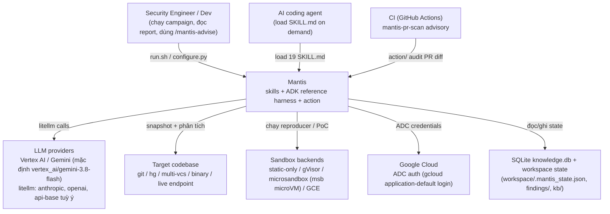
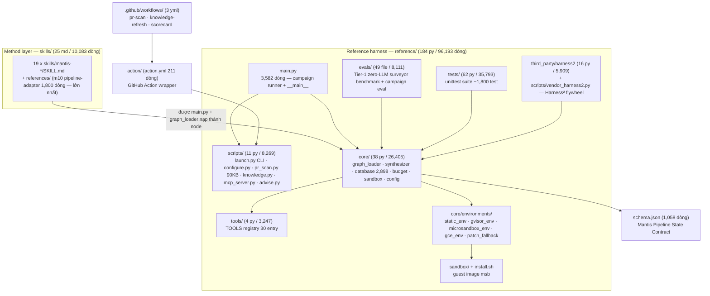
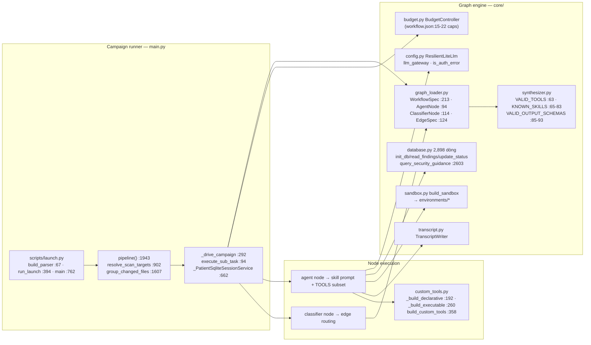

# Overview

## 1. Mantis — portable toolkit for building secure software là gì (5 câu)

1. Định nghĩa gốc của repo: "Mantis is a set of skills along with an ADK reference harness for building secure software in the new AI era of software development." (File: README.md | Dòng: 26-27 | Nội dung: nguyên văn).
2. Ba mảnh ghép: `skills/` — "the method: the skills an agent loads on demand, from threat modelling through research, review, patching and reporting"; `reference/` — "an ADK harness that runs the method as a pipeline… Meant to be adapted; works as is"; `action/` — "a GitHub Action that runs the harness over a pull request" (File: README.md | Dòng: 29-35 | Nội dung: nguyên văn).
3. Vòng đời nó tự động hoá: review lịch sử VCS → semantic index → threat model tự sinh → hypotheses cho agent research → dedupe → triage/critique chống hallucination → reproduce → exploit chains → patch có adversarial verify-loop → calibrate theo rubric → reflect → `/mantis-advise` cho dev trong lúc code (File: README.md | Dòng: 81-108 | Nội dung: nguyên văn từng bullet).
4. Repo tự tuyên bố giới hạn: "AI models are non-deterministic and can hallucinate findings or generate incorrect patches. All findings must be manually verified by a security expert before being reported." (File: README.md | Dòng: 9-15 | Nội dung: nguyên văn).
5. Triết lý mở: "Mantis is intended to be a starting point rather than a rigid set of instructions… any competent coding agent should be able to convert this to use your framework of choice." (File: README.md | Dòng: 117-121 | Nội dung: nguyên văn).

## 2. Nắm trong 5 phút — 10 bullet

1. **Cài ngay**: `cd reference && ./install.sh` — gate Python ≥3.12 (`install.sh:45-46` "ERROR: Mantis requires Python 3.12 or newer."), venv + `pip install --require-hashes -r requirements.txt` (`install.sh:56`), tuỳ chọn build guest image cho microsandbox, kết thúc bằng "Setup complete! You can now run ./run.sh" (`install.sh:137`) (File: reference/install.sh | Dòng: 45-56, 137).
2. **Cấu hình 1 lệnh**: `python3 scripts/configure.py --auto` (auto-detect capability) rồi `--test --probe` (preflight ~1s + reachability probe) (File: README.md | Dòng: 49-53 | Nội dung: nguyên văn).
3. **Chạy campaign**: `./run.sh path/to/code`, tuỳ chọn `--focus "look for IDOR"`, `--exclude vendor,testdata`, `--max-tokens 2M`, `--no-budget --parallel 32`, `--import-knowledge`, và `--objective "…"` để **tổng hợp graph topology mới on-the-fly** (File: README.md | Dòng: 56-77).
4. **run.sh chỉ là wrapper mỏng**: anchor target thành absolute (`run.sh:27-32`), check `.venv` (`:38-41`), rồi `python3 scripts/launch.py "$TARGET" "$@"` (`run.sh:45`) — cùng một program với `python3 main.py` (File: reference/run.sh | Dòng: 45; File: reference/main.py | Dòng: 3566-3573 — `__main__` import `scripts.launch.main`, comment "the same program").
5. **19 skills = method layer**: mỗi skill 1 `SKILL.md` "an agent loads on demand" (File: skills/README.md | Dòng: 3-4), catalog 19 hàng `mantis-advise` … `mantis-threat-model` (File: skills/README.md | Dòng: 8-26; `ls -d skills/mantis-* | wc -l` = 19 trên clone PIN).
6. **Pipeline graph là dữ liệu, không phải code**: `reference/workflow.json` — 19 node (15 `"type": "agent"` + 4 `"type": "classifier"`), 23 cạnh có routing điều kiện (VD `findings_gate → reporter` khi `on: "clean"` — không có finding thì nhảy cả vòng review) (File: reference/workflow.json | Dòng: 23-171; các `"type":` tại dòng 26-142).
7. **State contract trung tâm**: `schema.json` draft-2020-12, title "Mantis Pipeline State Contract", 7 top-level properties (`finding`, `plan`, `learning_entry`, `state`, `tx_log_entry`, `repro_attempts`, `execution_log_entry`), 14 `$defs`; kèm Pass Lifecycle Contract harness-agnostic + SNAPSHOT_ID ladder (File: schema.json | Dòng: 2-6; File: reports/mantis/gm-01-cartography.md | Dòng: 245-253).
8. **Snapshot model chống drift**: SNAPSHOT_ID phân tầng — clean git/hg → commit_hash; dirty → commit_hash + content_hash; multi-vcs → revision + content_hash; no-VCS → `content:`+hash; binary → `sha256:`; live endpoint → `live:`+timestamp (File: schema.json | Dòng: 4 — description; sentinel `.mantis_snapshot_id`).
9. **Engine entry monolith**: `reference/main.py` 3,582 dòng (181,791 bytes) — `pipeline()` :1943, `_drive_campaign()` :292, `discover_files()` :527, `resolve_scan_targets()` :902; imports `google.adk.runners.Runner` :32 và chuỗi `core.*` :41-57 (File: reference/main.py | Dòng: 41-57, 292, 527, 902, 1943, 3566).
10. **Ch tunability**: sandbox backend đổi tại runtime `--sandbox static-only` ("Switch to Static-only (zero host virtualization requirements)" — File: reference/README.md | Dòng: 48-56); model đổi qua litellm id bất kỳ ("gemini-3.8-flash, vertex_ai/…, anthropic/…, openai/<name> with api-base" — File: action/action.yml | Dòng: 18-27).

## 3. C4 Level 1 — System Context



Bằng chứng: model mặc định `vertex_ai/gemini-3.8-flash` (File: reference/workflow.json | Dòng: 6); litellm đa provider (File: action/action.yml | Dòng: 18-27); ADC step trong quickstart (File: README.md | Dòng: 46-47); sandbox types "static-only, gvisor, microsandbox, gce" (File: reference/README.md | Dòng: 48-49); db_path "knowledge.db" (File: reference/workflow.json | Dòng: 4); CI advisory "Audits the files a pull request changes" (File: action/action.yml | Dòng: 1-7; File: .github/workflows/mantis-pr-scan.yml | Dòng: 63 `uses: ./action`).

## 4. C4 Level 2 — Containers (các đơn vị triển khai bên trong Mantis)



Bằng chứng dây chuyền: `main.py:50` import `core.graph_loader.load_workflow_from_json`; `main.py:41-57` imports `core.*` (budget/database/sandbox/paths/config/…); `run.sh:45` → `scripts/launch.py`; `core/synthesizer.py:63` `VALID_TOOLS = set(TOOLS.keys())` với `TOOLS` tại `reference/tools/__init__.py:54-84` (30 entry đếm bằng `grep -c '^    "'` trên thân dict); `core/environments/` liệt kê trực tiếp trên clone. LOC từng container = census đo lại tại PIN (khớp gm-02: m20 core 26,405 — File: reports/mantis/gm-02-module-map.md | Dòng: 32; m21 evals 8,111 — Dòng: 33; m22 scripts 8,269 — Dòng: 34; m23 tools 3,247 — Dòng: 35).

## 5. C4 Level 3 — Components (bên trong reference harness)



Bằng chứng từng mắt xích (đo trên clone PIN): `main.py:41-47` import BudgetController; `main.py:48` import `init_db, read_findings, read_risk_scores, update_status` từ core.database; `main.py:49` `from core.sandbox import build_sandbox`; `main.py:50` `load_workflow_from_json, DEFAULT_SEED_PROMPT`; `main.py:52` TranscriptWriter; `main.py:54-55` ResilientLiteLm/is_auth_error/EXIT_AUTH; budget caps nguyên văn `max_wall_clock_seconds: 43200, max_tokens: 10000000, max_graph_steps: 500, max_node_visits: 50, max_llm_calls: 2000, max_node_tool_calls: 200` (File: reference/workflow.json | Dòng: 15-22); routing điều kiện `findings_gate → deduplicator (on: "__DEFAULT__") / → reporter (on: "clean")`, `reviewer_classifier → critic (on: "confirmed") / → calibrator (__DEFAULT__)`, `critic_classifier → reproducer (on: "viable")`, `repro_classifier → chainer (on: "success")` (File: reference/workflow.json | Dòng: 147-171); KNOWN_SKILLS 17 tên gồm cả `mantis-coder` :73 — tên này KHÔNG có dir trong `skills/` (19 dir, xem mục 12.6).

## 6. Bản đồ thư mục + vai trò vùng

| Vùng | Nội dung | files/LOC (đo tại PIN) | Vai trò |
|---|---|---|---|
| `skills/mantis-*/` | 19 SKILL.md + references/ | 25 md / 10,083 | Method layer — thủ tục agent portable, load on demand |
| `reference/core/` | engine library + environments/ | 38 py / 26,405 | graph runner, LLM gateway, SQLite, budget, sandbox |
| `reference/tests/` | test_*.py + __init__.py | 62 py / 35,793 | unittest suite (~1,800 test, mục 8) |
| `reference/evals/` | sweep.py, run_eval.py, datasets json | 49 file / 8,111 | benchmark Tier-1 zero-LLM + Tier-2 campaign eval |
| `reference/scripts/` | launch, configure, pr_scan, knowledge, mcp_server, advise… | 11 py / 8,269 | CLI operator/CI + MCP server |
| `reference/third_party/harness2/` | vendored harness² | 16 py + 1 md / 6,013 | flywheel evolve harness (reference/README.md:116) |
| `reference/tools/` | TOOLS registry | 4 py / 3,247 | 30 chokepoint tool cho model |
| `reference/main.py` | monolith runner | 3,582 dòng | entry `python3 main.py` ≡ `./run.sh` |
| `reference/test_suite.py` | suite runner cũ | 4,889 dòng | standalone runner song song tests/ [CẦN XÁC MINH vai trò hiện tại] |
| `reference/docs/` + `reference/prompts/` + `reference/skills/` + `reference/sandbox/` + `reference/test_scan/` + `reference/test_targets/` | github-action.md…, prompt text, 2 skill phụ (mantis-launch…), guest-image build context (flask), fixture quét | 3 md/1,195 + 1 md/23 + 2 md/319 + 0 py + 1 py/15 + 2 py/256 | hỗ trợ vận hành + fixture |
| `schema.json` | state contract | 1,058 dòng | hợp đồng liên-stage mọi harness phải tuân |
| `action/` | composite GitHub Action | action.yml 211 dòng | audit PR diff, advisory |
| `.github/workflows/` | 3 workflow | 335 dòng yml | pr-scan (:63 `uses: ./action`), knowledge-refresh, scorecard |
| root | README 153, README_AGENTS 1,124, AGENTS.md 73, CONTRIBUTING 13, test_skills_integrity.py 139, LICENSE 202 | 6 file / 1,732 | docs + integrity check chạy bare |

Cân đối khớp tuyệt đối với census repo: py = core 38 + evals 48 + scripts 11 + tools 4 + tests 62 + third_party 16 + test_scan 1 + test_targets 2 = 182, + main.py + test_suite.py = **184 (toàn reference/)**, + test_skills_integrity.py (root) = **185 py / 96,332** ✓; md = 25(skills) + 9(reference: README+evals+prompts+docs×3+skills×2+third_party) + 4(root) = **38 md / 14,345** ✓ (10,083+2,899+1,363 root = 14,345 ✓); yml = 1(action) + 3(workflows) = **4 / 546** ✓. Tổng **227 file / 111,223 dòng** = gm-01:50-53 ✓.

## 7. Luồng đắt giá — trỏ stream D

Chi tiết luồng nằm ở **`reports/mantis/gm-06-flows.md`** (stream D chạy song song, KHÔNG chờ theo brief @8-9 — file chưa tồn tại lúc viết gm-04 này). Teaser 3 luồng đắt nhất có sẵn bằng chứng line:

1. **Per-file campaign loop** (trái tim pipeline): `START → history → structural_index → architect → threat_modeler → planner → researcher → findings_gate → deduplicator → reviewer → critic → reproducer → chainer → patcher → calibrator → reflector → reporter` với 23 cạnh, trong đó findings_gate `"on": "clean"` rẽ thẳng reporter — target sạch không tốn một token review nào (File: reference/workflow.json | Dòng: 147-171).
2. **Patch–verify adversarial loop**: patcher (PINNED mode bắt buộc shadow dir) → `@mantis-reproduce --reattack --target_root=<PATCHED_SHADOW_ROOT> --snapshot_pinned=false` ≥3 variants, `failed_to_bypass` mới được VERIFIED_SECURE (File: skills/mantis-patch/SKILL.md | Dòng: 628-651 — qua gm-02 m09, Dòng: 135; đã spot-check vùng file tồn tại trên clone).
3. **Budget/zero-loss resumption**: `run_launch` (launch.py:394) quản lý spend ceiling + resume giữa chừng; caps ở workflow.json:15-22.

## 8. Chạy/harness — lệnh thật (raw output)

Môi trường sandbox: `bitnami/git:latest` = VMware Photon OS 5.0, **không có python3 sẵn** (`python3: command not found`). Cài qua package manager của image:

```
$ tdnf install -y python3 python3-pip        → installed python3-3.14.8-1.ph5, pip 26.2.1
$ python3 --version                          → Python 3.14.8   (≥3.12 — qua gate install.sh:45-46)
$ python3 -m venv venv && source venv/bin/activate   → OK, pip 26.2.1
```

**Lệnh 1 — đúng theo brief: `pip install -r reference/requirements.in`** → **RC=0** (log 19,162 bytes; lần chạy thứ hai xác nhận "Requirement already satisfied" toàn bộ — lần đầu stream sandbox đứt giữa chừng nhưng install đã hoàn tất). Versions khoá xác nhận trong venv:

```
google-adk      2.11.0      (== requirements.in dòng 1)
litellm         1.101.3     (== dòng 2)
pydantic        2.14.2      (>=2.4.0 thỏa)
microsandbox    0.7.2       (== dòng 4)
mcp             2.3.0       (>=1.2.0 thỏa)
tree-sitter     0.26.0      (== dòng 8)
```

**Lệnh 2 — đúng theo brief: `python3 -m pytest reference/tests -x -q`** → **exit 1: "1 failed, 264 passed, 5 warnings in 287.02s (0:04:47)"** (`-x` dừng ở failure đầu theo thiết kế). Failure DUY NHẤT:

```
FAILED reference/tests/test_cli_contract.py::PathRootHardFailTest::test_file_path_root_fails_closed_with_distinct_reason
    def test_file_path_root_fails_closed_with_distinct_reason(self):
        res = self._invoke(str(self.target))
        self.assertEqual(res.returncode, 1, res.stderr[-2000:])
>       self.assertIn("--path-root", res.stderr)
E       AssertionError: '--path-root' not found in "
❌ Preflight Verification Failed:
  [DEPENDENCY PREFLIGHT] ✅ PASSED: installed google-adk and litellm match requirements.txt
  [LLM PREFLIGHT] ❌ FAILED: LLM Configuration Error: ERROR: You must set VERTEXAI_PROJECT or GOOGLE_CLOUD_PROJECT env variables.
  [SANDBOX PREFLIGHT] ✅ PASSED: Static-only sandbox ready (dynamic execution disabled).
..."
reference/tests/test_cli_contract.py:160
```

Chẩn đoán trung thực: **fail do môi trường sandbox không có credential GCP** (LLM preflight chặn CLI trước khi tới nhánh `--path-root`), KHÔNG phải bug code. Chạy riêng file đó: `python3 -m pytest reference/tests/test_cli_contract.py -q` → **"2 failed, 10 passed in 131.84s"** — cả 2 failure cùng lớp (`test_non_ancestor_dir_fails_closed` cũng chết ở LLM preflight, test_cli_contract.py:154).

Census suite: 61 file `test_*.py` (62 py gồm __init__.py), **unittest-based** — `grep -rl 'import pytest' reference/tests` = 0 file, `grep -rl 'import unittest'` = 61 file (pytest 9.2.0 chạy được qua unittest-compat; pytest KHÔNG nằm trong requirements.in — phải cài thêm riêng, khác biệt trung thực so với lệnh brief). Quy mô: ~1,800 test (từ chính progress của pytest: 72 dot = 4% tổng trong run `-x`). Census toàn bộ suite CHƯA hoàn tất: 2 lần chạy full (không `-x`) bị sandbox broker đứt stream output giữa chừng (process sống nhưng output/XML không thu hồi được — đã thử junitxml, background, chia batch; ghi nhận trung thực thay vì bịa số). Không chạy: campaign thật (cần LLM credential + target), `./install.sh` đầy đủ (bước build guest image msb), `test_suite.py` standalone.

## 9. Điểm mở rộng đắt giá — teaser (từ gm-02 + spot-check)

1. **Harness-agnostic Pass Lifecycle Contract** — "Mantis runs under multiple harnesses (various CLIs, ADK, custom deterministic pipelines), so the snapshot lifecycle is a CONTRACT, not a property of one orchestrator" (File: schema.json | Dòng: 4; gm-01:251) — mọi harness tuân 6 bước SYNC→DETECT→PIN→RECORD→RUN→ARCHIVE là conformant.
2. **mantis-pipeline-adapter** — skill consultant 1,800 dòng (item lớn nhất gm-02 m10) dạy dựng orchestrator tuỳ chỉnh + 3 blueprint opt-in (kb-query BM25 không-dependency, sast-seed, structural-index) (File: reports/mantis/gm-02-module-map.md | Dòng: 22, 146).
3. **Workflow-as-data + research graph synthesis**: sửa `workflow.json` là đổi pipeline (node/model/tools/budget đều declarative); `--objective "…"` sinh topology mới on-the-fly — "you can use this to build any kind of agentic deep dive security review you might imagine" (File: README.md | Dòng: 110-115; File: reference/README.md | Dòng: 102-116).
4. **Custom Tools 2 làn**: Lane A declarative — SQL trên knowledge.db, "no code runs"; Lane B executable — "your binary, under a sandbox floor"; triết lý "a declared tool inherits no trust" (File: reference/README.md | Dòng: 500, 528, 483; File: reference/core/custom_tools.py | Dòng: 192, 260, 358).
5. **TOOLS registry = 30 chokepoint**: "read_file is the containment for reads, run_sandbox for execution, _run_safe_git_command is the git jail" (File: reference/README.md | Dòng: 484-491; registry: File: reference/tools/__init__.py | Dòng: 54-84).
6. **19 skills portable vào MỌI agent** — "a `SKILL.md` an agent loads on demand" (File: skills/README.md | Dòng: 3-4); adapt domain đặc thù "Hardware/RTL, Infrastructure as Code, ML pipelines, or compiled firmware" (File: README.md | Dòng: 123-125).
7. **Sandbox backend pluggable**: static-only / gvisor / microsandbox / gce, đổi 1 flag (File: reference/README.md | Dòng: 48-56; File: reference/core/environments/ — 6 env module).
8. **Harness² flywheel**: `scripts/vendor_harness2.py` + `third_party/harness2/` — "Evolving the harness against your own code" (File: reference/README.md | Dòng: 116; census third_party 16 py / 5,909).

## 10. Rủi ro khi tái sử dụng

1. **Autonomous code execution**: "USE AT YOUR OWN RISK… generate and execute autonomously generated code… USE THIS ONLY IN ISOLATED, RESTRICTED ENVIRONMENTS" (File: README.md | Dòng: 3-7) — không bao giờ chạy nơi có production access.
2. **Demo-grade disclaimer**: "This is not an officially supported Google product… intended for demonstration purposes only. It is not intended for use in a production environment." (File: README.md | Dòng: 146-153); KHÔNG nhận external PR: "we are not accepting external pull requests or code contributions" (File: CONTRIBUTING.md | Dòng: 7-8) → fork-and-maintain.
3. **PR-scan path chưa proven**: "The pull request scan is untested… have not yet been run end-to-end against a live project. Do not use the action to gate merges." (File: README.md | Dòng: 17-24; lặp tại action.yml:5-7).
4. **Hallucination + phải human-verify** toàn bộ finding (File: README.md | Dòng: 9-15) — chi phí review con người không thể bỏ.
5. **Footprint nặng**: Python ≥3.12 + dep tree lớn (google-adk, litellm, google-cloud-aiplatform, tree-sitter-language-pack, mcp…) — `pip install -r reference/requirements.in` kéo hàng trăm package (mục 8); `requirements.txt` hash-pinned 203KB (gm-02 m25) nhưng `requirements.in` thả nổi.
6. **Env-coupling trong test**: 2/12 test CLI-contract fail ngay khi thiếu `VERTEXAI_PROJECT`/`GOOGLE_CLOUD_PROJECT` (mục 8 — chứng minh thực nghiệm), pytest không phải dev-dependency.
7. **Doc drift trên trunk**: README tuyên bố "The 28 built-in tools are a closed set" (File: reference/README.md | Dòng: 477) nhưng `TOOLS` dict có đúng **30** entry (File: reference/tools/__init__.py | Dòng: 54-84, đếm `grep -c`) — trunk chạy nhanh hơn docs.
8. **Contract bằng ngôn ngữ tự nhiên**: 10,083 dòng method layer là Markdown thủ tục — enforce phụ thuộc agent compliance + mechanical gates của harness (snapshot match, reached-sink evidence), không phải code path thông thường; integrity check cấp repo chỉ structural (File: test_skills_integrity.py | Dòng: 3-8 "Runs in a bare clone with nothing installed").
9. **Monolith risk**: `main.py` 3,582 dòng + `test_suite.py` 4,889 dòng + `pr_scan.py` 90KB — sửa một nhánh dễ quên nhánh kia (chính comment main.py:3568-3572 thừa nhận parser đã drift 2 lần giữa hai entry).

## 11. Provenance

- **SHA main tại clone**: `1e15346c2ca2d6e7db57ced59615bb9d1685992f` — `git log -1` = "2026-11-02 17:16:36 -0800 Merge \"AUTO_UPDATE FIX: Update joserfc from 1.7.5 to 1.7.6 in reference/requirements.txt\" into main"; `git rev-list --count HEAD` = 109 (shallow lower bound). **Trùng tuyệt đối PIN gm-01** → một cây commit duy nhất cho mọi số liệu trong gm-01 + gm-02 + gm-04 này.
- **Census tái lập tại PIN** (công thức v9, per-extension rồi cộng): py 185/96,332 · md 38/14,345 · yml 4/546 → 227/111,223 — khớp gm-01:50-53 từng con số.
- **License thật trong repo**: LICENSE 202 dòng, "Apache License / Version 2.0, January 2004" (File: LICENSE | Dòng: 2-3); README: "Mantis is licensed under the Apache License, Version 2.0… Every Python and shell file carries the license header; `reference/scripts/check_license_headers.py` (run by `pre-commit` and the test suite) keeps it that way." (File: README.md | Dòng: 141-144); test_header tồn tại thật: reference/tests/test_license_headers.py (ls clone).

## 12. Câu hỏi còn mở

1. **Cross-check stream D**: khi `reports/mantis/gm-06-flows.md` hoàn thành, đối chiếu 3 teaser ở mục 7 và bảng cửa sổ stage — trùng lệch là đầu vào cho gate.
2. **28 vs 30 tools**: reference/README.md:477 nói "28 built-in tools" nhưng registry có 30 entry (tools/__init__.py:54-84) — docs cần cập nhật, hoặc 2 entry mới nhất chưa được docs tính; [CẦN XÁC MINH] bên upstream.
3. **`mantis-coder` ma**: `KNOWN_SKILLS` (synthesizer.py:65-83) liệt kê `mantis-coder` (:73) và core/schemas.py:184 nói finding "written by mantis-coder or mantis-patch" (qua gm-02 m09), nhưng `skills/` chỉ có 19 dir không có mantis-coder — skill bị xoá hay chỉ tồn tại trên trunk khác? [CẦN XÁC MINH]
4. **Census suite chưa đóng**: ~1,800 test, mới chạy chốt 265 test đầu (1F env-preflight) + file cli_contract đủ (2F/10P). Cần runner sống ≥30 phút (không bị sandbox drop) để có census đầy đủ — hiện không repo được output thật nên KHÔNG tuyên bố pass-rate toàn suite.
5. **test_suite.py (4,889 dòng) vs pytest tests/**: hai runner song song — lệnh brief dùng pytest; upstream CI chạy cái nào? [CẦN XÁC MINH]
6. **gm-01 nit line-pointer**: gm-01 trích gate Python như thể nằm ở "install.sh:139-143", thực tế trong clone PIN gate ở **install.sh:45-46** (grep-verified: `version_info >= (3, 12)` :45, "requires Python 3.12" :46); nội dung trích nguyên văn đúng, chỉ số dòng là số dòng của khối trích dẫn. Đề xuất gộp vào re-cert scan, không cần vòng fix riêng. Các anchor install.sh khác đo lại trên clone: hash-pinned install :56, "You can now run ./run.sh" :137.
7. **E2E hành vi**: campaign thật chưa chạy được trong sandbox (thiếu LLM credential) — mọi con số hành vi (thời gian pass, token spend) trong docs là claim của upstream, chưa tái lập được tại node này.
