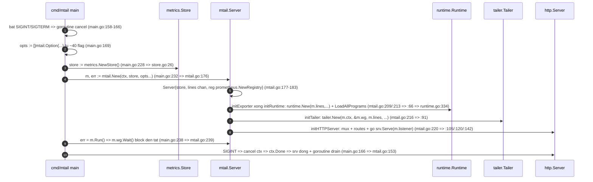

# Flows

## 1. Cách tính — dán nguyên văn

### 1a. Churn từng file — lệnh đúng brief

```
$ git log --format= --name-only | sort | uniq -c | sort -rn | head -20
     39 go.mod
     38 go.sum
     26 internal/tailer/logstream/pipestream.go
     25 .github/workflows/release.yml
     23 internal/tailer/tail.go
     23 internal/tailer/logstream/socketstream.go
     22 internal/tailer/logstream/filestream.go
     21 internal/tailer/logstream/dgramstream.go
     15 internal/tailer/logstream/pipestream_unix_test.go
     14 internal/tailer/logstream/socketstream_unix_test.go
     14 internal/tailer/logstream/filestream_test.go
     13 internal/tailer/logstream/logstream.go
     13 internal/tailer/logstream/dgramstream_unix_test.go
     11 internal/tailer/logstream/filestream_unix_test.go
     11 internal/mtail/testing.go
     10 internal/tailer/tail_unix_test.go
      9 internal/tailer/tail_test.go
      9 .github/workflows/benchmark.yml
      8 internal/mtail/mtail.go
      8 internal/mtail/log_rotation_integration_unix_test.go
```

Phương pháp: 1 commit đụng N file → N sự kiện file×commit (file test/asset tính bình thường).
Tổng sự kiện toàn repo: `git log --format= --name-only | grep -c .` = **957**.

### 1b. Churn theo module (18 item — global pipeline, derivation exclusive chạy thật)

| item | module | churn (ALL) | churn (.go) | ghi chú |
|------|--------|------------:|------------:|---------|
| m01 | compiler | 66 | 60 | |
| m02 | mtail | 160 | 110 | exclusive (đã trừ golden 6) |
| m03 | logstream | 209 | 209 | **cao nhất universe** |
| m04 | vm | 4 | 4 | |
| m05 | runtime | 46 | 14 | exclusive (đã trừ compiler 66/vm 4/code 10) |
| m06 | exporter | 32 | 32 | |
| m07 | metrics | 17 | 17 | exclusive (đã trừ datum 17) |
| m08 | tailer | 48 | 48 | exclusive (đã trừ logstream 209) |
| m09 | datum | 17 | 17 | |
| m10 | testutil | 34 | 34 | |
| m11 | waker | 16 | 16 | |
| m12 | cmd/mtail | 5 | 5 | |
| m13 | golden | 6 | 4 | |
| m14 | code | 10 | 10 | |
| m15 | mdot | 3 | 3 | |
| m16 | mgen | 2 | 2 | |
| m17 | mfmt | 2 | 2 | |
| m18 | logline | 2 | 2 | |

- Lệnh đo (mẫu): `git log --format= --name-only | grep -c '^internal/tailer/logstream/'`;
  exclusive: `git log --format= --name-only | grep '^internal/tailer/' | grep -cv '^internal/tailer/logstream/'` = 48;
  `... | grep '^internal/runtime/' | grep -cvE '^internal/runtime/(compiler|vm|code)/'` = 46;
  `... | grep '^internal/metrics/' | grep -cv '^internal/metrics/datum/'` = 17;
  `... | grep '^internal/mtail/' | grep -cv '^internal/mtail/golden/'` = 160.
- Đối soát: tổng module = **679** + non-module (`grep -cvE '^(internal/|cmd/)'` = **278**,
  gồm go.mod/go.sum/.github/testdata) = **957** = tổng 1a — khớp tuyệt đối.
- Lưu ý đo lường: re-run path-limited (`git log -- <path>`) lệch ±1 với global ở vài file
  (vd pipestream.go 26 global vs 25 pathspec) do history simplification bỏ merge commit
  TREESAME — bảng này dùng số GLOBAL (khớp lệnh brief 1a).

### 1c. Fan-in/out từ JSON gm-02 (§5, 18 entry; deps_out tổng = 41 cạnh ✓ gm-02 §4)

| item | module | deps_in | deps_out | fan (in+out) | churn |
|------|--------|--------:|---------:|-------------:|------:|
| m01 | compiler | 3 (m07,m09,m14) | 4 (m05,m15,m16,m17) | 7 | 66 |
| m02 | mtail | 8 (m05,m06,m07,m08,m09,m10,m11,m18) | 2 (m12,m15) | **10** | 160 |
| m03 | logstream | 2 (m11,m18) | 1 (m08) | 3 | 209 |
| m04 | vm | 4 (m07,m09,m14,m18) | 1 (m05) | 5 | 4 |
| m05 | runtime | 6 (m01,m04,m07,m09,m14,m18) | 1 (m02) | 7 | 46 |
| m06 | exporter | 2 (m07,m09) | 2 (m02,m12) | 4 | 32 |
| m07 | metrics | 1 (m09) | 8 (m01,m02,m04,m05,m06,m12,m13,m14) | **9** | 17 |
| m08 | tailer | 3 (m03,m11,m18) | 1 (m02) | 4 | 48 |
| m09 | datum | 0 | 7 (m01,m02,m04,m05,m06,m07,m13) | 7 | 17 |
| m10 | testutil | 1 (m18) | 1 (m02) | 2 | 34 |
| m11 | waker | 0 | 4 (m02,m03,m08,m12) | 4 | 16 |
| m12 | cmd/mtail | 4 (m02,m06,m07,m11) | 0 | 4 | 5 |
| m13 | golden | 2 (m07,m09) | 0 | 2 | 6 |
| m14 | code | 1 (m07) | 3 (m01,m04,m05) | 4 | 10 |
| m15 | mdot | 2 (m01,m02) | 0 | 2 | 3 |
| m16 | mgen | 1 (m01) | 0 | 1 | 2 |
| m17 | mfmt | 1 (m01) | 0 | 1 | 2 |
| m18 | logline | 0 | 6 (m02,m03,m04,m05,m08,m10) | 6 | 2 |

Nguồn: File: reports/mtail/gm-02-module-map.md | Dòng: 542-562 (JSON block, 18 entry, đủ 10 trường).

### 1d. Bảng điểm 5 luồng ứng viên → TOP-3

| # | luồng | module set | Σ fan | Σ churn | **Score** | hạng |
|---|-------|-----------|------:|--------:|----------:|------|
| F1 | Log ingestion pipeline (tailer → logstream → logline → runtime → vm → metrics) | m08,m03,m18,m05,m04,m07 | 4+3+6+7+5+9 = 34 | 48+209+2+46+4+17 = 326 | **360** | **1** |
| F4 | Server startup & wiring (cmd/mtail → mtail server → tailer/runtime/exporter/http) | m12,m02,m08,m05,m06 | 4+10+4+7+4 = 29 | 5+160+48+46+32 = 291 | **320** | **2** |
| F3 | Metrics export & HTTP serving (metrics store → exporter → mux endpoints) | m07,m06,m02 | 9+4+10 = 23 | 17+32+160 = 209 | **232** | **3** |
| F2 | Program compile & load (runtime loader → compiler → code → vm) | m05,m01,m14,m04 | 7+7+4+5 = 23 | 46+66+10+4 = 126 | 149 | 4 |
| F5 | Program visualization mdot (cmd/mdot → compiler front-end) | m15,m01 | 2+7 = 9 | 3+66 = 69 | 78 | 5 |

TOP-3 = **F1 (360) > F4 (320) > F3 (232)**. F2/F5 chỉ chấm điểm, không vẽ sequence (ngoài top-3).

## 2. F1 — Log ingestion pipeline (hạng 1, Score 360) — 12 bước

**Vì sao đắt (số):**
- Churn 326 sự kiện = **34.1%** toàn repo (326/957). Module m03 logstream churn **209 = cao nhất
  universe** (30.8% của 679 sự kiện module): **10/20 file churn-top của repo nằm trong logstream**
  (pipestream 26 #3, socketstream 23 #6, filestream 22 #7, dgramstream 21 #8, + 6 file test/reader
  — bảng 1a), thêm tail.go 23 (#5) thuộc m08 → **13/20 file churn-top thuộc F1**.
- Fan: luồng đi qua 4/5 module có fan cao nhất universe — metrics (m07) fan 9, runtime (m05) fan 7,
  logline (m18) fan-out 6, vm (m04) fan 5; logline bị 6 item import vì là kiểu trao đổi trung tâm.
- LOC: 8026/26896 = **29.8%** LOC universe (804+2017+19+1871+1989+1326 — census gm-02 dòng 5).
- Vai trò: **hot path per-line** — mọi dòng log của mọi nguồn chạy trọn đường này lúc runtime.

```mermaid
sequenceDiagram
    autonumber
    participant G as filesystem glob
    participant T as tailer.Tailer
    participant LS as logstream.LogStream
    participant LR as logstream.LineReader
    participant CH as lines chan
    participant R as runtime.Runtime
    participant VM as vm.VM
    participant D as datum metric state
    G->>T: pollLogPattern loop Wake => doPatternGlob filepath.Glob (tail.go:311/:322)
    T->>T: TailPath(absPath) cho moi file khop (tail.go:337)
    T->>LS: logstream.New(ctx, wg, waker, pathname) (tail.go:263 => logstream.go:64)
    LS->>LS: dispatch file thuong => newFileStream (logstream.go:104 => filestream.go:43)
    LS->>LR: NewLineReader(sourcename, lines, fd, bufSize) (filestream.go:83 => reader.go:33)
    LR->>LR: ReadAndSend doc buffer + rotation os.SameFile / truncation size<offset (filestream.go:102/:155/:178 => reader.go:45)
    LR->>CH: lines <- logline.New(ctx, sourcename, line) (reader.go:92 => logline.go:17)
    CH->>T: relay for line := range l.Lines() { t.lines <- line } (tail.go:273-274)
    T->>R: runtime consumer for line := range lines (runtime.go:287; chan m.lines wire mtail.go:66/:91)
    R->>VM: fan-out handles[prog].lines <- line; moi VM 1 goroutine go v.Run (runtime.go:291/:202)
    VM->>VM: Run loop => ProcessLogLine fetch-decode-execute (vm.go:1057/:962/:980/:982)
    VM->>D: Match vm.re[index].FindStringSubmatch / Inc => datum.IncIntBy (vm.go:356/:473/:486 => datum.go:180)
```

| # | bước | caller (file:line) | callee (file:line) | bằng chứng trích |
|---|------|--------------------|--------------------|------------------|
| 1 | poll pattern → glob | internal/tailer/tail.go:289,311 | tail.go:322 | `if err := t.doPatternGlob(pattern); err != nil {` ; `matches, err := filepath.Glob(pattern)` |
| 2 | glob match → TailPath | tail.go:337 | tail.go:256 | `if err := t.TailPath(absPath); err != nil {` |
| 3 | TailPath → logstream.New | tail.go:263 | logstream.go:64 | `l, err := logstream.New(t.ctx, &t.wg, t.logstreamPollWaker, pathname, t.oneShot)` |
| 4 | dispatch → newFileStream | logstream.go:104 | filestream.go:43 | `case m.IsRegular(): return newFileStream(ctx, wg, waker, path, fi, oneShot)` |
| 5 | newFileStream → LineReader | filestream.go:83 | reader.go:33 | `lr := NewLineReader(fs.sourcename, fs.lines, fd, defaultReadBufferSize, fs.cancel)` |
| 6 | đọc + rotation/truncation | filestream.go:102 | reader.go:45; filestream.go:155,178 | `count, err := lr.ReadAndSend(ctx)` ; `if !os.SameFile(fi, newfi) {` ; `if newfi.Size() < currentOffset {` |
| 7 | cắt dòng → LogLine → channel | reader.go:92 | logline.go:17 | `lr.lines <- logline.New(ctx, lr.sourcename, line)` |
| 8 | relay lên kênh chung | tail.go:273-274 | — | `for line := range l.Lines() {` / `t.lines <- line` |
| 9 | runtime tiêu thụ | runtime.go:287 | — | `for line := range lines {` (goroutine "main consumer/producer loop") |
| 10 | fan-out tới từng VM | runtime.go:291 | runtime.go:202 | `r.handles[prog].lines <- line` ; `go v.Run(lines, &r.wg)` |
| 11 | VM fetch–decode–execute | vm.go:1057,962 | vm.go:980,982,336 | `v.ProcessLogLine(ctx, line)` ; `i := v.prog[t.pc]` :980 / `v.execute(t, i)` :982 |
| 12 | Match/Inc ghi datum | vm.go:356,473,486 | datum.go:180 | `t.matches[index] = v.re[index].FindStringSubmatch(v.input.Line)` (quote nằm ở :361; :356 là guard `case code.Match:`) ; `datum.IncIntBy(n, delta, t.time)` ; `func IncIntBy(d Datum, v int64, ts time.Time)` |

Chuỗi gọi liên tục: 1→2→3→4→5→6→7→8→9→10→11→12 (mỗi bước gọi thẳng bước sau; 6↔7 lặp trong loop).

## 3. F4 — Server startup & wiring (hạng 2, Score 320) — 10 bước

**Vì sao đắt (số):**
- Churn 291 sự kiện = **30.4%** (291/957). internal/mtail (m02) churn **160 = #2 universe**
  (23.6% module events); 2 file của m02 nằm top-20: testing.go 11 (#15), mtail.go 8 (#19).
- Fan: **m02 mtail có deps_in 8 — import từ nhiều item nhất universe** (m02 dùng 8/17 item còn
  lại); chiều ngược lại chỉ **2 item import m02** (deps_out 2 = m12 cmd/mtail, m15 mdot — grep
  non-test toàn repo: chỉ `cmd/mtail/main.go` + `cmd/mdot/main.go`); cmd/mtail là entry binary
  production duy nhất (`deps_out: []` — không ai import).
- LOC: 9015/26896 = **33.5%** (278+4463+804+1871+1599).
- Vai trò: **điểm lắp ráp 5 component** (store/runtime/exporter/tailer/http) — mọi deployment đi
  qua đúng 1 lần; sai wiring = mất toàn bộ pipeline F1/F3.



| # | bước | caller (file:line) | callee (file:line) | bằng chứng trích |
|---|------|--------------------|--------------------|------------------|
| 1 | arm signal → cancel | cmd/mtail/main.go:158-166 | — | `signal.Notify(sigint, os.Interrupt, syscall.SIGTERM)` / `cancel()` trong goroutine |
| 2 | flag → Option | main.go:169 | mtail.go options | `opts := []mtail.Option{` |
| 3 | tạo store | main.go:228 | store.go:26 | `store := metrics.NewStore()` ; `func NewStore() (s *Store)` |
| 4 | gọi mtail.New | main.go:232 | mtail.go:176 | `m, err := mtail.New(ctx, store, opts...)` ; `func New(ctx context.Context, store *metrics.Store, options ...Option)` |
| 5 | dựng Server + kênh `lines` + registry | mtail.go:177-183 | — | `lines: make(chan *logline.LogLine)` / `reg: prometheus.NewRegistry()` |
| 6 | initExporter rồi initRuntime (+ nạp chương trình lúc boot) | mtail.go:209,213 | mtail.go:72,76; runtime.go:250,334 | `m.e, err = exporter.New(m.ctx, m.store, m.eOpts...)` ; `m.reg.MustRegister(m.e)` ; `m.r, err = runtime.New(m.lines, ...)` ; `if err := r.LoadAllPrograms(); err != nil {` |
| 7 | initTailer (nhận chung kênh `lines`) | mtail.go:216 | mtail.go:91 | `m.t, err = tailer.New(m.ctx, &m.wg, m.lines, m.tOpts...)` |
| 8 | initHTTPServer → serve | mtail.go:220 | mtail.go:105,120,142 | `mux := http.NewServeMux()` ; `mux.Handle("/metrics", promhttp.HandlerFor(m.reg, ...))` ; `if err := srv.Serve(m.listener); ...` |
| 9 | Run block chờ | main.go:238 | mtail.go:239 | `err = m.Run()` ; `m.wg.Wait()` |
| 10 | SIGINT → hủy → đóng | main.go:166 | mtail.go:153 | `cancel()` ; `case <-m.ctx.Done():` trong goroutine dừng server |

## 4. F3 — Metrics export & HTTP serving (hạng 3, Score 232) — 9 bước

**Vì sao đắt (số):**
- Churn 209 sự kiện = **21.8%** (209/957): m02 160 + m06 32 + m07 17.
- Fan: m07 metrics có **fan-out 8 — cao nhất universe** (mọi producer ghi vào store);
  m06 exporter fan 4; mux gắn ≥6 endpoint đo được trong code (`/metrics`, `/varz`, `/json`,
  `/graphite`, `/progz`, `/debug/vars`).
- LOC: 7388/26896 = **27.5%** (1326+1599+4463).
- Vai trò: **luồng giá trị cuối** — metric chỉ có giá trị khi scraper/pusher đọc được; Collect
  chạy lại trên TOÀN store cho mỗi lần scrape.

```mermaid
sequenceDiagram
    autonumber
    participant SC as scraper push target
    participant MUX as http mux (mtail.Server)
    participant REG as prometheus.Registry
    participant EX as exporter.Exporter
    participant ST as metrics.Store
    SC->>MUX: GET /metrics (route mtail.go:120)
    MUX->>REG: promhttp.HandlerFor(m.reg) => Gather (mtail.go:120; reg tao mtail.go:182)
    REG->>EX: collector da register m.reg.MustRegister(m.e) (mtail.go:76) => Describe (prometheus.go:26)
    EX->>ST: Collect => e.store.Range(...) (prometheus.go:31/:36 => store.go:141)
    ST->>EX: moi Metric => go m.EmitLabelSets(lsc) (prometheus.go:46)
    EX->>EX: NewConstHistogram / NewConstMetric per labelset (prometheus.go:66/:74)
    EX->>MUX: c <- pM tra ve phan hoi scrape (prometheus.go:93)
    MUX->>ST: route phu /varz => HandleVarz => store.Range (mtail.go:116 => varz.go:21/:24)
    MUX->>ST: /json (mtail.go:121 => json.go:17) va one_shot dump (main.go:254/:265 => store.go:207)
```

| # | bước | caller (file:line) | callee (file:line) | bằng chứng trích |
|---|------|--------------------|--------------------|------------------|
| 1 | route /metrics | mtail.go:120 | promhttp | `mux.Handle("/metrics", promhttp.HandlerFor(m.reg, promhttp.HandlerOpts{}))` |
| 2 | registry Gather | mtail.go:182,120 | — | `reg: prometheus.NewRegistry()` trong `New` |
| 3 | collector đã register → Describe | mtail.go:76 | prometheus.go:26 | `m.reg.MustRegister(m.e)` ; `func (e *Exporter) Describe(c chan<- *prometheus.Desc)` |
| 4 | Collect → store.Range | prometheus.go:31,36 | store.go:141 | `func (e *Exporter) Collect(c chan<- prometheus.Metric)` ; `e.store.Range(func(m *metrics.Metric) error {` |
| 5 | mỗi Metric phát labelsets | prometheus.go:46 | — | `go m.EmitLabelSets(lsc)` |
| 6 | dựng prometheus.Metric | prometheus.go:66,74 | — | `pM, err = prometheus.NewConstHistogram(` / `pM, err = prometheus.NewConstMetric(` |
| 7 | đẩy vào kênh scrape | prometheus.go:93 | — | `c <- pM` |
| 8 | /varz text format | mtail.go:116 | varz.go:21,24 | `mux.HandleFunc("/varz", http.HandlerFunc(m.e.HandleVarz))` ; `err := e.store.Range(func(m *metrics.Metric) error {` |
| 9 | /json + one_shot dump | mtail.go:121; main.go:254,265 | json.go:17; store.go:207 | `func (e *Exporter) HandleJSON(w http.ResponseWriter, ...)` ; `err = e.Write(os.Stdout)` ; `err = store.WriteMetrics(os.Stdout)` ; `func (s *Store) WriteMetrics(w io.Writer) error` |

Liên kết giữa các luồng: F1 bước 12 (VM ghi datum) sản sinh trạng thái mà F3 bước 4-5 đọc ra;
F4 bước 5-8 tạo kênh `lines` + registry mà F1/F3 chạy trên đó. m02/m07/m05/m08 xuất hiện ở
nhiều luồng — tính điểm mỗi luồng độc lập theo công thức khai báo (tiền lệ ef360255: flow ví dụ
của brief rớt hạng thì vẫn giữ thứ hạng theo số).

## 5. Machine block (cho node sau)

```json
{
  "subject": "mtail",
  "pin": "4c7e0e1174ac1ead032efe28d86428bbbe0ae145",
  "branch": "main",
  "clone": {"depth_requested": 100, "shallow": true,
            "shallow_roots": ["4ea81a1bbae1ac0913335f21203f75b75ff16d72", "5571ca08ba1417da66ce3c5626274a8a32c86a05"],
            "commits_reachable": 301},
  "churn_window": {"commits": 301, "total_file_events": 957, "module_events": 679,
                   "note": "mirror tra du 301 commit > depth 100; khong co du lieu bi cat"},
  "fan_source": "reports/mtail/gm-02-module-map.md section 5 JSON (18 item, 41 canh deps_out)",
  "scoring_formula": "score = sum(fan_in + fan_out) + sum(churn) over flow module set",
  "flows": [
    {"id": "F1", "name": "log ingestion pipeline", "modules": ["m08", "m03", "m18", "m05", "m04", "m07"], "fan_sum": 34, "churn_sum": 326, "score": 360, "rank": 1, "steps": 12},
    {"id": "F4", "name": "server startup and wiring", "modules": ["m12", "m02", "m08", "m05", "m06"], "fan_sum": 29, "churn_sum": 291, "score": 320, "rank": 2, "steps": 10},
    {"id": "F3", "name": "metrics export and http serving", "modules": ["m07", "m06", "m02"], "fan_sum": 23, "churn_sum": 209, "score": 232, "rank": 3, "steps": 9},
    {"id": "F2", "name": "program compile and load", "modules": ["m05", "m01", "m14", "m04"], "fan_sum": 23, "churn_sum": 126, "score": 149, "rank": 4, "steps": null},
    {"id": "F5", "name": "program visualization mdot", "modules": ["m15", "m01"], "fan_sum": 9, "churn_sum": 69, "score": 78, "rank": 5, "steps": null}
  ],
  "top3": ["F1", "F4", "F3"]
}
```

## 6. Hạn chế & ghi chú

1. **Cửa sổ churn = 301 commit** (toàn bộ lịch sử mirror), không phải ≤100 như brief giả định —
   khai báo minh bạch ở đầu tài liệu; con số churn là FULL history, không phải cửa sổ cắt cụt.
2. `reports/mtail/gm-01` không tồn tại → fan/churn đối chiếu qua gm-02 (JSON §5 + census);
   các con số module (files/LOC) lấy từ gm-02 đã gate.
3. Line numbers đúng tại PIN `4c7e0e1`; upstream tiến sẽ dịch số dòng (truy vết lại theo symbol
   đã trích trong bảng).
4. Số bước diagram = số message-arrow mermaid: F1 = 12, F4 = 10, F3 = 9 (đếm khớp giữa tiêu đề,
   diagram và machine block `steps`).
