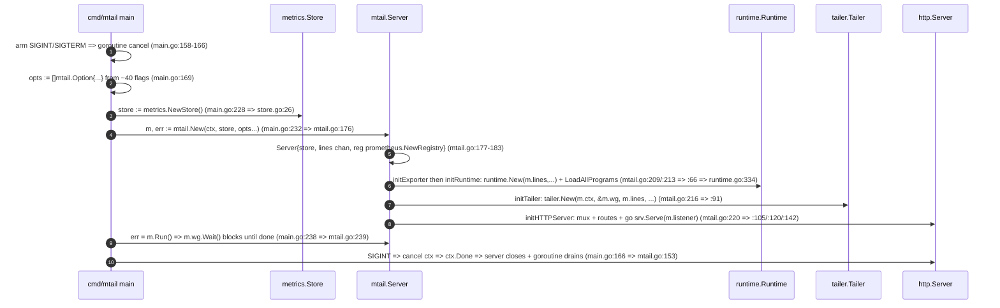

# Flows — the three most churn-heavy data flows


Method (measured on the pinned tree, see
[`01-cartography.md`](01-cartography.md)):


- **Churn window**: the full 301-commit history reachable from the pin —
  the whole mirror history, nothing truncated. 957 file events total
  (`git log --format= --name-only | grep -c .`); 679 of them inside
  `internal/` or `cmd/` modules.
- **Per-module churn** below is exclusive (subpackage events counted once,
  in the deepest owning module). Per-file counts use the global pipeline
  `git log --format= --name-only | sort | uniq -c | sort -rn`.
- **Ranking** is by churn only (one unit, % of 957). Import fan
  (in-degree + out-degree over the module map's 41 edges) is reported
  separately per flow — the two measures are kept apart because they are
  different units.
- Churn says *where change concentrates* (which code the maintainers keep
  rewriting); fan says *where breakage spreads* (which code everything
  depends on). The top-3 flows are where both are high.


## Module churn (18 items, exclusive)


| item | module | churn (all) | churn (.go) | note |
|---|---|---:|---:|---|
| m03 | logstream | **209** | 209 | highest in the universe |
| m02 | mtail | 160 | 110 | exclusive (golden's 6 excluded) |
| m08 | tailer | 48 | 48 | exclusive (logstream's 209 excluded) |
| m05 | runtime | 46 | 14 | exclusive (compiler 66 / vm 4 / code 10 excluded) |
| m01 | compiler | 66 | 60 | |
| m10 | testutil | 34 | 34 | |
| m06 | exporter | 32 | 32 | |
| m07 | metrics | 17 | 17 | exclusive (datum's 17 excluded) |
| m09 | datum | 17 | 17 | |
| m11 | waker | 16 | 16 | |
| m14 | code | 10 | 10 | |
| m13 | golden | 6 | 4 | |
| m12 | cmd/mtail | 5 | 5 | |
| m04 | vm | 4 | 4 | |
| m15 | mdot | 3 | 3 | |
| m16 | mgen | 2 | 2 | |
| m17 | mfmt | 2 | 2 | |
| m18 | logline | 2 | 2 | |


Top churn files overall: `pipestream.go` 26, `socketstream.go` 23,
`filestream.go` 22, `dgramstream.go` 21 (all in logstream — m03), and
`tail.go` 23 (m08): **10 of the repo's 20 most-churned files live in
logstream**, and 13 of 20 sit inside flow F1 below. Reconciliation: module
sum 679 + non-module 278 (`go.mod`/`go.sum`/`.github`/testdata) = 957 = the
whole-tree total — exact.


## Import fan (from the module map, 41 edges)


| item | module | fan-in | fan-out | fan |
|---|---|---:|---:|---:|
| m02 | mtail | 8 | 2 | **10** |
| m07 | metrics | 1 | 8 | **9** |
| m01 | compiler | 3 | 4 | 7 |
| m05 | runtime | 6 | 1 | 7 |
| m09 | datum | 0 | 7 | 7 |
| m18 | logline | 0 | 6 | 6 |
| m04 | vm | 4 | 1 | 5 |
| others | … | | | ≤4 |


`metrics` (fan-out 8) and `datum` (7, zero deps of its own) are the state
convergence points; `mtail` (fan-in 8) is the wiring hub; `logline`
(fan-out 6, 19 LOC) is the single in-flight exchange type.


## F1 — Log ingestion pipeline (rank 1: churn 326 = 34.1%)


Flow: `tailer → logstream → logline → (channel) → runtime → vm → metrics`.
Modules m08, m03, m18, m05, m04, m07 — churn 48+209+2+46+4+17 = 326
(34.1% of all 957 file events); fan 34 over 4 of the 5 highest-fan modules
in the universe; 8,026 LOC = 29.8% of the universe. Role: **the per-line
hot path** — every log line of every source walks this whole path at
runtime.


```mermaid
sequenceDiagram
    autonumber
    participant G as filesystem glob
    participant T as tailer.Tailer
    participant LS as logstream.LogStream
    participant LR as logstream.LineReader
    participant CH as lines chan
    participant R as runtime.Runtime
    participant VM as vm.VM
    participant D as datum metric state
    G->>T: pollLogPattern loop Wake => doPatternGlob filepath.Glob (tail.go:311/:322)
    T->>T: TailPath(absPath) for each matching file (tail.go:337)
    T->>LS: logstream.New(ctx, wg, waker, pathname) (tail.go:263 => logstream.go:64)
    LS->>LS: dispatch regular file => newFileStream (logstream.go:104 => filestream.go:43)
    LS->>LR: NewLineReader(sourcename, lines, fd, bufSize) (filestream.go:83 => reader.go:33)
    LR->>LR: ReadAndSend read buffer + rotation os.SameFile / truncation size<offset (filestream.go:102/:155/:178 => reader.go:45)
    LR->>CH: lines <- logline.New(ctx, sourcename, line) (reader.go:92 => logline.go:17)
    CH->>T: relay for line := range l.Lines() { t.lines <- line } (tail.go:273-274)
    T->>R: runtime consumer for line := range lines (runtime.go:287; chan m.lines wired mtail.go:66/:91)
    R->>VM: fan-out handles[prog].lines <- line; one goroutine per VM go v.Run (runtime.go:291/:202)
    VM->>VM: Run loop => ProcessLogLine fetch-decode-execute (vm.go:1057/:962/:980/:982)
    VM->>D: Match vm.re[index].FindStringSubmatch / Inc => datum.IncIntBy (vm.go:356 guard / quote :361, :473/:486 => datum.go:180)
```


| # | step | caller (file:line) | callee (file:line) | quoted evidence |
|---|---|---|---|---|
| 1 | poll pattern → glob | internal/tailer/tail.go:289,311 | tail.go:322 | `if err := t.doPatternGlob(pattern); err != nil {` ; `matches, err := filepath.Glob(pattern)` |
| 2 | glob match → TailPath | tail.go:337 | tail.go:256 | `if err := t.TailPath(absPath); err != nil {` |
| 3 | TailPath → logstream.New | tail.go:263 | logstream.go:64 | `l, err := logstream.New(t.ctx, &t.wg, t.logstreamPollWaker, pathname, t.oneShot)` |
| 4 | dispatch → newFileStream | logstream.go:104 | filestream.go:43 | `case m.IsRegular(): return newFileStream(ctx, wg, waker, path, fi, oneShot)` |
| 5 | newFileStream → LineReader | filestream.go:83 | reader.go:33 | `lr := NewLineReader(fs.sourcename, fs.lines, fd, defaultReadBufferSize, fs.cancel)` |
| 6 | read + rotation/truncation | filestream.go:102 | reader.go:45; filestream.go:155,178 | `count, err := lr.ReadAndSend(ctx)` ; `if !os.SameFile(fi, newfi) {` ; `if newfi.Size() < currentOffset {` |
| 7 | line cut → LogLine → channel | reader.go:92 | logline.go:17 | `lr.lines <- logline.New(ctx, lr.sourcename, line)` |
| 8 | relay to the shared channel | tail.go:273-274 | — | `for line := range l.Lines() {` / `t.lines <- line` |
| 9 | runtime consumes | runtime.go:287 | — | `for line := range lines {` (goroutine "main consumer/producer loop") |
| 10 | fan-out to each VM | runtime.go:291 | runtime.go:202 | `r.handles[prog].lines <- line` ; `go v.Run(lines, &r.wg)` |
| 11 | VM fetch–decode–execute | vm.go:1057,962 | vm.go:980,982,336 | `v.ProcessLogLine(ctx, line)` ; `i := v.prog[t.pc]` :980 / `v.execute(t, i)` :982 |
| 12 | Match/Inc write datum | vm.go:356,473,486 | datum.go:180 | `t.matches[index] = v.re[index].FindStringSubmatch(v.input.Line)` (quote at :361; :356 is the guard `case code.Match:`) ; `datum.IncIntBy(n, delta, t.time)` ; `func IncIntBy(d Datum, v int64, ts time.Time)` |


The call chain is continuous 1→2→…→12 (each step calls the next; 6↔7 loop
per line).


## F4 — Server startup & wiring (rank 2: churn 291 = 30.4%)


Flow: `cmd/mtail → mtail server → {runtime, tailer, exporter, http}`.
Modules m12, m02, m08, m05, m06 — churn 5+160+48+46+32 = 291; 9,015 LOC =
33.5%. `internal/mtail` has the universe's highest fan-in (8: it imports 8
of the other 17 items) while only 2 items import it (cmd/mtail, mdot — the
only non-test importers, grep-verified repo-wide); `cmd/mtail` itself has
zero dependents (production entry binary). Role: **the assembly point of 5
components** (store/runtime/exporter/tailer/http) — every deployment walks
it exactly once; a wiring mistake loses the whole F1/F3 pipeline.





| # | step | caller (file:line) | callee (file:line) | quoted evidence |
|---|---|---|---|---|
| 1 | arm signal → cancel | cmd/mtail/main.go:158-166 | — | `signal.Notify(sigint, os.Interrupt, syscall.SIGTERM)` / `cancel()` in a goroutine |
| 2 | flag → Option | main.go:169 | mtail options | `opts := []mtail.Option{` |
| 3 | create store | main.go:228 | store.go:26 | `store := metrics.NewStore()` ; `func NewStore() (s *Store)` |
| 4 | call mtail.New | main.go:232 | mtail.go:176 | `m, err := mtail.New(ctx, store, opts...)` ; `func New(ctx context.Context, store *metrics.Store, options ...Option)` |
| 5 | build Server + `lines` channel + registry | mtail.go:177-183 | — | `lines: make(chan *logline.LogLine)` / `reg: prometheus.NewRegistry()` |
| 6 | initExporter then initRuntime (+ program load at boot) | mtail.go:209,213 | mtail.go:72,76; runtime.go:250,334 | `m.e, err = exporter.New(m.ctx, m.store, m.eOpts...)` ; `m.reg.MustRegister(m.e)` ; `m.r, err = runtime.New(m.lines, ...)` ; `if err := r.LoadAllPrograms(); err != nil {` |
| 7 | initTailer (shares the `lines` channel) | mtail.go:216 | mtail.go:91 | `m.t, err = tailer.New(m.ctx, &m.wg, m.lines, m.tOpts...)` |
| 8 | initHTTPServer → serve | mtail.go:220 | mtail.go:105,120,142 | `mux := http.NewServeMux()` ; `mux.Handle("/metrics", promhttp.HandlerFor(m.reg, ...))` ; `if err := srv.Serve(m.listener); ...` |
| 9 | Run blocks | main.go:238 | mtail.go:239 | `err = m.Run()` ; `m.wg.Wait()` |
| 10 | SIGINT → cancel → close | main.go:166 | mtail.go:153 | `cancel()` ; `case <-m.ctx.Done():` in the server-stopping goroutine |


## F3 — Metrics export & HTTP serving (rank 3: churn 209 = 21.8%)


Flow: `metrics store → exporter → mux endpoints`. Modules m07, m06, m02 —
churn 17+32+160 = 209; 7,388 LOC = 27.5%. Fan: `metrics` has the
universe's highest fan-out (8 — every producer writes into the store);
`exporter` fan 4; the mux wires ≥6 code-observed endpoints (`/metrics`,
`/varz`, `/json`, `/graphite`, `/progz`, `/debug/vars`). Role: **the final
value flow** — metrics are only worth anything if a scraper/pusher can read
them; `Collect` re-walks the whole store on every scrape.


```mermaid
sequenceDiagram
    autonumber
    participant SC as scraper / push target
    participant MUX as http mux (mtail.Server)
    participant REG as prometheus.Registry
    participant EX as exporter.Exporter
    participant ST as metrics.Store
    SC->>MUX: GET /metrics (route mtail.go:120)
    MUX->>REG: promhttp.HandlerFor(m.reg) => Gather (mtail.go:120; reg built mtail.go:182)
    REG->>EX: collector registered m.reg.MustRegister(m.e) (mtail.go:76) => Describe (prometheus.go:26)
    EX->>ST: Collect => e.store.Range(...) (prometheus.go:31/:36 => store.go:141)
    ST->>EX: per Metric => go m.EmitLabelSets(lsc) (prometheus.go:46)
    EX->>EX: NewConstHistogram / NewConstMetric per labelset (prometheus.go:66/:74)
    EX->>MUX: c <- pM returned to the scrape response (prometheus.go:93)
    MUX->>ST: side route /varz => HandleVarz => store.Range (mtail.go:116 => varz.go:21/:24)
    MUX->>ST: /json (mtail.go:121 => json.go:17) and one_shot dump (main.go:254/:265 => store.go:207)
```


| # | step | caller (file:line) | callee (file:line) | quoted evidence |
|---|---|---|---|---|
| 1 | route /metrics | mtail.go:120 | promhttp | `mux.Handle("/metrics", promhttp.HandlerFor(m.reg, promhttp.HandlerOpts{}))` |
| 2 | registry Gather | mtail.go:182,120 | — | `reg: prometheus.NewRegistry()` in `New` |
| 3 | collector registered → Describe | mtail.go:76 | prometheus.go:26 | `m.reg.MustRegister(m.e)` ; `func (e *Exporter) Describe(c chan<- *prometheus.Desc)` |
| 4 | Collect → store.Range | prometheus.go:31,36 | store.go:141 | `func (e *Exporter) Collect(c chan<- prometheus.Metric)` ; `e.store.Range(func(m *metrics.Metric) error {` |
| 5 | per Metric emit labelsets | prometheus.go:46 | — | `go m.EmitLabelSets(lsc)` |
| 6 | build prometheus.Metric | prometheus.go:66,74 | — | `pM, err = prometheus.NewConstHistogram(` / `pM, err = prometheus.NewConstMetric(` |
| 7 | push into scrape channel | prometheus.go:93 | — | `c <- pM` |
| 8 | /varz text format | mtail.go:116 | varz.go:21,24 | `mux.HandleFunc("/varz", http.HandlerFunc(m.e.HandleVarz))` ; `err := e.store.Range(func(m *metrics.Metric) error {` |
| 9 | /json + one_shot dump | mtail.go:121; main.go:254,265 | json.go:17; store.go:207 | `func (e *Exporter) HandleJSON(w http.ResponseWriter, ...)` ; `err = e.Write(os.Stdout)` ; `err = store.WriteMetrics(os.Stdout)` ; `func (s *Store) WriteMetrics(w io.Writer) error` |


Flow linkage: F1 step 12 (the VM writing datum) produces the state that F3
steps 4-5 read out; F4 steps 5-8 create the `lines` channel and the
registry that F1/F3 run on. `mtail`, `metrics`, `runtime` and `tailer`
appear in multiple flows — each flow is scored independently on its own
module set.


## Ranked out (no diagram)


- **F2 — Program compile & load** (m05, m01, m14, m04): churn 126 (13.2%),
  fan 23 — rank 4.
- **F5 — Program visualization via mdot** (m15, m01): churn 69 (7.2%),
  fan 9 — rank 5.


## Limitations


1. Churn window = 301 commits (the whole mirror history reachable from the
   pin — nothing cut short); counts are full-history file events
   (test/asset files count like code).
2. Per-file counts use the global pipeline; re-running path-limited
   (`git log -- <path>`) can differ by ±1 on a few files
   (e.g. pipestream.go 26 global vs 25 pathspec) because history
   simplification drops TREESAME merge commits — the tables above use the
   global numbers throughout.
3. Line numbers are exact at the pin `4c7e0e11`; as upstream moves they
   drift — re-trace by the quoted symbols in each table row.
4. Diagram arrow counts: F1 = 12, F4 = 10, F3 = 9 — matching the step
   tables above.
