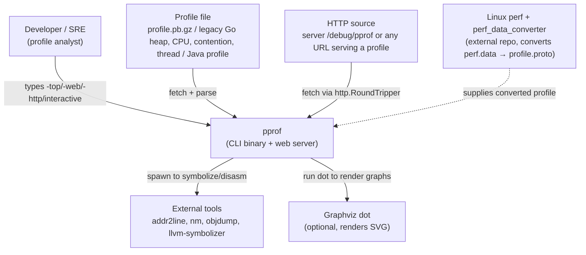
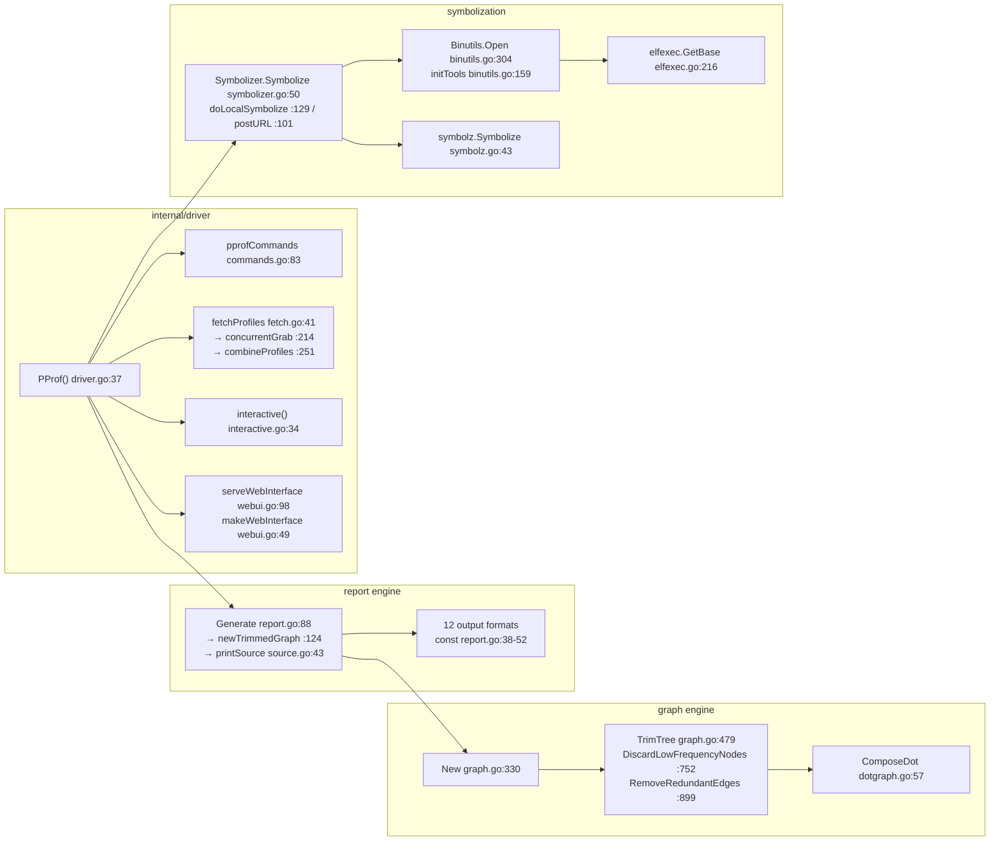

# Overview: how pprof works

## (1) What pprof is — 5 sentences

1. The repository's own definition: "pprof is a tool for visualization and
   analysis of profiling data." (README.md:10, verbatim).
2. It reads "a collection of profiling samples in profile.proto format"
   and "generates reports to visualize and help analyze the data", both
   "text and graphical reports" via dot (README.md:12-14, verbatim).
3. profile.proto is "a protocol buffer that describes a set of callstacks
   and symbolization information"; the most common representation is
   "sampled callstacks from statistical profiling" (README.md:16-18,
   verbatim). The format spec lives at proto/profile.proto, "represented
   as a gzip-compressed protocol buffer" (proto/README.md:5-8).
4. Inputs are flexible: "Profiles can be read from a local file, or over
   http. Multiple profiles of the same type can be aggregated or
   compared." (README.md:22-23, verbatim). Samples containing machine
   addresses are symbolized "through the use of the native binutils tools
   (addr2line and nm)" (README.md:25-26).
5. pprof is a single Go binary (entry `main()` at pprof.go:29) with three
   modes: batch report (`pprof -top …`), an interactive shell, and an
   interactive web server (`-http`) with a graphical web UI / flame graph
   (README.md:56, 76-79, 91 — verbatim command examples).

## (2) Grasp in 5 minutes — 10 bullets

1. **Install & run immediately**: `go install github.com/google/pprof@latest`
   — the binary lands in `$GOPATH/bin` (README.md:43-45).
2. **Fastest text report**: `pprof -top [main_binary] profile.pb.gz` —
   hottest functions; `-web` produces an SVG you open in a browser
   (README.md:56, 66).
3. **No format flag → interactive shell**: "Type 'help' for available
   commands/options." (README.md:76-79). The text commands
   (comments/disasm/dot/list/peek/raw/tags/text/top/traces/tree plus
   file-writing variants callgrind/proto/topproto) are registered
   centrally in `pprofCommands` (internal/driver/commands.go:83-100,
   verbatim command table).
4. **Web UI**: `-http=[host]:[port]` starts the interactive server,
   default host localhost, random port (README.md:84-91); the server is
   built in `serveWebInterface` (internal/driver/webui.go:98).
5. **Legacy formats still readable**: parsers for Go CPU (`parseCPU`,
   legacy_profile.go:304), heap (`parseHeap` :468), contention
   (`parseContention` :683), thread (`parseThread` :840) and Java
   profiles (`parseJavaProfile`, legacy_java_profile.go:68) — all convert
   into the modern Profile model.
6. **Linux perf input too**: "pprof can read `perf.data` files … by using
   the `perf_to_profile` program from the perf_data_converter package"
   (README.md:100-103) — the converter is an external repo, not part of
   pprof.
7. **Symbolization depends on external tools**: addr2line / nm / objdump /
   llvm-symbolizer (README.md:25-26, 107-109).
8. **Reusable library API**: the `driver` package provides
   `PProf(o *Options) error` plus the plugin-agnostic interface set
   (Options/Writer/FlagSet/Fetcher/Symbolizer/ObjTool/UI) so external
   callers never import internal packages (driver/driver.go:33, 69, 82,
   88, 121, 126, 138, 207).
9. **The data foundation is the `profile` package**:
   `Parse`/`ParseData`/`Write`/`CheckValid`/`Aggregate`/`Copy` around the
   `Profile` struct (profile/profile.go:35, 172, 182, 345, 364, 445, 867)
   — 8,627 LOC, the central library of the repo (see `02-module-map.md`).
10. **Detailed documentation**: doc/README.md (26 KB) with Usage modes /
    Details / Fetching profiles / Symbolization / Web Interface sections
    (doc/README.md:36, 65, 329, 367, 412); the proto format has its own
    proto/README.md (README.md:115).

## (3) System context (C4 L1)



Evidence: "a local file, or over http" (README.md:22-23); symbolization
via binutils (README.md:25-26); Graphviz is "Optional, used to generate
graphic visualizations" (README.md:38-39); perf via the external
converter (README.md:100-103); fetch splits local/remote sources in
`grabProfile` (internal/driver/fetch.go:332) and merges multiple profiles
in `combineProfiles` (internal/driver/fetch.go:251).

## (4) Containers (C4 L2)

```mermaid
graph TB
    main["main binary<br/>pprof.go (109 LOC, package main)"]
    pubapi["driver (public API)<br/>driver/driver.go 300 LOC"]
    orchestrator["internal/driver<br/>8,056 LOC — orchestrator"]
    fetch["fetch subsystem<br/>fetch.go 633 LOC"]
    interactive["interactive shell<br/>interactive.go 422 LOC + readlineUI (pprof.go:41-103)"]
    webui["web UI<br/>webui.go 480 + webhtml.go 85 + svg.go 80 + third_party/svgpan"]
    report["internal/report<br/>4,467 LOC — 12-format report generation"]
    graph["internal/graph<br/>2,628 LOC — call graph"]
    profile["profile<br/>8,627 LOC — profile.proto decode/encode/aggregate"]
    sym["symbolization stack<br/>binutils 2,750 + elfexec 887 + symbolizer 856 + symbolz 366 + transport 181"]
    plugin["internal/plugin<br/>219 LOC — interface contract"]
    main --> pubapi --> orchestrator
    orchestrator --> fetch
    orchestrator --> interactive
    orchestrator --> webui
    orchestrator --> report
    orchestrator --> sym
    report --> graph
    report --> profile
    sym --> plugin
```

Call-chain evidence: `main()` (pprof.go:29) →
`driver.PProf(&driver.Options{UI: newUI()})` (pprof.go:30) →
`internalOptions()` (driver/driver.go:37) → `PProf(eo *plugin.Options)`
(internal/driver/driver.go:37). Container LOC from the module map
(`02-module-map.md`; total 86 files / 30,683 lines matches the census).
`readlineUI` is deliberately kept in pprof.go so that the "vendored copy
of pprof in the Go distribution" does not pull the readline dependency
(pprof.go:39, verbatim).

## (5) Component highlights (C4 L3)



All line anchors were measured directly on the pinned clone (`sed -n` per
line). Edge directions were cross-checked against the real imports:
`internal/report` imports only graph/measurement/plugin/profile
(internal/report/report.go:31-34) — symbolization is orchestrated by
internal/driver before `Generate` receives the profile ("PProf acquires a
profile, and symbolizes it using a profile…" — internal/driver/driver.go:34).
A pointer correction vs. the raw measurement log: `initTools` is declared
at **binutils.go:159** (line 150 is the loop body inside it;
internal/binutils/binutils.go:159, verbatim `func initTools(b *binrep,
config string) {`).

## (6) Directory map + zone roles

Nine top-level zones (LOC assigned per the module map):

| Zone | Contents | Role | LOC |
|---|---|---|---|
| `profile/` | 16 .go files + testdata | Central library: parse/encode/aggregate/legacy | 8,627 |
| `internal/driver/` | 24 files | Orchestrator: flags, fetch, interactive, web UI | 8,056 |
| `internal/report/` | 13 files + testdata | 12-format report generation, annotated source | 4,467 |
| `internal/binutils/` | 7 files + testdata(94) | ObjTool plugin: nm/addr2line/llvm-symbolizer/objdump | 2,750 (+94 testdata) |
| `internal/graph/` | 4 files | Call-graph building/trimming, DOT export | 2,628 |
| `internal/elfexec/` | 2 files | ELF: base address, build-id, program headers | 887 |
| `internal/symbolizer/` | 2 files | Symbolize orchestration: local (binutils) + HTTP symbolz | 856 |
| `internal/measurement/` | 2 files | Scale/format sample values, percentages | 416 |
| `browsertests/` | 2 files (separate Go module) | Web-UI integration tests with Chrome (chromedp) | 416 |
| `internal/symbolz/` | 2 files | Symbolize via symbolz service | 366 |
| `driver/` | 1 file | Public API + re-declared plugin interfaces | 300 |
| `internal/proftest/` | 2 files | Shared test helpers (Diff, TestUI, large profile) | 229 |
| `internal/plugin/` | 1 file | Interface contract between driver and implementations | 219 |
| `internal/transport/` | 2 files | http.RoundTripper TLS (client cert/key/CA) | 181 |
| root (`pprof.go` + `third_party/svgpan/`) | 1 + 1 files | Binary main + readlineUI; JS pan/zoom embedded into SVG | 120 |
| `fuzz/` | 2 files | go-fuzz harness for the parser | 71 |
| `.github/workflows`, `doc/`, `proto/` | not .go | CI (ci.yaml), user docs, profile.proto spec | — |

Total: 86 files / 30,683 lines (per-extension census re-measured at the
pin, exactly matching `01-cartography.md`).

## (7) Build & test evidence on the pin

Command per the standard: `go build ./... && go test ./...`. The sandbox
(bitnami/git image) has no Go toolchain, so the official Go
`go1.27.3 linux/amd64` tarball was installed first (satisfies
`go 1.26.0` in go.mod line 3), then run for real:

```
$ export PATH=/usr/local/go/bin:$PATH && cd /workspace/pprof
$ go build ./...
go: downloading github.com/ianlancetaylor/demangle v0.0.0-20250417193237-f615e6bd150b
go: downloading github.com/chzyer/readline v1.5.1
(real time 0m59.743s) → BUILD_OK, exit 0

$ go test ./...   # run 1 — missing system tools
FAIL github.com/google/pprof/internal/binutils   (TestObjFile: "exec: no command" — no nm/addr2line)
FAIL github.com/google/pprof/internal/report     (TestPrintAssemblyErrorMessage, TestWebList — no objdump)
ok: fuzz, internal/driver, internal/elfexec, internal/graph, internal/measurement,
    internal/proftest, internal/symbolizer, internal/symbolz, internal/transport, profile
→ 10/12 packages with tests pass

$ tdnf install -y binutils   # nm, objdump, addr2line 2.46.1
$ go test ./...   # run 2 — internal/report OK; binutils still has TestObjFile
    binutils_test.go:399: SourceLine for main: got [{main /tmp/hello.c 3 0 0}]; want [{main /tmp/hello.c 3 0 3}]
    (GNU addr2line 2.46.1 does not return the column — tool difference, not a code bug)

$ tdnf install -y llvm   # llvm-symbolizer 22.1.0
$ go test ./...   # run 3 — FINAL
?   	github.com/google/pprof	[no test files]
?   	github.com/google/pprof/driver	[no test files]
ok  	github.com/google/pprof/fuzz	(cached)
ok  	github.com/google/pprof/internal/binutils	2.443s
ok  	github.com/google/pprof/internal/driver	(cached)
ok  	github.com/google/pprof/internal/elfexec	(cached)
ok  	github.com/google/pprof/internal/graph	(cached)
ok  	github.com/google/pprof/internal/measurement	(cached)
?   	github.com/google/pprof/internal/plugin	[no test files]
ok  	github.com/google/pprof/internal/proftest	(cached)
ok  	github.com/google/pprof/internal/report	(cached)
ok  	github.com/google/pprof/internal/symbolizer	(cached)
ok  	github.com/google/pprof/internal/symbolz	(cached)
ok  	github.com/google/pprof/internal/transport	(cached)
ok  	github.com/google/pprof/profile	(cached)
?   	github.com/google/pprof/third_party/svgpan	[no test files]
→ exit 0: 12/12 packages with tests pass, 4 packages [no test files]
```

Upstream's standard CI (for comparison): the `ci` workflow runs on push
to main / PRs plus a daily schedule (.github/workflows/ci.yaml:1-8) with
the Go matrix `['1.26', '1.27']` (ci.yaml:25). The repository carries
**155 test functions** (`grep -r '^func Test' --include='*_test.go' |
wc -l`). Harness note: `browsertests/` is a separate Go module
(module github.com/google/pprof/browsertests — browsertests/go.mod:1,
`replace github.com/google/pprof => ../` :6) and therefore is **not**
covered by the root module's `go test ./...`; it needs a real Chrome plus
chromedp and self-skips without Chrome (browsertests/browser_test.go:32).

## (8) Expensive extension points

1. **The 6-interface plugin contract**: `internal/plugin.Options` gathers
   Writer/FlagSet/Fetcher/Symbolizer/ObjTool/UI (plugin.go:28/50/56/92/
   97/109/179) — swapping it replaces all of pprof's I/O
   (internal/plugin/plugin.go:28).
2. **Public API mirror**: `driver/driver.go` re-declares the same
   interface set so pprof can be embedded in another program without
   importing internal packages (driver.go:69/82/88/121/126/138/207) —
   browsertests is the sample consumer via `makeTestServer`
   (testutils.go:17).
3. **12 output formats** are just constants selecting a handler in
   `Generate` (report.go:38-52 + :88) — adding a format means adding one
   const + one case.
4. **Custom graphing**: `graph.New`/`TrimTree`/`ComposeDot` (graph.go:330/
   479, dotgraph.go:57) cleanly separate graph construction from drawing —
   reusable for any graph-style analysis.
5. **Multi-source symbolizer**: local binutils (`doLocalSymbolize` :129)
   vs. HTTP symbolz (`postURL` :101, `symbolz.Symbolize` symbolz.go:43) —
   chosen per environment; external demangling through
   ianlancetaylor/demangle (`Demangle` symbolizer.go:249).
6. **A crisp fuzz surface**: the whole parser is exposed as
   `profile.ParseData` to go-fuzz (`Fuzz(data []byte) int` →
   `profile.ParseData(data)` — fuzz/main.go:24).
7. API-stability caveat: the `internal/*` packages carry no compatibility
   promise — only `driver` and `profile` are importable surfaces from
   outside the module.

## (9) Risks when reusing

1. **internal/* is a hard boundary**: all heavy logic lives under
   `internal/` — Go forbids importing it from other modules; only
   `driver` (300 LOC) and `profile` (8,627 LOC) are valid entry points;
   deeper changes require a fork.
2. **System tool dependency**: without addr2line/nm/objdump/
   llvm-symbolizer you lose symbols and disassembly — proven
   experimentally: `go test` failed in binutils/report when the sandbox
   lacked the tools (section 7 above); non-Windows needs POSIX tools,
   Windows needs LLVM/GCC (README.md:107-109).
3. **New Go versions**: go.mod requires `go 1.26.0` (go.mod:3); the CI
   matrix is 1.26+1.27 (ci.yaml:25) — forks must track upstream's Go
   version bumps.
4. **Fast-moving main trunk**: the pin `dbd0ed30…` (2026-10-26) is a
   snapshot; README/APIs of internal packages can change at any time
   (re-verify `git ls-remote` before any re-sync — see
   `tracking/pprof.md` for the process).
5. **browsertests cannot run in headless CI**: the separate module needs
   Chrome (browser_test.go:32 self-skips) — easy to miss when reusing the
   test layer.
6. **The readline binding lives in the main binary**: pprof.go:39 explains
   why readlineUI is kept separate so the vendored Go-distribution copy
   does not pull readline — forks embedding into the Go tree must keep
   this structure.
7. **"This is not an official Google product."** (README.md:28) + Apache-2.0
   license — commercially usable but with no SLA/support.
8. **The web UI embeds built assets**: webhtml.go (85 lines) + svg.go:21
   embed the svgpan JS via go:embed — UI changes require rebuilding the
   embedded assets, they cannot be patched at runtime.

## (10) Provenance

- **Measured SHA of main**: `dbd0ed30aa888a30e21ba83b9831ac0e80d41022` —
  `git log -1`: "dbd0ed30aa888a30e21ba83b9831ac0e80d41022 2026-10-26
  19:23:09 +0000 Record the selected sample type as default_sample_type
  in -proto output. (#1055)"; `rev-list --count` = 100 (bounded by the
  shallow window of ≤100 commits — see `01-cartography.md`). Identical to
  the pin of every other document in this set — all numbers come from the
  same commit tree.
- **Actual license in the repo**: `LICENSE` exists; lines 2-3 read
  "Apache License / Version 2.0, January 2004" (verbatim; line 1 empty).
- **Manifest**: `module github.com/google/pprof`, `go 1.26.0`, direct deps
  `chzyer/readline v1.5.1` + `ianlancetaylor/demangle
  v0.0.0-20250417193237-f615e6bd150b`, indirect `golang.org/x/sys
  v0.32.0` (go.mod:1-10 — matches `01-cartography.md` verbatim).
- **Census re-checked at the pin**: 86 .go files / 30,683 lines
  (per-extension formula) — matches `01-cartography.md` and the module
  map invariants exactly.
