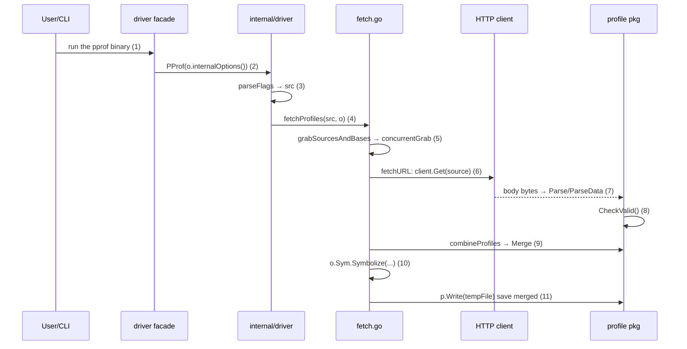
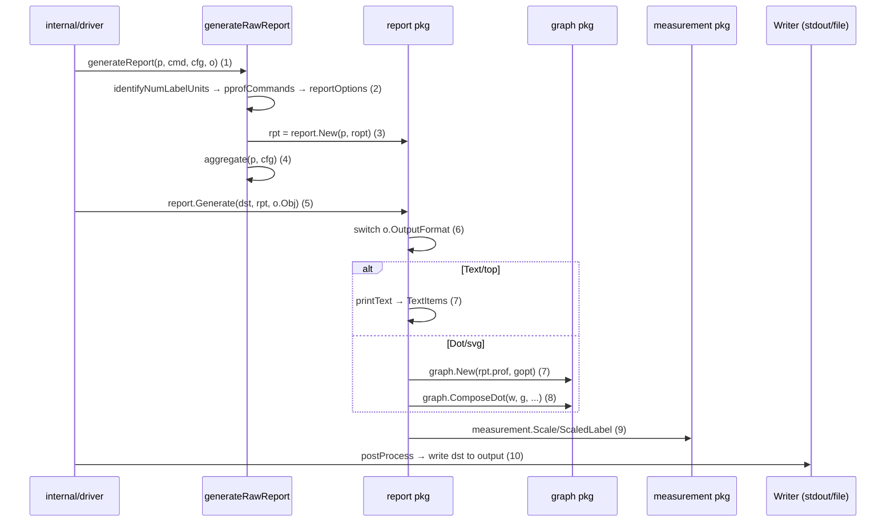
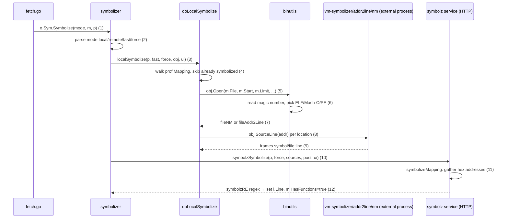

# Flows — the three most churn-heavy data flows

> **Disclosure:** churn is measured over a **shallow window of the ≤100
> most recent commits** (`--depth 100`, `rev-list --count HEAD` = 100) —
> it is the number of times a file was touched within this window, not
> full history.

## Churn per file (top of the window)

```
$ git log --format= --name-only | sort | uniq -c | sort -rn | head -20
     55 .github/workflows/ci.yaml
      9 browsertests/go.mod
      8 go.mod
      7 internal/report/report.go
      6 internal/driver/driver_test.go
      6 internal/binutils/binutils_test.go
      5 profile/profile.go
      5 internal/symbolizer/symbolizer.go
      5 internal/report/source.go
      5 internal/report/report_test.go
      5 internal/driver/fetch.go
      4 test.sh
      4 profile/profile_test.go
      4 internal/measurement/measurement.go
      4 internal/graph/graph.go
      4 internal/elfexec/elfexec_test.go
      4 internal/driver/webui.go
      4 internal/binutils/binutils.go
      4 browsertests/browser_test.go
      3 profile/merge.go
```

255 files were touched in the window in total
(`git log --format= --name-only | sort -u | wc -l`). The hottest non-test
file is `internal/report/report.go` (7), followed by `profile/profile.go`,
`internal/symbolizer/symbolizer.go`, `internal/report/source.go`,
`internal/driver/fetch.go` (5 each).

## Churn per module (touch events, path → item)

```
    128 internal/driver      → m02
     59 profile              → m01
     58 .github              (outside the universe)
     38 internal/report      → m03
     31 internal/binutils    → m04
     20 browsertests         → m08
     16 internal/graph       → m05
     10 doc                  (outside the universe)
      9 fuzz                 → m17
      8 internal/symbolizer  → m07
      8 go.mod               (manifest — outside the modules)
      7 internal/proftest    → m12
      7 internal/elfexec     → m06
      6 internal/measurement → m09
      4 third_party/svgpan   → m15
      4 test.sh / 4 proto    (outside the universe)
      3 internal/transport   → m14
      3 internal/symbolz     → m10
      3 internal/plugin      → m13
      3 driver               → m11
      1 pprof.go             → m15
```

Σ churn inside the universe (m01..m17): **346** touch events; outside:
**95** (58+10+8+4+4+4+2+2+2+1×4 — the components add up to the window
total).

## Import fan (from the module map, 33 edges)

| id | module | fan-in | fan-out | Σ fan | churn | loc |
|---|---|---|---|---|---|---|
| m01 | profile | 0 | 10 | 10 | 59 | 8,627 |
| m02 | internal/driver | 9 | 1 | 10 | 128 | 8,056 |
| m03 | report | 4 | 1 | 5 | 38 | 4,467 |
| m04 | binutils | 2 | 2 | 4 | 31 | 2,750 |
| m05 | graph | 2 | 2 | 4 | 16 | 2,628 |
| m06 | elfexec | 0 | 1 | 1 | 7 | 887 |
| m07 | symbolizer | 4 | 1 | 5 | 8 | 856 |
| m08 | browsertests | 2 | 0 | 2 | 20 | 416 |
| m09 | measurement | 1 | 3 | 4 | 6 | 416 |
| m10 | symbolz | 2 | 1 | 3 | 3 | 366 |
| m11 | driver | 3 | 2 | 5 | 3 | 300 |
| m12 | proftest | 0 | 0 | 0 | 7 | 229 |
| m13 | plugin | 1 | 7 | 8 | 3 | 219 |
| m14 | transport | 1 | 1 | 2 | 3 | 181 |
| m15 | pprof (root) | 1 | 1 | 2 | 5 | 120 |
| m16 | binutils/testdata | 0 | 0 | 0 | 0 | 94 |
| m17 | fuzz | 1 | 0 | 1 | 9 | 71 |

## Scoring the candidate flows

Declared formula (the task did not prescribe one; the convention follows
the previous subjects): `Score = Σ(fan-in + fan-out of the modules the
flow passes through) + Σ(churn of those modules)`.

| Rank | Flow | Modules (ids) | Σ fan | Σ churn | **Score** |
|---|---|---|---|---|---|
| **1** | **A — Profile ingest: fetch → parse → merge** | m15, m11, m02, m14, m01, m13 | 2+5+10+2+10+8 = 37 | 5+3+128+3+59+3 = 201 | **238** |
| **2** | **C — Report render: generate → graph → output** | m02, m09, m05, m03, m13 | 10+4+4+5+8 = 31 | 128+6+16+38+3 = 191 | **222** |
| **3** | **B — Symbolization: local binutils + remote symbolz** | m02, m13, m07, m04, m10, m06 | 10+8+5+4+3+1 = 31 | 128+3+8+31+3+7 = 180 | **211** |
| 4 | D — Web UI serve | m02, m15, m03, m05 | 10+2+5+4 = 21 | 128+5+38+16 = 187 | 208 |
| 5 | E — Interactive shell loop | m15, m11, m02 | 2+5+10 = 17 | 5+3+128 = 136 | 153 |

**TOP-3 = A (238) > C (222) > B (211).** Ranking note: D misses B by only
3 points (208 vs 211) because the Web UI reuses the exact render pipeline
of C (webui.go:275 calls `generateRawReport`, webui.go:440 calls
`report.Generate` — traced in flow C below); E is just the readline
dispatch loop, and its data-path body coincides with A+C
(interactive.go:34 receives the already-fetched/symbolized profile). By
the numbers: A wins because it crosses both heaviest modules in the repo
(m02 churn 128 + m01 churn 59; Σ loc m02+m01 = 16,683/30,683 = 54.4% of
the repository), and it is the mandatory data path of EVERY pprof command
(no profile in memory → no output at all).

## FLOW A — Profile ingest: fetch → parse → merge (score 238, rank 1)

**Why it is expensive (numbers):** it crosses m02 (churn 128 — the
highest in the repo, 2.2× m01) and m01 (churn 59; 8,627 LOC — the largest
module). 2 of the top-5 hottest non-test files lie on this path:
`internal/driver/fetch.go` (5 touches) and `profile/profile.go` (5
touches). The flow contains the only two external I/O entry points of the
whole system (HTTP GET of a profile + file reads), and it runs once per
source in EVERY command (CLI, web and interactive all call
`fetchProfiles` — internal/driver/driver.go:48/58/60). Σ loc of the
module set = 17,503/30,683 = 57.0% of the repository.



### Step → file:line map (traced by reading the code on the pin)

| # | Step | File:Line | Evidence (verbatim sed/grep) |
|---|---|---|---|
| 1 | Binary entry point | pprof.go:29 | `sed -n '25,35p' pprof.go` → `func main() {` / `if err := driver.PProf(&driver.Options{UI: newUI()}); err != nil {` (pprof.go:29-30) |
| 2 | Facade delegation | driver/driver.go:33-34 | `sed -n '30,45p'` → `func PProf(o *Options) error {` + `return internaldriver.PProf(o.internalOptions())` |
| 3 | Parse flags → src | internal/driver/driver.go:37,43 | `sed -n '35,50p'` → `func PProf(eo *plugin.Options) error {`; `grep -n` → `43: src, cmd, err := parseFlags(o)` |
| 4 | Call fetch | internal/driver/driver.go:48 → fetch.go:41 | `48: p, err := fetchProfiles(src, o)`; `grep -n '^func ' fetch.go` → `41:func fetchProfiles(s *source, o *plugin.Options) (*profile.Profile, error) {` |
| 5 | Gather sources (parallel) | fetch.go:58,136,214 | `58: p, pbase, m, mbase, save, err := grabSourcesAndBases(...)`; `136:func grabSourcesAndBases(...)`; `214:func concurrentGrab(...)` |
| 6 | Download profile (HTTP/file) | fetch.go:332,343,503,532 | `332:func grabProfile(...)`; `343: p, src, err = fetch(source, duration, timeout, ui, tr)`; `503:func fetch(...)`; `532:func fetchURL(...)` → `client := &http.Client{ Transport: tr, ... }` + `resp, err := client.Get(source)` |
| 6b | TLS transport (m14) | internal/transport/transport.go:49,102 | `49:func New(flagset plugin.FlagSet) http.RoundTripper {`; `102:func (tr *transport) RoundTrip(req *http.Request) (*http.Response, error) {` |
| 7 | Decode profile (m01) | profile/profile.go:172,182,185,237 | `172:func Parse(r io.Reader) (*Profile, error) {`; `182:func ParseData(data []byte) (*Profile, error) {`; `185: if len(data) >= 2 && data[0] == 0x1f && data[1] == 0x8b {` (gzip sniff); `237:func ParseUncompressed(data []byte) (*Profile, error) {`; legacy fallback: `if p, err = ParseUncompressed(data); err != nil ... { p, err = parseLegacy(data) }` (profile.go:194-195) |
| 8 | Validate | fetch.go:349 → profile.go:364 | `349: if err = p.CheckValid(); err != nil {`; `364:func (p *Profile) CheckValid() error {` |
| 8b | Locate binaries + symbol sources | fetch.go:354,358 | `354: locateBinaries(p, s, obj, ui)`; `358: msrc = collectMappingSources(p, src)` |
| 9 | Merge multiple sources | fetch.go:244,251 → profile/merge.go:44 | `244: p, msrc, err := combineProfiles(profiles, msrcs)`; `251:func combineProfiles(...)`; `44:func Merge(srcs []*Profile) (*Profile, error) {`; diff-base branch: fetch.go:73-74 `pbase.Scale(-1)` + `74: p, m, err = combineProfiles([]*profile.Profile{p, pbase}, ...)` |
| 10 | Bridge to symbolization | fetch.go:86 | `86: if err := o.Sym.Symbolize(s.Symbolize, m, p); err != nil {` — the trigger of FLOW B below |
| 11 | Save state (merged) | fetch.go:113 → profile.go:345 | `113: writeErr := p.Write(tempFile)` (only when a remote source is present — `if save`); `345:func (p *Profile) Write(w io.Writer) error {` |

## FLOW C — Report render: generate → graph → output (score 222, rank 2)

**Why it is expensive (numbers):** it crosses m03 (churn 38; the file
`internal/report/report.go` has churn **7 — the hottest non-test file in
the repo**) + m02 (128) + m05/m09. Every output format (12 cases in one
switch) goes through exactly one function, `report.Generate`
(report.go:88); the graph is rebuilt from samples at each refinement step
(`newTrimmedGraph`, report.go:124). The same pipeline serves the CLI
(driver.go:54), the Web UI (webui.go:275 + webui.go:440) and all 12
formats; Σ loc of the module set = 15,786/30,683 = 51.4% of the
repository.



### Step → file:line map

| # | Step | File:Line | Evidence |
|---|---|---|---|
| 1 | Choose the CLI path | internal/driver/driver.go:54,114 | `54: return generateReport(p, cmd, currentConfig(), o)`; `114:func generateReport(p *profile.Profile, cmd []string, cfg config, o *plugin.Options) error {` → `115: c, rpt, err := generateRawReport(p, cmd, cfg, o)`. Web-UI variant: driver.go:58 `serveWebInterface(...)` → webui.go:275 `_, rpt, err := generateRawReport(...)` + webui.go:440 `report.Generate(out, rpt, ui.options.Obj)` |
| 2 | Prepare options | driver.go:66,69,74,78,87 | `66: numLabelUnits := identifyNumLabelUnits(p, o.UI)`; `69: c := pprofCommands[cmd[0]]`; `74: cfg = applyCommandOverrides(cmd[0], c.format, cfg)`; `78: generateTagRootsLeaves(p, cfg, o.UI)`; `87: ropt, err := reportOptions(p, numLabelUnits, cfg)` |
| 3 | Create the Report | driver.go:100 → report.go:1291 | `100: rpt := report.New(p, ropt)`; `1291:func New(prof *profile.Profile, o *Options) *Report {` |
| 4 | Aggregate | driver.go:106 | `106: if err := aggregate(p, cfg); err != nil {` |
| 5 | Call Generate | driver.go:121,127 → report.go:88 | `121: dst := new(bytes.Buffer)`; `127: err = report.Generate(dst, rpt, o.Obj)`; `88:func Generate(w io.Writer, rpt *Report, obj plugin.ObjTool) error {` |
| 6 | The 12-format switch | report.go:91-117 | `switch o.OutputFormat {` with `case Comments/Dot/Tree/Text/Traces/Raw/Tags/Proto/TopProto/Dis/List/Callgrind` (report.go:92-116), `// Note: WebList handling is in driver package.` (report.go:118) |
| 7a | Text branch (top) | report.go:851-852 | `851:func printText(w io.Writer, rpt *Report) error {` → `852: items, labels := TextItems(rpt)` |
| 7b | Dot branch (svg) | report.go:1171,1173 | `1171:func printDOT(w io.Writer, rpt *Report) error {` → `1173: graph.ComposeDot(w, g, &graph.DotAttributes{}, c)` |
| 7c | Build the trimmed graph | report.go:124,293 → graph.go:330 | `124:func (rpt *Report) newTrimmedGraph() (g *graph.Graph, ...)`; `293: return graph.New(rpt.prof, gopt)`; `330:func New(prof *profile.Profile, o *Options) *Graph {` (internal/graph/graph.go) |
| 9 | Scale/format values (m09) | report.go:216,274 | `216: _, minUnit := measurement.Scale(minValue, o.SampleUnit, "minimum")`; `274: return measurement.ScaledLabel(v, key, o.OutputUnit)` |
| 10 | Post-process + write | driver.go:135 | `135: if c.postProcess != nil {` (preceded by the comment `// If necessary, perform any data post-processing.` at driver.go:134) |

## FLOW B — Symbolization: local binutils + remote symbolz (score 211, rank 3)

**Why it is expensive (numbers):** it crosses m04 binutils (churn 31,
2,750 LOC) + m07 symbolizer (churn 8; `internal/symbolizer/symbolizer.go`
churn 5) + m10/m06. This is intrinsically the **slowest path of the
system**: it spawns external processes (llvm-symbolizer/addr2line/nm/
objdump through `Binutils`) and issues HTTP POSTs to a symbolz endpoint —
and it sits UNDER every command because it is invoked inside
`fetchProfiles` (fetch.go:86). Σ loc of the module set = 13,134/30,683 =
42.8% of the repository.



### Step → file:line map

| # | Step | File:Line | Evidence |
|---|---|---|---|
| 1 | Trigger from fetch | internal/driver/fetch.go:86 | `86: if err := o.Sym.Symbolize(s.Symbolize, m, p); err != nil {` |
| 2 | Entry + mode parsing | internal/symbolizer/symbolizer.go:50 | `50:func (s *Symbolizer) Symbolize(mode string, sources plugin.MappingSources, p *profile.Profile) error {` → loop `for _, o := range strings.Split(strings.ToLower(mode), ":")` with cases `none/local/fastlocal/remote/force` |
| 3 | Call local + remote + demangle | symbolizer.go:83,91,96 | `83: if err = localSymbolize(p, fast, force, s.Obj, s.UI); err != nil {`; `91: if err = symbolzSymbolize(p, force, sources, post, s.UI); err != nil {`; `96: demangleFunction(p, force, demanglerMode)` |
| 4 | Walk mappings | symbolizer.go:129,152,159 | `129:func doLocalSymbolize(prof *profile.Profile, fast, force bool, obj plugin.ObjTool, ui plugin.UI) error {`; `152: for midx, m := range prof.Mapping {`; `159: if !force && (m.HasFunctions || m.HasFilenames || m.HasLineNumbers) { continue }` |
| 5 | Open the binary | symbolizer.go:185 → binutils.go:304 | `185: f, err := obj.Open(m.File, m.Start, m.Limit, m.Offset, m.KernelRelocationSymbol)`; `304:func (bu *Binutils) Open(name string, start, limit, offset uint64, relocationSymbol string) (plugin.ObjFile, error) {` |
| 6 | Magic-number sniff | binutils.go:325-330 | `// Read the first 4 bytes of the file.` → `var header [4]byte; if _, err = io.ReadFull(f, header[:]); ...` |
| 7 | Pick the implementation | binutils.go:393,395,691,714 | `393: return &fileNM{file: file{b: b, name: name, base: base}}, nil` / `395: return &fileAddr2Line{...}, nil`; `691:type fileNM struct {` (grouped by `nm`); `714:type fileAddr2Line struct {` (llvm-symbolizer/addr2line) |
| 8 | Query symbols per address | symbolizer.go:209 → binutils.go:696,722 | `209: stack, err := obj.SourceLine(l.Address)`; `696:func (f *fileNM) SourceLine(addr uint64) ([]plugin.Frame, error) {`; `722:func (f *fileAddr2Line) SourceLine(addr uint64) ([]plugin.Frame, error) {` |
| 9 | Frames back into the profile | symbolizer.go:136-145 | `addFunction := func(f *profile.Function) *profile.Function { ... f.ID = uint64(len(prof.Function)) + 1; prof.Function = append(prof.Function, f) }` (dedup + ID assignment) |
| 10 | Remote symbolz | symbolizer.go:88,101 → symbolz.go:43 | `88: post := func(source, post string) ([]byte, error) {`; `101:func postURL(source, post string, tr http.RoundTripper) ([]byte, error) {` → `client.Post(source, "application/octet-stream", strings.NewReader(post))`; `43:func Symbolize(p *profile.Profile, force bool, sources plugin.MappingSources, syms func(string, string) ([]byte, error), ui plugin.UI) error {` |
| 11 | Gather addresses + query | symbolz.go:104,126 | `104:func symbolizeMapping(source string, offset int64, syms func(string, string) ([]byte, error), m *profile.Mapping, p *profile.Profile) error {`; `126: b, err := syms(source, strings.Join(a, "+"))` (the hex query, joined by `+`) |
| 12 | Assign results to the profile | symbolz.go:142,174,58,86,93 | `142: if symbol := symbolzRE.FindStringSubmatch(l); len(symbol) == 3 {`; `174: l.Line = []profile.Line{line}`; `58: m.HasFunctions = true` (inside `Symbolize`, after `symbolizeMapping` succeeds); endpoint selection: `symbolz(source)` (symbolz.go:86) → `url.Path = path.Clean(url.Path + "/../symbolz")` (symbolz.go:93) |

## Ranked out (no diagram)

- **FLOW D — Web UI serve (208)**: reuses the render pipeline of flow C —
  webui.go:275 calls `generateRawReport` and webui.go:440 calls
  `report.Generate`; its own churn sits in webui.go/webhtml.go (m02).
- **FLOW E — Interactive shell loop (153)**: interactive.go:34 is the
  readline dispatch loop; the heavy data path beneath it coincides with
  A (fetch) and C (render), so its score double-counts nothing new.

## Limitations

1. Every file:line above is the verbatim result of `grep -n` / `sed -n
   'X,Yp'` commands run on the pinned clone
   (`dbd0ed30aa888a30e21ba83b9831ac0e80d41022`) — sequences were not
   inferred from documentation; step order is confirmed by call-site grep
   (e.g. symbolization sits inside fetchProfiles, before report
   generation — fetch.go:86 precedes generateReport).
2. The churn window is the **≤100 most recent commits** (shallow
   `--depth 100`); the `.github/workflows/ci.yaml` line (55) is
   infrastructure churn outside the module universe and was excluded from
   scores.
3. Line numbers are valid at the pin; as upstream advances they will
   drift (see `tracking/pprof.md` for the re-sync rule).
4. Fan-in/out numbers are taken verbatim from the module map (33 balanced
   edges); this document does not re-count dependencies.
