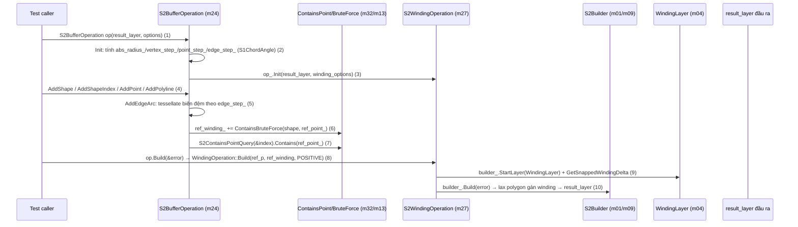

# Flows

## 1. CÁCH TÍNH — chọn TOP-3 bằng số

### 1a. Churn per-file — công thức brief dán nguyên văn

```
$ git log --format= --name-only | sort | uniq -c | sort -rn | head -20
     33 .github/workflows/build.yml
     32 src/MODULE.bazel
     14 src/python/BUILD.bazel
     12 src/python/README.md
     12 CMakeLists.txt
     10 src/python/module.cc
      5 src/python/s2point_test.py
      5 pyproject.toml
      5 README.md
      5 .github/workflows/lint.yml
      4 src/python/s2point_bindings.cc
      4 src/python/s2latlng_test.py
      4 src/python/s2geometry_test.py
      4 src/python/s2cell_id_test.py
      4 src/python/s2cell_id_bindings.cc
      4 src/python/s1interval_test.py
      4 src/python/s1interval_bindings.cc
      4 src/python/s1angle_test.py
      3 src/s2/util/math/exactfloat/exactfloat.cc
      3 src/s2/util/math/exactfloat/BUILD.bazel
```

Tổng: **736 touch events / 522 file duy nhất** (`git log --format= --name-only | grep -vc '^$'` = 736; `| sort -u | wc -l` = 522). File non-infra churn cao nhất trong `src/s2`: `s1interval_test.cc`/`s1interval.h`/`s1angle.h` (3 mỗi file), kế tiếp 2 touches (`s2polyline.h`, `s2polygon.h`, `s2cell.cc`, `s2cap.h`, `r2rect.h`, `r1interval.h`, `s2cell_id.h`, `s2cell_test.cc`, `s2point_test.cc`, `s2point_array.h`, `s2cap_test.cc`, `s1angle_test.cc`, `r2rect_test.cc`, `r1interval_test.cc`, `s1interval.cc`). Đặc thù cửa sổ này: hoạt động gần nhất tập trung vào CI + đóng gói Python; core `src/s2` flat phần lớn 1 touch/file.

### 1b. Churn per-module (touch events, map path → item gm-02)

Luật map (khai báo, khớp định nghĩa item gm-02 mục "Định nghĩa item"): file `src/python/*` → `s2-python` (m02); `src/s2/util|base|internal|testing/*` → NOASSIGN (ngoài universe 61 item); file flat `src/s2/<name>` → họ = tên trước `_` đầu tiên, không `_` → `s2-core` (m01), `_fp_contract_off.h` → `s2-core`. Ngoại lệ khai báo theo chính checklist gm-02 (class của item test-only nằm ở s2-core): `s1interval.{h,cc}`, `s1angle.{h,cc}`, `r1interval.h`, `r2rect.{h,cc}`, `s2predicates.{h,cc}`, `s2coder.h` → `s2-core`; `s2testing.{h,cc}` → `s2-core` (m01 — basename không `_`, khớp checklist m01 files=55 và gm-05 §2.2; bản đầu gán nhầm NOASSIGN — sửa theo review vòng 1, sandbox sess-4854e0c0 đếm trên cây PIN: s2testing.h và s2testing.cc đúng 1 touch mỗi file trong cửa sổ 100 commit).

```
$ git log --format= --name-only | grep -v '^$' | awk '<luật trên>' | sort -rn
    124 OUTSIDE            (.github, CMakeLists.txt, README.md, pyproject.toml, doc/…)
    116 s2-python   (m02)
     72 NOASSIGN           (src/s2/{util,base,internal,testing}/)
     66 s2-core     (m01)
     34 s2shapeutil (m13)
     34 s2builderutil (m04)
     20 s2cell     (m03)
     18 s2edge     (m06)
     17 s2shape    (m11)
     16 s2closest  (m05)
     15 s2region   (m14)
     15 s2point    (m21)
     14 encoded    (m08)
     11 s2polyline (m18)
      9 s2lax      (m20)
      7 s2latlng   (m15)
      5 s2contains (m32)
      5 s2builder  (m09)
      4 s2loop     (m16)
      4 s2density  (m17)
      3 ×19 item: s2winding(m27), s2wedge(m48), s2text(m26), s2padded(m41), s2min(m31),
                  s2memory(m36), s2max(m29), s2hausdorff(m33), s2furthest(m25),
                  s2crossing(m28), s2convex(m35), s2chain(m34), s2buffer(m24),
                  s2boolean(m07), s1interval(m37), s1chord(m30), mutable(m12),
                  id(m43), gmock(m22)
      2 ×11 item: value(m42), thread(m55), sequence(m38), s2wrapped(m59),
                  s2validation(m19), s2predicates(m23), s2coords(m39), s2cap(m40),
                  s1angle(m46), r2rect(m47), r1interval(m50)
      1 ×13 item: s2random(m45), s2r2rect(m44), s2projections(m60), s2polygon(m10),
                  s2pointutil(m53), s2metrics(m51), s2measures(m57), s2fractal(m56),
                  s2error(m49), s2earth(m54), s2distance(m52), s2coder(m61),
                  s2centroids(m58)
```

Σ universe (61 item, gồm s2-python): **502**; ngoài universe: 124 + 72 + 38 = **234** (`src/MODULE.bazel` 32 + `src/BUILD.bazel` 6 thuộc bucket manifest, phần còn lại là OUTSIDE+NOASSIGN). Cộng khớp 736. (Vòng 1 review: 2 touch `s2testing.{h,cc}` chuyển từ NOASSIGN sang s2-core.)
Ghi chú trung thực: lần chạy awk đầu tiên gán nhầm `src/MODULE.bazel`/`src/BUILD.bazel` (basename không `_`) vào `s2-core` làm bucket này báo 102; chạy lại có lọc `src/s2/` cho **s2-core = 66** (danh sách 55 file, ví dụ `s1interval.h`×3, `s1angle.h`×3, `s2polyline.h`×2, `s2polygon.h`×2, `s2cell.cc`×2, `s2cap.h`×2, `s1interval.cc`×2, `r2rect.h`×2, `r1interval.h`×2, và 46 file 1-touch — gồm `s2testing.{h,cc}` 1-touch mỗi file; vòng 1 review: 53→55 file, 44→46 sau khi sửa gán nhầm NOASSIGN) — số 64 được dùng toàn bộ file này; 2 file manifest được tách ra ngoài universe.

### 1c. Fan-in/fan-out — từ bảng mục 3 + JSON mục 4 của gm-02 (61 object)

Bảng đầy đủ 61 item (fan = deps_in/deps_out chép nguyên từ gm-02; churn từ mục 1b; loc từ checklist):

| id | module | fan-in | fan-out | Σ fan | churn | loc |
|---|---|---|---|---|---|---|
| m01 | s2-core | 24 | 60 | 84 | 66 | 20879 |
| m02 | s2-python | 9 | 0 | 9 | 116 | 9125 |
| m03 | s2cell | 11 | 31 | 42 | 20 | 8746 |
| m04 | s2builderutil | 14 | 9 | 23 | 34 | 8213 |
| m05 | s2closest | 13 | 8 | 21 | 16 | 8084 |
| m06 | s2edge | 6 | 27 | 33 | 18 | 6608 |
| m07 | s2boolean | 13 | 6 | 19 | 3 | 5706 |
| m08 | encoded | 14 | 5 | 19 | 14 | 4693 |
| m09 | s2builder | 11 | 7 | 18 | 5 | 4555 |
| m10 | s2polygon (test) | 13 | 0 | 13 | 1 | 4414 |
| m11 | s2shape | 17 | 18 | 35 | 17 | 4185 |
| m12 | mutable | 12 | 23 | 35 | 3 | 3815 |
| m13 | s2shapeutil | 13 | 17 | 30 | 34 | 3719 |
| m14 | s2region | 7 | 5 | 12 | 15 | 3643 |
| m15 | s2latlng | 5 | 17 | 22 | 7 | 3432 |
| m16 | s2loop | 9 | 2 | 11 | 4 | 3379 |
| m17 | s2density | 10 | 0 | 10 | 4 | 3198 |
| m18 | s2polyline | 8 | 2 | 10 | 11 | 3179 |
| m19 | s2validation | 9 | 1 | 10 | 2 | 2304 |
| m20 | s2lax | 9 | 17 | 26 | 9 | 2257 |
| m21 | s2point | 7 | 22 | 29 | 15 | 2201 |
| m22 | gmock | 2 | 4 | 6 | 3 | 2006 |
| m23 | s2predicates (test) | 3 | 4 | 7 | 2 | 1977 |
| m24 | s2buffer | 18 | 1 | 19 | 3 | 1933 |
| m25 | s2furthest | 12 | 1 | 13 | 3 | 1527 |
| m26 | s2text | 4 | 32 | 36 | 3 | 1391 |
| m27 | s2winding | 13 | 1 | 14 | 3 | 1139 |
| m28 | s2crossing | 8 | 7 | 15 | 3 | 1041 |
| m29 | s2max | 12 | 2 | 14 | 3 | 909 |
| m30 | s1chord | 3 | 19 | 22 | 3 | 899 |
| m31 | s2min | 8 | 2 | 10 | 3 | 863 |
| m32 | s2contains | 9 | 12 | 21 | 5 | 827 |
| m33 | s2hausdorff | 9 | 0 | 9 | 3 | 791 |
| m34 | s2chain | 6 | 0 | 6 | 3 | 641 |
| m35 | s2convex | 7 | 1 | 8 | 3 | 578 |
| m36 | s2memory | 2 | 5 | 7 | 3 | 509 |
| m37 | s1interval (test) | 1 | 0 | 1 | 3 | 504 |
| m38 | sequence | 1 | 1 | 2 | 2 | 463 |
| m39 | s2coords | 1 | 3 | 4 | 2 | 453 |
| m40 | s2cap (test) | 1 | 0 | 1 | 2 | 448 |
| m41 | s2padded | 3 | 5 | 8 | 3 | 435 |
| m42 | value | 1 | 1 | 2 | 2 | 415 |
| m43 | id | 2 | 5 | 7 | 3 | 368 |
| m44 | s2r2rect (test) | 1 | 0 | 1 | 1 | 333 |
| m45 | s2random (test) | 1 | 0 | 1 | 1 | 319 |
| m46 | s1angle (test) | 1 | 0 | 1 | 2 | 288 |
| m47 | r2rect (test) | 1 | 0 | 1 | 2 | 251 |
| m48 | s2wedge | 2 | 2 | 4 | 3 | 235 |
| m49 | s2error (test) | 1 | 0 | 1 | 1 | 227 |
| m50 | r1interval (test) | 1 | 0 | 1 | 2 | 201 |
| m51 | s2metrics (test) | 1 | 0 | 1 | 1 | 190 |
| m52 | s2distance | 2 | 4 | 6 | 1 | 182 |
| m53 | s2pointutil (test) | 2 | 0 | 2 | 1 | 169 |
| m54 | s2earth (test) | 3 | 0 | 3 | 1 | 166 |
| m55 | thread | 1 | 2 | 3 | 2 | 162 |
| m56 | s2fractal (test) | 1 | 0 | 1 | 1 | 160 |
| m57 | s2measures (test) | 1 | 0 | 1 | 1 | 158 |
| m58 | s2centroids (test) | 1 | 0 | 1 | 1 | 108 |
| m59 | s2wrapped | 5 | 4 | 9 | 2 | 87 |
| m60 | s2projections (test) | 1 | 0 | 1 | 1 | 81 |
| m61 | s2coder | 1 | 8 | 9 | 1 | 56 |

Ghi chú dữ liệu upstream: tổng Σ fan-in = 387 ≠ Σ fan-out = 403 (chênh 16 cạnh) — deps của gm-02 được classify độc lập theo từng phía (part w1..w4) nên không cân đối 100% như pprof; node này KHÔNG đếm lại deps, dùng nguyên số gm-02 theo brief (điểm chênh lệch 16/790 ≈ 2% không đổi thứ hạng top-3).

### 1d. Chấm điểm 7 luồng ứng viên

Công thức KHAI BÁO (brief không định nghĩa — kế thừa tiền lệ chuỗi trước: pprof/kafka): `Score = Σ(fan-in + fan-out của module luồng đi qua) + Σ(churn của module đó)`. Module set = các module có file nằm trên đường dữ liệu được truy vết, xác định bằng (a) `#include` của file engine chính của luồng (map theo luật mục 1b), (b) kiểu cụ thể caller test truyền vào. Churn = touch events mục 1b.

| Hạng | Luồng | Module đi qua (id) | Σ fan | Σ churn | **Score** |
|---|---|---|---|---|---|
| **1** | **D — S2Builder::Build: snap pipeline → Graph → Layers** | m01,m03,m04,m05,m06,m09,m12,m13,m18,m21,m26,m28,m30,m43 (14) | 405 | 234 | **639** |
| **2** | **G — S2BufferOperation: buffer/offset → winding → builder** | m01,m04,m06,m09,m11,m13,m20,m21,m23,m24,m27,m30,m32,m36 (14) | 368 | 217 | **585** |
| **3** | **A — S2BooleanOperation: crossings → EdgeClippingLayer → builder** | m01,m03,m04,m06,m09,m11,m13,m28,m32,m36,m42,m43 (12) | 317 | 210 | **527** |
| 4 | C — MutableS2ShapeIndex build (cluster cell thích nghi) | m01,m03,m06,m08,m11,m12,m13,m36,m39,m41 (10) | 297 | 180 | 477 |
| 5 | B — S2ClosestEdgeQuery (priority-queue traversal) | m01,m03,m05,m11,m13,m14,m30,m31,m52 (9) | 262 | 175 | 437 |
| 6 | F — pybind11 binding path (module.cc → bindings → API) | m01,m02,m15 (3) | 115 | 189 | 304 |
| 7 | E — S2RegionCoverer (covering đệ quy) | m01,m03,m14 (3) | 138 | 101 | 239 |

Ví dụ cách tính hạng 1 (D): Σ fan = 84(m01)+42(m03)+23(m04)+21(m05)+33(m06)+18(m09)+35(m12)+30(m13)+10(m18)+29(m21)+36(m26)+15(m28)+22(m30)+7(m43) = 405; Σ churn = 66+20+34+16+18+5+3+34+11+15+3+3+3+3 = 234; Score = 405+234 = **639**.

Ghi chú xếp hạng: ba luồng top đều là "gia đình builder" vì `s2builder.cc` (thuộc m01) là hub include của thư viện (24 include `s2/*` — mục 2 bảng map); khác biệt của từng luồng nằm ở đầu vào engine (shape thô / offset arc / crossings 2 index) và layer đầu ra. C (index build) là nền chung của mọi query nhưng đứng hạng 4 vì bản thân `mutable_s2shape_index.cc` chỉ include 10 họ. F vọt lên hạng 6 gần như hoàn toàn nhờ churn s2-python = 116 (đóng gói pybind là hoạt động nóng nhất cửa sổ).

---

## 2. FLOW D — S2Builder::Build: snap pipeline → Graph → Layers (Score 639, hạng 1)

**Vì sao đắt (số):** đi qua m01 s2-core (fan 84 — cao nhất repo, churn 66 — cao nhất trong các module lib, chỉ sau s2-python 116 vốn là packaging) và m04 s2builderutil (churn 34) + m03/m13/m06 (churn 20/34/18). Luồng là **đường dữ liệu bắt buộc của mọi phép dựng hình**: boolean (A), buffer (G), winding đều kết thúc tại đúng pipeline này; `s2builder.cc` include 32 header `s2/*` map vào 14 họ universe (File: src/s2/s2builder.cc | Dòng: 69-120). Σ loc module set = 73,698/139,825 = **52,7% LOC universe** (gm-02 mục 1).

```mermaid
sequenceDiagram
    participant T as Test caller
    participant B as S2Builder (m01)
    participant CS as ChooseSites (m01)
    participant IX as MutableS2ShapeIndex (m12)
    participant Q as Crossing/PointIndex/Closest (m28/m21/m05)
    participant BL as BuildLayers (m01)
    participant G as S2Builder::Graph (m09)
    participant L as Layers (m04/m20)

    T->>B: AddShape(shape); Build(&error) (1)
    B->>B: Build: layer_begins_.push_back + check snapping_requested_ (2)
    B->>CS: ChooseSites() (3)
    CS->>IX: tạo input_edge_index cục bộ + Add(VertexIdEdgeVectorShape) (4)
    CS->>Q: AddEdgeCrossings / S2PointIndex<SiteId> + ChooseInitialSites + CollectSiteEdges (5)
    CS->>Q: AddExtraSites(input_edge_index) — tìm site sát cạnh (6)
    B->>BL: BuildLayers() (7)
    BL->>BL: BuildLayerEdges: SnapEdge(e) cho từng cạnh input (8)
    BL->>G: dựng Graph(layer_options, vertices, edges, IdSetLexicon) (9)
    G->>L: layers_[i]->Build(graph, error_) (10)
    L-->>T: geometry đầu ra (S2Polygon/S2LaxPolygonShape…); Reset() (11)
```

### Bảng map bước → file:line (truy vết bằng đọc code thật trên cây PIN `677c8ceb`)

| # | Bước | File:Line | Bằng chứng (trích nguyên văn) |
|---|---|---|---|
| 1 | Caller test | src/s2/s2builder_test.cc:148-150 | `builder.AddShape(*input->index().shape(0));` / `S2Error error;` / `ASSERT_TRUE(builder.Build(&error)) << error;` |
| 2 | Entry Build | src/s2/s2builder.cc:523,528,531-533 | `bool S2Builder::Build(S2Error* absl_nonnull error) {` → `layer_begins_.push_back(input_edges_.size());` → `if (snapping_requested_ && !options_.idempotent()) { snapping_needed_ = true; }` |
| 3 | Chọn sites | s2builder.cc:534,558 | `ChooseSites();` → `void S2Builder::ChooseSites() {` |
| 4 | Index cạnh input (m12) | s2builder.cc:564-566 | `MutableS2ShapeIndex input_edge_index;` / `input_edge_index.set_memory_tracker(tracker_.tracker());` / `input_edge_index.Add(make_unique<VertexIdEdgeVectorShape>(input_edges_, input_vertices_));` |
| 5 | Điểm giao + site (m28/m21) | s2builder.cc:568-569,573,575-578 (+defs 690,715,727,812) | `if (options_.split_crossing_edges()) { AddEdgeCrossings(input_edge_index); }` (call @569, def @690); `S2PointIndex<SiteId> site_index;` @573; `AddForcedSites(&site_index);` @575 (def @715); `ChooseInitialSites(&site_index);` @576 (def @727); `CollectSiteEdges(site_index);` @578 (def @812) |
| 6 | Site bổ sung (m05) | s2builder.cc:580-583,888,587 | `if (snapping_needed_) { AddExtraSites(input_edge_index); } else { ChooseAllVerticesAsSites(); }` (call @581, def @888; def @587) |
| 7 | Build layers | s2builder.cc:535,1254 | `BuildLayers();` → `void S2Builder::BuildLayers() {` |
| 8 | Snap từng cạnh | s2builder.cc:1326,1162,1384 | `void S2Builder::BuildLayerEdges(...)` @1326 (comment `// Snaps and possibly simplifies the edges for each layer` @1320-1325); `void S2Builder::SnapEdge(InputEdgeId e, vector<SiteId>* chain) const` @1162; call `SnapEdge(e, &chain);` @1384 |
| 9 | Dựng Graph (m09/m43) | s2builder.cc:1262,1310-1313 | `IdSetLexicon input_edge_id_set_lexicon;` @1262; `Graph graph(layer_options_[i], &vertices, &layer_edges[i],` @1310 (tiếp `&layer_input_edge_ids[i], &input_edge_id_set_lexicon, &label_set_ids_, &label_set_lexicon_,` @1311-1312) |
| 10 | Giao graph cho layer | s2builder.cc:1314 | `layers_[i]->Build(graph, error_);` |
| 11 | Dọn state | s2builder.cc:536,541 | `Reset();` → `void S2Builder::Reset() {` (clear input_vertices_/input_edges_/layers_/sites_/edge_sites_…) |

---

## 3. FLOW G — S2BufferOperation: buffer/offset → winding → builder (Score 585, hạng 2)

**Vì sao đắt (số):** đi qua 14 họ gồm cả 3 hub phụ: m04 s2builderutil (churn 34), m13 s2shapeutil (churn 34), m06 s2edge (churn 18) cộng m24 (churn 3, fan-in 18 — được 18 họ gọi). Đây là operation tổ hợp cao nhất repo: một lệnh buffer chạy tessellate offset (m06) + brute-force containment (m13/m32) + toàn bộ winding→builder pipeline (m27→m01/m09/m04). `s2buffer_operation.cc` include 24 header `s2/*` (File: src/s2/s2buffer_operation.cc | Dòng: 49-83). Σ loc module set = 59,901/139,825 = **42,8% LOC universe**.



### Bảng map bước → file:line

| # | Bước | File:Line | Bằng chứng |
|---|---|---|---|
| 1 | Caller test | src/s2/s2buffer_operation_test.cc:102-106 | `S2BufferOperation op(` … `EXPECT_TRUE(op.Build(&error)) << error;` (varian t Addison index: `op.AddShapeIndex(*s2textformat::MakeIndexOrDie("# # 2:2, 2:3, 3:2"));` @284) |
| 2 | Init tính bước tessellate | s2buffer_operation.cc:283,308,315-316,322 | `void S2BufferOperation::Init(unique_ptr<S2Builder::Layer> result_layer,` @283; `abs_radius_ = S1ChordAngle(abs_radius);` @308; `point_step_ = S1ChordAngle::Radians(2 * M_PI / ceil(2 * M_PI / vertex_step.radians()) + 1e-15);` @315-316; `edge_step_ = S1ChordAngle(GetMaxEdgeSpan(edge_radius, requested_error));` @322 |
| 3 | Uỷ quyền winding (m27) | s2buffer_operation.cc:332-336 | `S2WindingOperation::Options winding_options{options.snap_function()};` @332; `op_.Init(std::move(result_layer), winding_options);` @336 |
| 4 | Nhận geometry | s2buffer_operation.cc:724-738,743-747,749-758 | `void S2BufferOperation::BufferShape(const S2Shape& shape) {` @724 (dispatch: `if (dimension == 0) {` @730 → `AddPoint(shape.edge(c).v0);` @731; `AddPolyline(S2PointSpan(tmp_vertices_));` @735; `BufferLoop(S2PointLoopSpan(tmp_vertices_));` @737); `void S2BufferOperation::AddShape(const S2Shape& shape) {` @743; `void S2BufferOperation::AddShapeIndex(const S2ShapeIndex& index) {` @749 |
| 5 | Tessellate offset (m06/m21) | s2buffer_operation.cc:508,557 | `void S2BufferOperation::AddEdgeArc(const S2Point& a, const S2Point& b) {` @508; call `AddEdgeArc(a, b);` @557 (trong AddPolyline path @692/699) |
| 6 | Winding tham chiếu (m13) | s2buffer_operation.cc:745 | `ref_winding_ += s2shapeutil::ContainsBruteForce(shape, ref_point_);` |
| 7 | Containment qua index (m32) | s2buffer_operation.cc:756 | `ref_winding_ += S2ContainsPointQuery(&index).Contains(ref_point_);` |
| 8 | Build (m27) | s2buffer_operation.cc:760-768 → s2winding_operation.cc:553 | `bool S2BufferOperation::Build(S2Error* absl_nonnull error) {` @760 → `return op_.Build(ref_point_, ref_winding_, S2WindingOperation::WindingRule::POSITIVE, error);` @767; `bool S2WindingOperation::Build(const S2Point& ref_p, int ref_winding,` @553 |
| 9 | WindingLayer (m04) | s2winding_operation.cc:541,139 | `builder_.StartLayer(make_unique<s2builderutil::WindingLayer>(` @541; `ref_winding_ = ref_winding_in + s2builderutil::GetSnappedWindingDelta(` @139 |
| 10 | Builder chạy | s2winding_operation.cc:562 | `return builder_.Build(error);` — pipeline FLOW D nhận quyền điều khiển |

---

## 4. FLOW A — S2BooleanOperation: crossings → EdgeClippingLayer → builder (Score 527, hạng 3)

**Vì sao đắt (số):** đi qua 12 họ; riêng bước 7 quét crossings dùng `s2shapeutil::VisitCrossingEdgePairs` (m13 — churn 34) trên toàn bộ cặp cạnh của 2 index, rồi mọi cạnh output lại đi qua S2Builder (m01/m09). `s2boolean_operation.cc` (2.773 dòng — file .cc non-test lớn nhất universe, lớn hơn cả `s2builder.cc` 2.208 dòng — File: reports/s2geometry/gm-02-module-map.md | Dòng: 104/30) include 22 header `s2/*` (File: src/s2/s2boolean_operation.cc | Dòng: 88-112). Σ loc module set = 60,065/139,825 = **43,0% LOC universe**.

```mermaid
sequenceDiagram
    participant T as Test caller
    participant O as S2BooleanOperation (m07)
    participant I as Impl (m07)
    participant V as VisitCrossingEdgePairs (m13)
    participant Q as S2ContainsPointQuery (m32)
    participant CP as CrossingProcessor (m07)
    participant B as S2Builder (m01/m09)
    participant E as EdgeClippingLayer (m07)
    participant L as Output layers (m04)

    T->>O: op(op_type, layers, options); op.Build(a, b, &error) (1)
    O->>O: Build: regions_[0..1] = &a,&b → Impl(this).Build (2)
    I->>I: DoBuild: builder_options_ = Options(snap_function) + memory tracker (3)
    I->>E: builder_->StartLayer(EdgeClippingLayer(...)) (4)
    I->>B: AddIsFullPolygonPredicate(IsFullPolygonResult) (5)
    I->>I: (void) BuildOpType(op_type) (6)
    I->>V: InitIndexCrossings: VisitCrossingEdgePairs quét mọi cặp cạnh a×b (7)
    I->>Q: S2ContainsPointQuery(&b_index).Contains(...) — vertex nằm trong? (8)
    I->>CP: AddBoundaryPair → AddBoundary → CrossingIterator/ProcessEdge (9)
    CP->>B: builder_->AddEdge(v0,v1) phát cạnh biên output (10)
    I->>B: builder_->Build(error) (11)
    B->>L: EdgeClippingLayer::Build cắt cạnh giao nhau → layers_[d]->Build(new_graph) (12)
```

### Bảng map bước → file:line

| # | Bước | File:Line | Bằng chứng |
|---|---|---|---|
| 1 | Caller test | src/s2/s2boolean_operation_test.cc:124-126 | `S2BooleanOperation op(op_type, std::move(layers), options);` / `S2Error error;` / `ASSERT_TRUE(op.Build(a, b, &error))` |
| 2 | Public Build | s2boolean_operation.cc:2757-2761 | `bool S2BooleanOperation::Build(const S2ShapeIndex& a, const S2ShapeIndex& b,` … `regions_[0] = &a; regions_[1] = &b; return Impl(this).Build(error);` |
| 3 | DoBuild options (m36) | s2boolean_operation.cc:2600,2564-2572 | `bool S2BooleanOperation::Impl::Build(S2Error* absl_nonnull error) {` @2600 → `void S2BooleanOperation::Impl::DoBuild(...)` @2564; `builder_options_ = S2Builder::Options(op_->options_.snap_function());` @2566; `builder_options_.set_memory_tracker(tracker_.tracker());` @2568 |
| 4 | StartLayer (m04 layer stack) | s2boolean_operation.cc:2584-2586 | `builder_->StartLayer(make_unique<EdgeClippingLayer>(` (EdgeClippingLayer :730 nhận `&op_->layers_`) |
| 5 | Full-polygon predicate | s2boolean_operation.cc:2589-2592 | `builder_->AddIsFullPolygonPredicate(` @2589 `[this](const S2Builder::Graph& g, S2Error* absl_nonnull error) { return IsFullPolygonResult(g, error); });` |
| 6 | BuildOpType | s2boolean_operation.cc:2593,2282-2290 | `(void) BuildOpType(op_->op_type_);` → `bool S2BooleanOperation::Impl::BuildOpType(OpType op_type) {` @2282; `CrossingProcessor cp(..., builder_.get(), ...)` @2285-2290; switch UNION/INTERSECTION/… → `AddBoundaryPair(...)` @2294+ |
| 7 | Quét crossings (m13/m06) | s2boolean_operation.cc:2207,2214,2178 | `bool S2BooleanOperation::Impl::InitIndexCrossings(int region_id) {` @2207 → `if (!s2shapeutil::VisitCrossingEdgePairs(` @2214; `AddIndexCrossing` @2178 |
| 8 | Containment check (m32) | s2boolean_operation.cc:2109,1595 | `S2ContainsPointQuery query(&b_index);` @2109; `ABSL_DCHECK_EQ(S2ContainsPointQuery(&it->b_index()).Contains(a.v1),` @1595 |
| 9 | Duyệt biên | s2boolean_operation.cc:2252,2028,2088,1016,1099,1416 | `AddBoundaryPair` @2252 → `bool S2BooleanOperation::Impl::AddBoundary(` @2028 → `GetChainStarts` @2088; `class S2BooleanOperation::Impl::CrossingIterator {` @1016; `class S2BooleanOperation::Impl::CrossingProcessor {` @1099; `bool ...::ProcessEdge(` @1416 |
| 10 | Phát cạnh output | s2boolean_operation.cc:1240,1253,2189 | `builder_->AddEdge(a.v0, a.v1);` @1240; `builder_->AddEdge(p, p);` @1253; `builder_->AddIntersection(` @2189 |
| 11 | Chạy builder | s2boolean_operation.cc:2597 | `builder_->Build(error);` |
| 12 | Layer clip + output | s2boolean_operation.cc:760,802,830 | `void EdgeClippingLayer::Build(const Graph& g, S2Error* absl_nonnull error) {` @760 → dựng `new_graph` rồi `if (tracker_->ok()) layers_[0]->Build(new_graph, error);` @802, `layers_[d]->Build(layer_graphs[d], error);` @830 |

---

## 5. Phương pháp + hạn chế (khai báo minh bạch)

1. Mọi file:line ở trên là kết quả lệnh `grep -n` / `sed -n 'X,Yp'` chạy thật trên clone `/workspace/s2geometry` @ PIN `677c8cebcff11ba11accc0b02005bc214e06e9fd` trong session `sess-f44e93d6` — không suy trình tự từ tài liệu; thứ tự các bước được xác nhận bằng call-site grep (vd `SnapEdge` được gọi trong `BuildLayerEdges` @1384, không phải trong ChooseSites; `WindingLayer` được StartLayer ngay trong `S2WindingOperation::Init` @541).
2. Churn cửa sổ **≤100 commit gần nhất** (shallow `--depth 100`, `rev-list --count HEAD` = 100) — churn là số touch trong cửa sổ, không phải lịch sử toàn phần; các file infra (`.github/workflows/build.yml` 33, `src/MODULE.bazel` 32) thuộc ngoài universe nên không vào score.
3. Line số đúng tại PIN `677c8ceb`; upstream tiến tiếp sẽ dịch số dòng (theo `tracking/s2geometry.md` khi re-sync).
4. Fan-in/out lấy nguyên từ gm-02 (mục 1c); deps gm-02 lệch cân đối 16 cạnh (Σ in 387 vs Σ out 403) do classify độc lập theo từng part — đã ghi chú, không đổi thứ hạng top-3.
5. Module set của từng luồng khai báo tường minh trong bảng 1d (include-based + caller type); ai dispute có thể tái lập bằng `grep -n '#include "s2/' <file>` trên cây PIN.

## 6. JSON đầu ra cho node sau

```json
{
  "subject": "s2geometry",
  "pin": "677c8cebcff11ba11accc0b02005bc214e06e9fd",
  "churn_window": "shallow <=100 commits (git log --format= --name-only | sort | uniq -c | sort -rn); 736 touch events / 522 files",
  "score_formula": "Score = sum(fan_in + fan_out of modules on flow) + sum(churn of those modules)",
  "universe_churn_total": 502,
  "outside_universe_churn": {"OUTSIDE": 124, "NOASSIGN": 72, "src_manifests": 38},
  "module_stats": {
    "m01_s2-core":      {"fan_in": 24, "fan_out": 60, "churn": 66,  "loc": 20879},
    "m02_s2-python":    {"fan_in": 9,  "fan_out": 0,  "churn": 116, "loc": 9125},
    "m03_s2cell":       {"fan_in": 11, "fan_out": 31, "churn": 20,  "loc": 8746},
    "m04_s2builderutil":{"fan_in": 14, "fan_out": 9,  "churn": 34,  "loc": 8213},
    "m05_s2closest":    {"fan_in": 13, "fan_out": 8,  "churn": 16,  "loc": 8084},
    "m06_s2edge":       {"fan_in": 6,  "fan_out": 27, "churn": 18,  "loc": 6608},
    "m07_s2boolean":    {"fan_in": 13, "fan_out": 6,  "churn": 3,   "loc": 5706},
    "m08_encoded":      {"fan_in": 14, "fan_out": 5,  "churn": 14,  "loc": 4693},
    "m09_s2builder":    {"fan_in": 11, "fan_out": 7,  "churn": 5,   "loc": 4555},
    "m10_s2polygon":    {"fan_in": 13, "fan_out": 0,  "churn": 1,   "loc": 4414},
    "m11_s2shape":      {"fan_in": 17, "fan_out": 18, "churn": 17,  "loc": 4185},
    "m12_mutable":      {"fan_in": 12, "fan_out": 23, "churn": 3,   "loc": 3815},
    "m13_s2shapeutil":  {"fan_in": 13, "fan_out": 17, "churn": 34,  "loc": 3719},
    "m14_s2region":     {"fan_in": 7,  "fan_out": 5,  "churn": 15,  "loc": 3643},
    "m15_s2latlng":     {"fan_in": 5,  "fan_out": 17, "churn": 7,   "loc": 3432},
    "m16_s2loop":       {"fan_in": 9,  "fan_out": 2,  "churn": 4,   "loc": 3379},
    "m17_s2density":    {"fan_in": 10, "fan_out": 0,  "churn": 4,   "loc": 3198},
    "m18_s2polyline":   {"fan_in": 8,  "fan_out": 2,  "churn": 11,  "loc": 3179},
    "m19_s2validation": {"fan_in": 9,  "fan_out": 1,  "churn": 2,   "loc": 2304},
    "m20_s2lax":        {"fan_in": 9,  "fan_out": 17, "churn": 9,   "loc": 2257},
    "m21_s2point":      {"fan_in": 7,  "fan_out": 22, "churn": 15,  "loc": 2201},
    "m22_gmock":        {"fan_in": 2,  "fan_out": 4,  "churn": 3,   "loc": 2006},
    "m23_s2predicates": {"fan_in": 3,  "fan_out": 4,  "churn": 2,   "loc": 1977},
    "m24_s2buffer":     {"fan_in": 18, "fan_out": 1,  "churn": 3,   "loc": 1933},
    "m25_s2furthest":   {"fan_in": 12, "fan_out": 1,  "churn": 3,   "loc": 1527},
    "m26_s2text":       {"fan_in": 4,  "fan_out": 32, "churn": 3,   "loc": 1391},
    "m27_s2winding":    {"fan_in": 13, "fan_out": 1,  "churn": 3,   "loc": 1139},
    "m28_s2crossing":   {"fan_in": 8,  "fan_out": 7,  "churn": 3,   "loc": 1041},
    "m29_s2max":        {"fan_in": 12, "fan_out": 2,  "churn": 3,   "loc": 909},
    "m30_s1chord":      {"fan_in": 3,  "fan_out": 19, "churn": 3,   "loc": 899},
    "m31_s2min":        {"fan_in": 8,  "fan_out": 2,  "churn": 3,   "loc": 863},
    "m32_s2contains":   {"fan_in": 9,  "fan_out": 12, "churn": 5,   "loc": 827},
    "m33_s2hausdorff":  {"fan_in": 9,  "fan_out": 0,  "churn": 3,   "loc": 791},
    "m34_s2chain":      {"fan_in": 6,  "fan_out": 0,  "churn": 3,   "loc": 641},
    "m35_s2convex":     {"fan_in": 7,  "fan_out": 1,  "churn": 3,   "loc": 578},
    "m36_s2memory":     {"fan_in": 2,  "fan_out": 5,  "churn": 3,   "loc": 509},
    "m37_s1interval":   {"fan_in": 1,  "fan_out": 0,  "churn": 3,   "loc": 504},
    "m38_sequence":     {"fan_in": 1,  "fan_out": 1,  "churn": 2,   "loc": 463},
    "m39_s2coords":     {"fan_in": 1,  "fan_out": 3,  "churn": 2,   "loc": 453},
    "m40_s2cap":        {"fan_in": 1,  "fan_out": 0,  "churn": 2,   "loc": 448},
    "m41_s2padded":     {"fan_in": 3,  "fan_out": 5,  "churn": 3,   "loc": 435},
    "m42_value":        {"fan_in": 1,  "fan_out": 1,  "churn": 2,   "loc": 415},
    "m43_id":           {"fan_in": 2,  "fan_out": 5,  "churn": 3,   "loc": 368},
    "m44_s2r2rect":     {"fan_in": 1,  "fan_out": 0,  "churn": 1,   "loc": 333},
    "m45_s2random":     {"fan_in": 1,  "fan_out": 0,  "churn": 1,   "loc": 319},
    "m46_s1angle":      {"fan_in": 1,  "fan_out": 0,  "churn": 2,   "loc": 288},
    "m47_r2rect":       {"fan_in": 1,  "fan_out": 0,  "churn": 2,   "loc": 251},
    "m48_s2wedge":      {"fan_in": 2,  "fan_out": 2,  "churn": 3,   "loc": 235},
    "m49_s2error":      {"fan_in": 1,  "fan_out": 0,  "churn": 1,   "loc": 227},
    "m50_r1interval":   {"fan_in": 1,  "fan_out": 0,  "churn": 2,   "loc": 201},
    "m51_s2metrics":    {"fan_in": 1,  "fan_out": 0,  "churn": 1,   "loc": 190},
    "m52_s2distance":   {"fan_in": 2,  "fan_out": 4,  "churn": 1,   "loc": 182},
    "m53_s2pointutil":  {"fan_in": 2,  "fan_out": 0,  "churn": 1,   "loc": 169},
    "m54_s2earth":      {"fan_in": 3,  "fan_out": 0,  "churn": 1,   "loc": 166},
    "m55_thread":       {"fan_in": 1,  "fan_out": 2,  "churn": 2,   "loc": 162},
    "m56_s2fractal":    {"fan_in": 1,  "fan_out": 0,  "churn": 1,   "loc": 160},
    "m57_s2measures":   {"fan_in": 1,  "fan_out": 0,  "churn": 1,   "loc": 158},
    "m58_s2centroids":  {"fan_in": 1,  "fan_out": 0,  "churn": 1,   "loc": 108},
    "m59_s2wrapped":    {"fan_in": 5,  "fan_out": 4,  "churn": 2,   "loc": 87},
    "m60_s2projections":{"fan_in": 1,  "fan_out": 0,  "churn": 1,   "loc": 81},
    "m61_s2coder":      {"fan_in": 1,  "fan_out": 8,  "churn": 1,   "loc": 56}
  },
  "top3_flows": [
    {"rank": 1, "id": "FLOW_D", "name": "S2Builder::Build: snap pipeline -> Graph -> Layers", "score": 639,
     "modules": ["m01","m03","m04","m05","m06","m09","m12","m13","m18","m21","m26","m28","m30","m43"],
     "loc_coverage": "73698/139825 = 52.7%",
     "key_anchors": ["s2builder_test.cc:148-150", "src/s2/s2builder.cc:523,534,535,558,564-566,568-569,573,575-578,580-583,690,715,727,812,888,1162,1254,1310-1314,1326,1384"]},
    {"rank": 2, "id": "FLOW_G", "name": "S2BufferOperation: buffer/offset -> winding -> builder", "score": 585,
     "modules": ["m01","m04","m06","m09","m11","m13","m20","m21","m23","m24","m27","m30","m32","m36"],
     "loc_coverage": "59901/139825 = 42.8%",
     "key_anchors": ["s2buffer_operation_test.cc:102-106", "src/s2/s2buffer_operation.cc:283,308,315-316,322,332,336,508,557,724-738,743,745,749,756,760,767", "src/s2/s2winding_operation.cc:541,553,562"]},
    {"rank": 3, "id": "FLOW_A", "name": "S2BooleanOperation: crossings -> EdgeClippingLayer -> builder", "score": 527,
     "modules": ["m01","m03","m04","m06","m09","m11","m13","m28","m32","m36","m42","m43"],
     "loc_coverage": "60065/139825 = 43.0%",
     "key_anchors": ["s2boolean_operation_test.cc:124-126", "src/s2/s2boolean_operation.cc:1016,1099,1240,1253,1416,2028,2109,2189,2207,2214,2252,2282,2564,2584,2593,2597,2600,2757"]}
  ],
  "runner_ups": [
    {"id": "FLOW_C", "name": "MutableS2ShapeIndex build (adaptive cell clustering)", "score": 477,
     "note": "mutable_s2shape_index.cc:580,643,647,700,1007,1124,1262,1288,1380,1424,1592; nen chung cua moi query nhung chi include 10 ho"},
    {"id": "FLOW_B", "name": "S2ClosestEdgeQuery priority-queue traversal", "score": 437,
     "note": "s2closest_edge_query_base.h:82,270,560,611,637,720,830,844,860-864,888,1028,985,1098; Distance=S2MinDistance (s2closest_edge_query.h:113)"},
    {"id": "FLOW_F", "name": "pybind11 binding path (module.cc -> bindings -> API)", "score": 304,
     "note": "churn s2-python 116 (dong goi pybind la hoat dong nong nhat cua so churn)"},
    {"id": "FLOW_E", "name": "S2RegionCoverer recursive covering", "score": 239,
     "note": "s2region_coverer.cc:18,30-34; set nho (3 ho)"}
  ]
}
```
